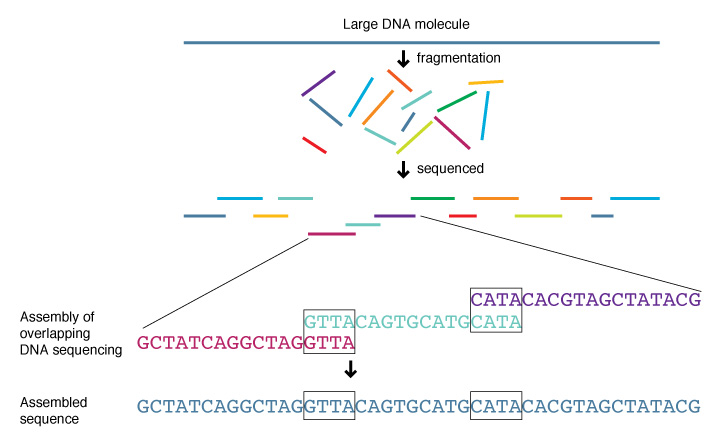

## Would You Sign?

::: {.thought-question}
You are a parent on the postpartum floor, twelve hours after a healthy delivery. A research nurse offers to read your newborn's whole genome at no cost. The report, returned in two weeks, will list gene variants linked to several hundred conditions. Some are treatable in childhood. Some show up only in adulthood. Some are of uncertain meaning. Your partner is leaning yes. You want to ask more questions first.

**Write or discuss:**

1. Which of those three kinds of result would you want to receive, and which would you rather not know?
2. Does your answer change if the test is offered at the *six-year* visit instead?
3. Whose decision is this — yours, your partner's, or the child's own, twenty years from now?
:::

::: {.aside-note}
The question underneath is the *time-shape* of genetic information: a decision made today binds a person for life.
:::

## After You've Discussed

::: {.callout-note}
- **Actionable now** — a finding the family can act on in childhood (a treatable metabolic condition).
- **Actionable later** — a finding that matters in adulthood, when the child can decide for herself whether to know (BRCA1, late-onset Alzheimer's risk).
- **Informative but not actionable** — a finding that names a risk no one can act on yet (some Huntington's variants in a healthy infant).
:::

## Today

::: {.learning-outcomes}
By the end of Part A, you will be able to:

- Tell the story of the **Human Genome Project** and the gap between what was promised in 1999 and what arrived.
- Define [geneticization]{.key-term} and spot it in prenatal testing, ancestry kits, and forensic genealogy.
- Explain **ancestry bias** in polygenic risk scores.
- Apply Feinberg's **open future** to genetic testing of children.
- State the **NASEM 2023** rule on race and genetic variation.
- Describe what **GINA** (2008) covers and what it does not.
:::

# The Human Genome Project: Promise and Aftermath {.section-divider}

## Thirteen Years, Two Teams

```{dot}
//| fig-height: 2.6
digraph HGP {
  rankdir=LR;
  graph [bgcolor="transparent"];
  node [shape=box, style="rounded,filled", fillcolor="#f3f4f6", fontname="Helvetica", fontsize=11];
  edge [arrowhead=vee, color="#6b7280"];
  "1990\nHGP launched\n(NIH + DOE)" -> "1995\nFirst bacterial\ngenome sequenced" -> "1998\nCelera enters\nthe race" -> "2000\n'Working draft'\nat White House" -> "2003\nCompletion\ndeclared";
}
```

- The **Human Genome Project** was a public, international effort led by the NIH and the Department of Energy, begun in 1990.
- In 1998 a private company, **Celera Genomics**, run by **Craig Venter**, said it would finish first with a faster "shotgun" method.
- The race ended in a declared tie at the White House in June 2000. The public group kept the data free; Celera dropped its plan to sell access.

:::: {.content-hidden when-format="revealjs"}

## The Public-Celera Race

::: {.columns}
::: {.column width="48%"}
**The public effort (HGP)**

- Funded by NIH, DOE, and the Wellcome Trust.
- **Clone-by-clone** method: cut the genome into mapped chunks, sequence each, reassemble.
- Slower, but more careful with repeats.
- Data released to public databases each night.
:::
::: {.column width="4%"}
:::
::: {.column width="48%"}
**Celera Genomics**

- Privately funded; planned to sell access to the result.
- **Whole-genome shotgun** method: break the genome into random fragments, sequence in bulk, reassemble by computer.
- Faster and cheaper, but leaned on the public data to fill gaps.
- Backed off its patent plan under public pressure.
:::
::::

Both finished. The shotgun method won the science fight; the public group won the policy fight.

::::

:::: {.content-hidden when-format="revealjs"}

## Shotgun Sequencing, Illustrated

{width="72%" fig-alt="Diagram of whole-genome shotgun sequencing: a genome is broken into random overlapping fragments, each is sequenced, and a computer reassembles them by matching the overlaps"}

::: {.attribution}
National Human Genome Research Institute. Public domain.
:::

Break the genome at random, sequence the pieces, and let the computer find the overlaps. The method is fast because nothing has to be mapped first — and fragile for the same reason, since repeated stretches look alike.

::::

:::: {.content-hidden when-format="revealjs"}

## Collins 1999, Verbatim

::: {.quote-card}
"By the year 2010, it is expected that predictive genetic tests will be available for as many as a dozen common conditions, allowing individuals who wish to know this information to learn their individual susceptibilities and to take steps to reduce those risks for which interventions are or will be available. Such interventions could take the form of medical surveillance, lifestyle modifications, diet, or drug therapy."

— Francis S. Collins, "Medical and Societal Consequences of the Human Genome Project," *NEJM* 341 (1999): 28.
:::

[@collins1999_hgp]

::::

## Promised vs. Delivered

| Collins predicted by 2010 | What 2026 actually has |
|---|---|
| Routine cheek-swab risk prediction for common diseases | A small set of strong single-gene tests; broad risk prediction still uneven |
| Drugs dosed by genotype | A few dozen drug-gene pairs in use; far fewer than promised |
| Twelve common conditions with usable predictive tests | Several, but most predict only modest risk |
| Genetic privacy laws "fully in place" | GINA 2008 covers health insurance and employment only |
| Public catching up with the science | Ancestry-kit marketing still routinely overpromises |

**Francis Collins**, the project's director, made these predictions in 1999 [@collins1999_hgp].

:::: {.content-hidden when-format="revealjs"}

## "Missing Heritability"

::: {.context-box}
**What GWAS expected and what it found**

A **genome-wide association study** (GWAS) lines up the DNA of people who have a trait — height, diabetes, schizophrenia — against people who don't, and looks for variants that show up more often in one group. By 2010, GWAS had been run on hundreds of thousands of people.

Twin and family studies had predicted that most variation in these traits was heritable, and that GWAS would find a few moderately strong variants. What it found instead were thousands of variants of *tiny* effect — which still leave most of the predicted heritability unexplained. That gap is the **missing heritability** problem. It is part of why "cheek-swab risk prediction" did not arrive on the 1999 schedule.
:::

::::

# Geneticization {.section-divider}

:::: {.content-hidden when-format="revealjs"}

## Lippman Names the Tendency

::: {.quote-card}
"Geneticization refers to an ongoing process by which differences between individuals are reduced to their DNA codes, with most disorders, behaviours and physiological variations defined, at least in part, as genetic in origin.… It refers as well to the process by which interventions employing genetic technologies are adopted to manage problems of health."

— Abby Lippman, "Prenatal Genetic Testing and Screening," *American Journal of Law & Medicine* 17 (1991): 19.
:::

[@lippman1991; @gannett_sep_hgp]

::::

## Three Related Pulls

- [Geneticization]{.key-term}, **Abby Lippman**'s 1991 term: the *tendency* to cast human differences, risks, and identities as mostly genetic, and to reach for genetic fixes [@lippman1991].
- **Genetic reductionism**: the working assumption that the gene is the right level at which to *explain* a trait. Sometimes useful; often overshoots.
- **Genetic determinism**: the stronger claim that genes *fix* outcomes. Almost no working geneticist believes it; it lives mostly in marketing copy.

## Gene × Environment — the Working Picture

```{dot}
//| fig-height: 2.4
digraph GxE {
  rankdir=LR;
  graph [bgcolor="transparent"];
  node [shape=box, style="rounded,filled", fillcolor="#f3f4f6", fontname="Helvetica", fontsize=11];
  edge [arrowhead=vee, color="#6b7280"];
  "Genotype" -> "Phenotype\n(observed trait)";
  "Environment\n(diet, exposure,\nstress, care)" -> "Phenotype\n(observed trait)";
  "Genotype" -> "Environment\n(diet, exposure,\nstress, care)" [label="  shapes", style=dashed];
}
```

- The textbook case is **phenylketonuria (PKU)**. It causes severe intellectual disability, but only if the diet contains phenylalanine.
- Find the gene at birth, change the diet, and the disability never appears. Same DNA, different outcome.
- Diabetes, heart disease, and depression sit closer to the PKU end than popular framing suggests.

## Four Words

| Term | What it means |
|---|---|
| **Gene** | A stretch of DNA that codes for a working product (usually a protein). Humans have about 20,000. |
| **Allele** | One of the possible versions of a gene at a given spot. You get one from each parent. |
| **Genome** | The full set of DNA in an organism's cells — about 3.2 billion base pairs in humans. |
| **Variant** | Any place where one person's DNA differs from a reference sequence. Most variants do nothing visible. A few do a lot. |

The older word **mutation** is still used, but *variant* has largely replaced it. "Mutation" carries an unhelpful hint that the difference is always bad.

:::: {.content-hidden when-format="revealjs"}

## Germline vs. Somatic

::: {.columns}
::: {.column width="48%"}
**Germline**

- Present in the egg or sperm — and so in *every* cell of the resulting person.
- Heritable: passed to children.
- A germline edit changes one person *and* every descendant.
:::
::: {.column width="4%"}
:::
::: {.column width="48%"}
**Somatic**

- A change in one tissue, in one person, in non-reproductive cells.
- Not heritable: dies with the patient.
- Most cancers are somatic. So are most approved gene therapies (Casgevy for sickle-cell disease, for example).
:::
::::

This distinction does most of the moral work in Part B. Editing one patient's bone marrow is not the same as editing every cell in every descendant.

::::

# Whose Genome Is the Reference? {.section-divider}

## A Reference Built from Two Men

- When a lab says a patient has "a variant," it means her DNA differs from **the human reference genome**, a published sequence everyone is compared against.
- The public reference is roughly **74% from one anonymous man** in Buffalo, New York, known as "RP11." He was paid $50 and never knew he was the main donor.
- Celera's reference is roughly **71% Craig Venter himself**, who quietly added his own DNA to the donor pool.
- For about twenty years, the standard for billions of human genomes was mostly two men [@gannett_sep_hgp].

## Why It Matters: Ancestry Bias

:::: {.columns}

::: {.column width="48%"}
A **genome-wide association study (GWAS)** compares the DNA of thousands of people with a trait to thousands without. Who took part, cumulatively, by the mid-2010s:

- ~80% European ancestry
- ~10% Asian ancestry
- ~3% African ancestry
- ~1% Hispanic / Latin American
:::

::: {.column width="4%"}
:::

::: {.column width="48%"}
- A **polygenic risk score** for coronary disease built on this data is about 4–5× more accurate in people of European ancestry than in people of African ancestry.
- The math is not biased. The *training data* was.
- The fix is a **pangenome**: many reference genomes instead of one. The first draft, in 2023, had 47.
:::

::::

[@popejoy_fullerton_2016]

:::: {.content-hidden when-format="revealjs"}

## Toward a Pangenome

The fix is not to "patch the reference." It is to replace one reference with *many*. A **pangenome reference** is a set of high-quality genomes from people around the world, queried as a group rather than as one string.

The first draft human pangenome was published in 2023. Its 47 starting genomes are still only a fraction of human variation. The shift — from one reference to many — closes the bias gap at the root rather than patching it downstream.

::::

# What Gets Tested, and When {.section-divider}

## Three Kinds of Genetic Testing

| Type | Who is tested | What it tells you |
|---|---|---|
| **Diagnostic** | A patient with symptoms | Whether their disease has a known genetic cause |
| **Predictive** | A healthy person at risk | Their chance of developing a disease later |
| **Reproductive** | A future parent, fetus, or embryo | Whether a future person is likely to be affected |

The same lab test can be used for any of the three. What changes is *who is asking, on whose behalf, and what they will do with the answer*.

## NIPT

```{dot}
//| fig-height: 2.6
digraph NIPT {
  rankdir=LR;
  graph [bgcolor="transparent"];
  node [shape=box, style="rounded,filled", fillcolor="#f3f4f6", fontname="Helvetica", fontsize=11];
  edge [arrowhead=vee, color="#6b7280"];
  "Maternal\nblood draw\n(~10 weeks)" -> "Cell-free DNA\n(mother + fetus)" -> "Sequencing" -> "Count chromosome\nfragments" -> "Probability\nof trisomy 21,\n18, 13, etc.";
}
```

- **Non-invasive prenatal testing (NIPT)** reads fetal DNA floating in the mother's blood, from about ten weeks.
- It is *screening*, not diagnosis. A confirming test, usually amniocentesis, is needed before any permanent decision.
- After a confirmed Down syndrome diagnosis, the US termination rate is above 60%; in Denmark and Iceland it is close to 95%. NIPT made that question routine.

:::: {.content-hidden when-format="revealjs"}

## NIPT, Down Syndrome, and the >90% Question

NIPT has been offered to nearly all pregnant patients in the US since the mid-2010s, regardless of age. After a confirmed Down syndrome diagnosis, the US termination rate is above 60%. In Denmark and Iceland, where first-trimester screening is universal, the rate is close to 95%.

::: {.context-box}
**A question that returns later in the course**

The disability scholar **Adrienne Asch** argued that aborting a fetus diagnosed with Down syndrome is not the same as the general right to abortion. The *grounds* matter, she said. "We don't want a child like *that*" sends a message to people already living with the condition.

This lecture does not settle the argument. The disability-rights treatment belongs to a later lecture. The point here is that NIPT is the technology that made the question scale — from rare diagnosis to a routine offer.
:::

::::

:::: {.content-hidden when-format="revealjs"}

## BRCA in Adults

The genes **BRCA1** and **BRCA2** are tumor-suppressor genes. Certain variants in either raise lifetime risk of breast and ovarian cancer by a lot. Among Ashkenazi Jewish women, three specific variants account for most of the inherited risk. Predictive testing in healthy adult women is, by now, routine.

What a positive result changes for an adult woman is concrete: more frequent screening, the option of preventive surgery in her thirties or forties, sometimes drug therapy. The decision is hers, with a genetic counselor.

The adult case is largely a settled use of informed consent. The child case is not.

::::

## Testing Healthy Children for Adult-Onset Conditions

::: {.columns}
::: {.column width="48%"}
**BRCA in a healthy eight-year-old**

- The risk is real, but does not become *actionable* until her twenties or thirties.
- The result will follow her through every insurance form and school record for two decades before she can act on it.
- The American Society of Human Genetics has long advised *against* testing children for adult-onset conditions with no childhood treatment.
:::
::: {.column width="4%"}
:::
::: {.column width="48%"}
**Huntington's in a healthy eight-year-old**

- A near-certain prediction of a fatal brain disease in midlife.
- No treatment. No prevention.
- The professional view is even firmer: do not test.
- Yet some adult Huntington's patients say they wish they had been told earlier. Others say the opposite.

The same rule, applied twice, gives the same answer for *different* reasons.
:::
::::

## Feinberg's "Open Future," Applied to Information

::: {.context-box}
**Feinberg's right to an open future**

The legal philosopher **Joel Feinberg** argued that children hold a class of "rights in trust." These are autonomy rights they cannot yet use, but which adults must keep *open* on their behalf. Parental choices that *close off* a future the child might have chosen are, on this view, a distinct kind of wrong.

The first uses were about things like religion and schooling. Applied to genetic information, the rule is simple: **don't fix the meaning of an adult-onset risk before the future adult can decide whether to know it.**

The same adult, twenty years later, can walk into a clinic and ask.
:::

:::: {.content-hidden when-format="revealjs"}

## BabySeq and GUARDIAN

Two long-running US studies are quietly normalizing the choice we opened with.

- **BabySeq** (Boston, since 2015) randomly assigned newborns to whole-genome reading plus normal care, or normal care alone. It tracked what families and pediatricians did with the results.
- **GUARDIAN** (New York, since 2022) is enrolling a much larger group. It returns about 150–250 conditions, all chosen for childhood treatability.

Neither study has reported major harm. Both report that families want the results — even for adult-onset conditions the researchers were nervous about returning.

::::

## ACMG vs. AAP — Two Positions

| | **American College of Medical Genetics** | **American Academy of Pediatrics** |
|---|---|---|
| **Default frame** | Sequencing is cheap; expanding the panel of conditions returned is the responsible move | The longstanding rule against testing healthy children should not erode with technology |
| **What to report** | A regularly updated list of "medically actionable" findings, including some adult-onset | Conditions with a *childhood* treatment, by preference |
| **Why** | Information delayed is treatments missed | Information returned is futures narrowed |
| **Direction of pressure** | Expand the panel | Hold the line |

Two mainstream bodies disagree, in public, about the question this lecture opened with.

# Consumer Genomics {.section-divider}

## 23andMe

- Founded 2006; cleared by the FDA as a home health test in 2017. About **14 million customers** by 2023, most for ancestry rather than health.
- **2023:** attackers reused leaked passwords to break into accounts. Through the "DNA Relatives" feature, each broken account exposed *relatives* who were never hacked. About 6.9 million users were affected.
- **2025:** the company filed for bankruptcy, and its genetic database was **sold as an asset** for $305 million to a nonprofit led by its own co-founder [@23andme2025_ttam_sale].
- Bankruptcy law, not medical-privacy law, decided who would hold 14 million people's DNA.

::: {.aside-note}
**What happens to your DNA if the company goes under?** For years the standard privacy worry about consumer genomics was hypothetical: *what happens to your DNA if the company goes under?* In 2025 we found out.

23andMe entered Chapter 11, and its genetic database went to auction like any other asset. After competing bids — including one from the pharmaceutical company Regeneron — the winner was **TTAM Research Institute**, a nonprofit founded and led by Anne Wojcicki, 23andMe's own co-founder, for **$305 million**. The sale closed in **July 2025**, and the service continues to operate [@23andme2025_ttam_sale].

The outcome was comparatively benign: a nonprofit with privacy commitments rather than a data broker or an insurer. But notice what the process established regardless of who won. Your genome, once handed to a company, is **property on a balance sheet**. Bankruptcy law, not medical-privacy law, determined who ended up holding 14 million people's DNA — and the customers were creditors' collateral, not parties to the decision. Consent given to one company in 2015 transferred to a different legal entity a decade later.

**Write or discuss:** You consented to research with *Company A*. Company A is liquidated and your data goes to *Entity B*. Is your original consent still valid? What would a consent form have to say up front for the answer to be clearly yes — and would anyone sign it?
:::

:::: {.content-hidden when-format="revealjs"}

## The 2023 Breach

In October 2023, attackers got into 23andMe accounts by reusing passwords leaked from other sites. Because many customers had opted into a feature called "DNA Relatives," each broken account also exposed information about that user's *relatives* — relatives who had never been hacked themselves.

About **6.9 million users** were affected. Lists targeting Ashkenazi Jewish and Chinese-ancestry customers were posted on hacker forums. The company agreed in late 2024 to settle for about $30 million — but the bankruptcy intervened, and the settlement had to be resolved through the bankruptcy court, where the fund was ultimately increased to roughly **$47 million** and approved in 2026. Affected customers became one more class of creditors waiting in line.

::::

:::: {.content-hidden when-format="revealjs"}

## Why This Comes Up Here

Race is not the topic of this lecture. The technology puts it on the table all the same, in two places.

- **Ancestry kits**: a customer is told she is "23% Italian" with a precision the science does not support. The reference panels behind those percentages are social-political artifacts, not natural categories.
- **Genetic research**: studies often report results by self-reported race, treating race as a stand-in for genetic variation. The 2023 National Academies report says that is a mistake.

The field has argued about race and genetics since the HGP itself. The latest professional consensus is short and specific.

::::

## NASEM 2023 — The Headline Rule

::: {.callout-important}
**Recommendation 1.** *"Researchers should not use race as a proxy for human genetic variation. In particular, researchers should not assign genetic ancestry group labels to individuals or sets of individuals based on their race, whether self-identified or not."*

— National Academies of Sciences, Engineering, and Medicine, *Using Population Descriptors in Genetics and Genomics Research* (2023), Summary, Rec. 1.
:::

- Race is a social-political category that shifts by country and era. Human genetic variation is continuous, not discrete.
- An ancestry kit's "23% Italian" has a precision the science does not support.
- The report also retires *Caucasian*, a term coined in 1795 by **Blumenbach** to rank a skull he found beautiful [@nasem_2023_population_descriptors].

:::: {.content-hidden when-format="revealjs"}

## Population Descriptors at a Glance

| Descriptor | What it captures | When to use it |
|---|---|---|
| **Race** | A social-political category about perceived ancestry; shifts by country and era | Not as a stand-in for genetic variation; sometimes as a stand-in for *social exposure* (with a stated reason) |
| **Ethnicity** | A social-political category about shared cultural heritage | For *cultural* features, not genetic ones |
| **Geography** | Where a person's recent ancestors lived | Useful to describe sampling; not a stand-in for ancestry |
| **Genetic ancestry** | The paths through a family tree by which DNA was passed down | When the study question is about ancestry as such |
| **Genetic similarity** | A number measuring how genetically alike two people are | The preferred tool for most population comparisons |

Adapted from NASEM 2023, Table S-1.

::::

# Forensics and Discrimination {.section-divider}

## GEDmatch and the Golden State Killer

::: {.callout-important}
**Joseph James DeAngelo, 2018**

Between 1973 and 1986, one offender committed at least 13 murders and dozens of rapes across California. The case went cold for thirty years. In 2018, a Sacramento team uploaded a DNA profile from a 1980 crime scene to **GEDmatch**, an open genealogy site used mostly by hobbyist family-tree researchers.

The profile matched several of DeAngelo's distant cousins. None of them had any idea their saliva tubes could finger a relative for murder. Investigators built family trees from the matches, narrowed to DeAngelo, picked up DNA from his car door handle, and arrested him.

He pleaded guilty in 2020.
:::

With a few million users in a database, some third or fourth cousin of almost any American is in it. Staying out yourself does not keep you out of the searches it enables.

:::: {.content-hidden when-format="revealjs"}

## How Long-Range Familial Search Works

```{dot}
//| fig-height: 2.8
digraph IGG {
  rankdir=LR;
  graph [bgcolor="transparent"];
  node [shape=box, style="rounded,filled", fillcolor="#f3f4f6", fontname="Helvetica", fontsize=11];
  edge [arrowhead=vee, color="#6b7280"];
  "Crime-scene\nDNA sample" -> "SNP profile\n(~500k markers)" -> "Upload to\nGEDmatch /\nFamilyTreeDNA" -> "Identify shared\nDNA segments" -> "Build family\ntrees from matches" -> "Narrow to one\ncandidate suspect" -> "Confirm with\nrecovered DNA";
}
```

The method works because of one fact about DNA. A third cousin shares about 0.8% of their DNA with you, in long, readable chunks. With a database of a few million users, *some* third or fourth cousin of any given American is almost certainly in it.

Your choice to stay out of the database does not, by itself, keep you out of searches it enables.

::::

:::: {.content-hidden when-format="revealjs"}

## The Law Catches Up

| Year | Action |
|---|---|
| **2018** | DeAngelo arrest brings the method to public attention |
| **2019** | US Department of Justice issues an *interim policy* for federal use — only with prosecutor approval, only for violent crimes |
| **2021** | **Maryland** becomes the first US state to regulate forensic genealogy by statute — court approval required, limited crimes |
| **2021** | **Montana** passes a tighter law requiring a search warrant |
| **2023–** | Other state legislatures consider similar bills; most US states still have no law |

The federal courts have not yet ruled on whether a Fourth Amendment "search" happens when investigators query a database your cousin uploaded.

::::

## Thought Question — Whose Consent?

::: {.thought-question}
Your second cousin — someone you have met twice in your life — uploads her saliva to a genealogy site. Six years later, investigators use her upload to identify *you* as a suspect in a thirty-year-old assault case. They are right; you did it. You are arrested, charged, and convicted.

**Write or discuss.**

1. Did you have a privacy interest that was violated, given that your own DNA was never tested?
2. Does the answer change if you are *innocent* and were briefly a suspect before being cleared?
3. Does it change if the crime is a serial murder vs. a thirty-year-old simple assault?
:::

## GINA (2008) and Its Gaps

The **Genetic Information Nondiscrimination Act** is the federal floor against genetic discrimination. It covers two things only.

| | Covered by GINA? |
|---|---|
| **Health insurance** | Yes |
| **Employers with 15 or more workers** | Yes |
| **Life, disability, and long-term-care insurance** | **No**: insurers may ask for genetic results and price on them |
| **Smaller employers** | No |
| **US military** | **No** |

In 2020 **Florida** became the first state to extend protection to life, disability, and long-term-care insurance.

:::: {.content-hidden when-format="revealjs"}

## Florida 2020 and the State-Level Patchwork

In 2020, **Florida** became the first US state to extend protection to *life, disability, and long-term-care* insurance — partly closing the GINA gap inside its own borders. A few other states have passed narrower versions. Many more have tried and failed.

Federal law has not moved since 2008. For now, the action is in state legislatures and in the actuarial departments of life insurers. Both know that a whole-genome reading for under a thousand dollars is on the near horizon for every American applicant.

::::

## Geneticization, Five Times Over

| Where it shows up | What gets read as genetic | What gets read out |
|---|---|---|
| **NIPT + the >90% question** | Fetal trisomy | What life with Down syndrome actually looks like |
| **23andMe ancestry** | "23% Italian" — discrete national identities | The continuous geographic gradients beneath the labels |
| **Polygenic risk scores** | Disease risk as a number | The training-data ancestry that set how accurate the number is |
| **Race in research** | Genetic variation as racial-group difference | The environment and history that track race in the US |
| **Forensic genealogy** | A suspect's identity from distant-cousin matches | The non-suspect relatives whose DNA was searched without consent |

## Review Questions

Write a brief answer to each, or use them as discussion prompts.

::: {.review-questions}

::: {.review-item .review-recall}
[Recall]{.review-label}

Define *geneticization* in your own words. Then explain why polygenic risk scores work better for people of European ancestry than for everyone else.
:::

::: {.review-item .review-apply}
[Apply]{.review-label}

A 34-year-old whose mother died of ovarian cancer brings a 23andMe report flagging two BRCA1 variants. What should her care team do before any discussion of preventive surgery? Which of those steps is the one a 23andMe report cannot replace?
:::

::: {.review-item .review-debate}
[Debate]{.review-label}

Should police need a warrant before searching genealogy databases for a suspect's relatives? Take a side, then name the strongest argument on the other side.
:::

:::

## Key Terms

::: {.columns}
::: {.column width="48%"}
- [**Geneticization**]{.key-term} — Lippman's term for the cultural tendency to explain human differences, risks, and identities primarily in genetic terms, and to favor genetic interventions as the preferred solution to health problems.
- [**Genetic determinism**]{.key-term} — the strong claim that genes fix outcomes — that DNA is destiny — regardless of environment; almost no working geneticist defends it in this form, but it persists in popular and marketing framings.
- [**Germline vs. somatic**]{.key-term} — germline changes occur in reproductive cells and are inherited by every descendant; somatic changes occur in non-reproductive tissue of one person and die with that person.
- [**Genome-wide association study (GWAS)**]{.key-term} — a research method that scans the DNA of thousands of people with and without a trait to identify variants statistically linked to it; results work best in the ancestry group the study was run on.
- [**Polygenic risk score**]{.key-term} — a number calculated by adding up the small effects of thousands of variants across the genome to estimate an individual's risk for a complex trait; accuracy depends heavily on whether the training population matches the person being scored.
:::
::: {.column width="4%"}
:::
::: {.column width="48%"}
- [**NIPT**]{.key-term} — non-invasive prenatal testing; reads fragments of fetal DNA floating in the mother's blood from about ten weeks of pregnancy to screen for chromosomal conditions like trisomy 21; a screening result, not a diagnosis, and requires confirmatory testing before any permanent decision.
- [**Open future (Feinberg)**]{.key-term} — Feinberg's principle that children hold autonomy rights "in trust"; adults must keep those futures open rather than foreclosing choices — including the choice of whether to know one's genetic risks — before the child can make them herself.
- [**Population descriptor (NASEM)**]{.key-term} — a label used to group people in genetics research; the 2023 NASEM report recommends using geographic ancestry or genetic similarity rather than race as a stand-in for genetic variation, since race is a social-political category, not a biological one.
- [**Investigative genetic genealogy**]{.key-term} — a forensic technique that uploads a crime-scene DNA profile to a consumer genealogy database, identifies distant-cousin matches among users, and builds a family tree to narrow to a suspect; used to solve the Golden State Killer case in 2018.
- [**GINA**]{.key-term} — the Genetic Information Nondiscrimination Act (2008); bars health insurers and employers from using genetic information against people, but does not cover life, disability, or long-term-care insurance, or the US military.
:::
::::

:::: {.content-hidden when-format="revealjs"}

## Further Reading

- James Tabery, *Tyranny of the Gene: Personalized Medicine and Its Threat to Public Health* (Knopf, 2023).
- Lisa Gannett, "The Human Genome Project," *Stanford Encyclopedia of Philosophy* (2023 revision).
- National Academies of Sciences, Engineering, and Medicine, *Using Population Descriptors in Genetics and Genomics Research* (2023) — read the summary at minimum.
- Alice Popejoy and Stephanie Fullerton, "Genomics is Failing on Diversity," *Nature* 538 (2016).

::::

## References

::: {#refs}
:::
