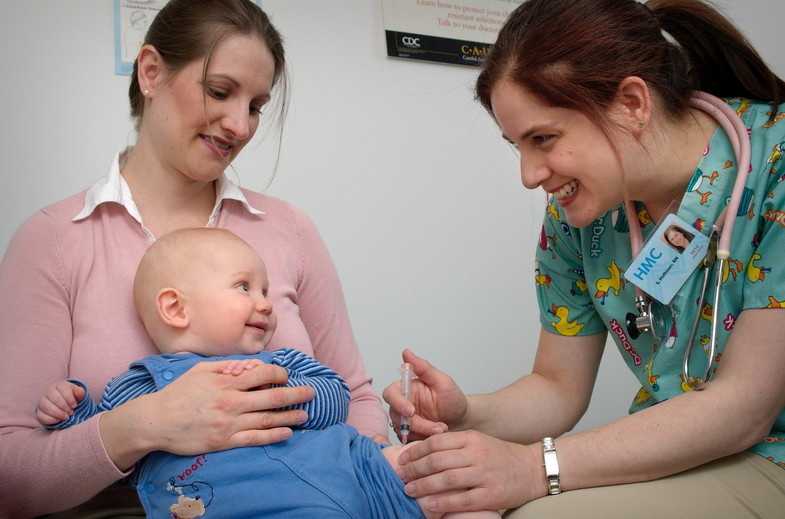
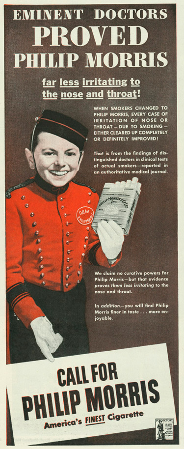
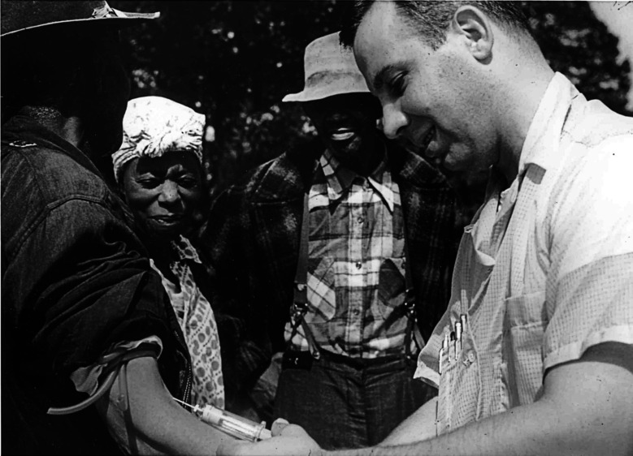
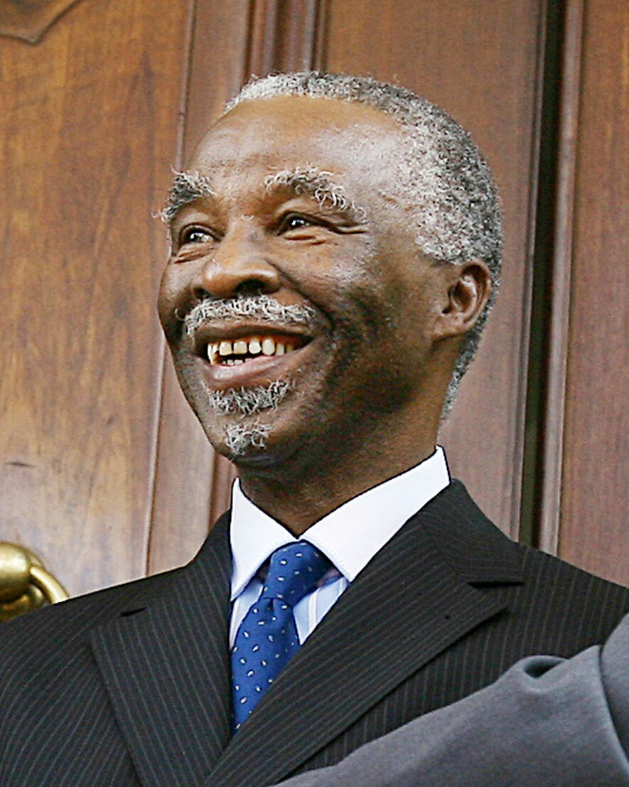
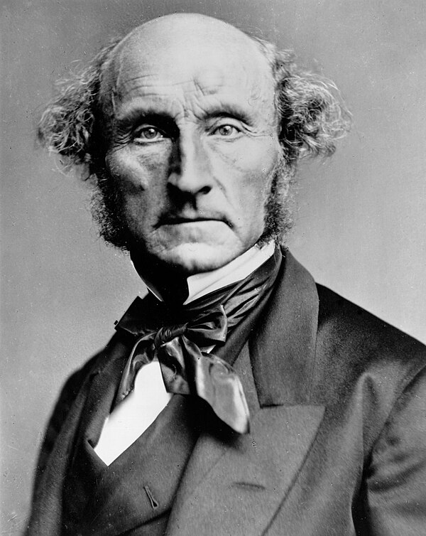

# The Patient Who Won't Believe You {.section-divider}

## A Case to Sit With

:::: {.columns}
::: {.column width="62%"}
::: {.thought-question}
A mother brings her healthy 14-month-old to your clinic. She is warm, college-educated, and devoted to her child. She refuses the **MMR vaccine**, certain it causes autism. She has read widely, and she is not careless.

You have about **15 minutes**.

1. What would you actually *say* to her? Be specific.
2. If you hand her the studies showing no link, what do you expect to happen?
3. She is choosing for her child. Is her refusal a choice you must respect, or something else?
:::
:::
::: {.column width="38%"}
{width="100%" fig-alt="A smiling nurse in duck-print scrubs gives a vaccine in the thigh of a happy baby, who sits on his smiling mother's lap in a clinic exam room."}

::: {.attribution}
CDC Public Health Image Library #9346. Photo: James Gathany, 2006. Public domain.
:::
:::
::::

## After You've Discussed

:::: {.columns}
::: {.column width="50%"}
::: {.callout-note}
Her problem is *not* a shortage of information. She has plenty, much of it false, all of it confidently held. Handing her more facts may do little.

She is not alone. Fewer U.S. kindergartners are protected against measles each year, and vaccine exemptions reached a record **4.2%** in 2025–26.

To help her, we first have to understand how a smart, caring person ends up here.
:::
:::
::: {.column width="50%"}
```{python}
#| echo: false
#| fig-align: center
#| fig-cap: "U.S. kindergartners without documented MMR vaccination (CDC). Above the dashed line, about 5% unprotected, measles can spread."
import matplotlib.pyplot as plt

# CDC national estimates of 2-dose MMR coverage among kindergartners
# (MMWR 2021-2024; SchoolVaxView and data.cdc.gov/d/ijqb-a7ye for 2024-26).
years = ["2019–20", "2020–21", "2021–22", "2022–23", "2023–24", "2024–25", "2025–26"]
mmr   = [95.2, 93.9, 93.0, 93.1, 92.7, 92.5, 92.4]
gap   = [round(100 - m, 1) for m in mmr]

fig, ax = plt.subplots(figsize=(4.8, 3.6))
bars = ax.bar(range(len(years)), gap, color="#c0392b", width=0.62, zorder=2)
bars[0].set_color("#94a3b8")
ax.axhline(5, color="#0f172a", lw=1.4, ls="--", zorder=3)
ax.text(-0.45, 8.6, "dashed line = 5%", fontsize=9.5, color="#0f172a", va="top")
for b, g in zip(bars, gap):
    ax.text(b.get_x() + b.get_width() / 2, g + 0.12, f"{g}%", ha="center",
            va="bottom", fontsize=9.5, color="#334155")
ax.set_xticks(range(len(years)), years, fontsize=8.5, rotation=30)
ax.set_ylim(0, 9)
ax.set_ylabel("% without both MMR doses")
ax.spines[["top", "right"]].set_visible(False)
fig.tight_layout()
plt.show()
```
:::
::::

## Today

::: {.callout-important}
**If giving people the facts does not fix false medical beliefs, what may a clinician or a state do instead, without manipulating people or simply declaring them irrational?**
:::

::: {.learning-outcomes}
By the end of Part B, you will be able to:

- Explain why "just give them the facts" often fails, using **Kahan's** identity-protective cognition and **Nguyen's** bubble/echo-chamber distinction.
- Tell **earned distrust** from **manufactured doubt**, and use two diagnostic questions to choose a response.
- Distinguish **persuasion**, **manipulation**, and **coercion**, and place a response on the **correction ladder**.
:::

# Why Facts Bounce Off {.section-divider}

## The Deficit Model, Tested

::: {.context-box}
**The deficit model** says people believe false things because they are *missing* information: fill the gap, and the belief dissolves. If so, the people who know the most science should agree the most. But on climate change, Kahan found the most science-literate and numerate people were the **most divided** [@kahan2012].
:::

```{python}
#| echo: false
#| fig-align: center
import numpy as np
import matplotlib.pyplot as plt

x = np.linspace(0, 1, 100)
fig, (ax1, ax2) = plt.subplots(1, 2, figsize=(9.6, 2.4), sharey=True)
panels = [
    (ax1, "What the deficit model predicts", 0.30 * (1 - x)),
    (ax2, "What Kahan found", 0.06 + 0.30 * x),
]
for ax, title, gap in panels:
    ax.plot(x, 0.5 + gap, color="#2c7fb8", lw=3)
    ax.plot(x, 0.5 - gap, color="#c0392b", lw=3)
    ax.fill_between(x, 0.5 - gap, 0.5 + gap, color="#f0e6c8", alpha=0.6, zorder=0)
    ax.set_title(title, fontsize=12, color="#0f172a", loc="left")
    ax.set_xlabel("Science literacy and numeracy →", fontsize=10)
    ax.set_xticks([]); ax.set_yticks([])
    ax.set_ylim(0.1, 0.9)
    ax.spines[["top", "right"]].set_visible(False)
ax1.set_ylabel("Sees climate change\nas a serious risk →", fontsize=10)
ax2.text(0.42, 0.72, "egalitarian, community-minded", ha="center", va="bottom",
         fontsize=10, color="#2c7fb8", rotation=10)
ax2.text(0.42, 0.28, "hierarchical, individualist", ha="center", va="top",
         fontsize=10, color="#c0392b", rotation=-10)
fig.text(0.99, 0.01, "A sketch of the pattern, not the data.", ha="right",
         fontsize=9, color="#64748b", style="italic")
fig.tight_layout()
plt.show()
```

## Kahan: Reasoning Defends the Group

:::: {.columns}
::: {.column width="54%"}
Dan Kahan calls the pattern [identity-protective cognition]{.key-term}. On issues that have become badges of group identity, people reason to **protect their standing in their group**, not to track the truth [@kahan2012].

- The mind quietly asks "What does someone *like me* believe?" before "What is true?"
- More skill does not fix it. A skilled reasoner is a better lawyer for the side they already favor.
- Liberals and conservatives, the educated and the not: everyone does it.
:::
::: {.column width="46%"}
::: {.callout-important}
**What this does *not* mean**

It does not mean people are stupid, and it does not mean there is no truth. The MMR–autism link is false either way.

It changes the *strategy*, not the *facts*: on a badge issue, a fact that threatens someone's group will be fought, not weighed.
:::
:::
::::

## Vaccines Became a Badge

:::: {.columns}
::: {.column width="44%"}
For decades, childhood vaccines were not a badge. In 2001, Democrats and Republicans gave Gallup nearly the same answer. By 2024 the gap was **37 points**, almost all of it from Republicans [@gallup2024].

**Ivermectin** became a badge even faster. Trials found it did not work against COVID, but demand tracked politics, not evidence.
:::
::: {.column width="56%"}
```{python}
#| echo: false
#| fig-align: center
#| fig-cap: "Gallup: % saying it is extremely important that parents vaccinate their children. Party includes leaners."
import matplotlib.pyplot as plt

yrs = [2001, 2015, 2019, 2024]
dem = [66, 59, 67, 63]
rep = [62, 52, 52, 26]

fig, ax = plt.subplots(figsize=(5.2, 3.8))
ax.plot(yrs, dem, color="#2c7fb8", lw=3, marker="o", ms=7)
ax.plot(yrs, rep, color="#c0392b", lw=3, marker="o", ms=7)
for y, d, r in zip(yrs, dem, rep):
    ax.annotate(f"{d}", (y, d), textcoords="offset points", xytext=(0, 8),
                ha="center", fontsize=10, color="#2c7fb8")
    ax.annotate(f"{r}", (y, r), textcoords="offset points", xytext=(0, -16),
                ha="center", fontsize=10, color="#c0392b")
ax.text(2025.3, 63, "Democrats", va="center", fontsize=10.5, color="#2c7fb8")
ax.text(2025.3, 26, "Republicans", va="center", fontsize=10.5, color="#c0392b")
ax.set_xticks(yrs)
ax.set_xlim(2000, 2032)
ax.set_ylim(0, 80)
ax.set_ylabel("% extremely important")
ax.spines[["top", "right"]].set_visible(False)
fig.tight_layout()
plt.show()
```
:::
::::

## Bubbles and Echo Chambers

You have never run the experiments behind germ theory. Almost everything we know about medicine, we take on trust. So the real question is not "Why won't they think for themselves?" but **"Whom do they trust?"** The philosopher **C. Thi Nguyen** separates two ways trust goes wrong [@nguyen2020].

```{python}
#| echo: false
#| fig-align: center
import numpy as np
import matplotlib.pyplot as plt
from matplotlib.patches import Circle

teal, grey, red = "#0e7c86", "#64748b", "#c0392b"
ang = np.linspace(0, 2 * np.pi, 7)[:-1] + np.pi / 6
pts = np.c_[0.42 * np.cos(ang), 0.42 * np.sin(ang)]
outside = [(1.45, 0.62, "doctor"), (1.62, 0.0, "CDC"), (1.45, -0.62, "study")]

fig, axes = plt.subplots(1, 2, figsize=(10, 3.0))
for ax, kind in zip(axes, ["bubble", "chamber"]):
    for i in range(6):
        for j in range(i + 1, 6):
            ax.plot(*zip(pts[i], pts[j]), color=teal, alpha=0.25, lw=1, zorder=1)
    ax.scatter(pts[:, 0], pts[:, 1], s=170, color=teal, zorder=3)
    if kind == "bubble":
        ax.add_patch(Circle((0, 0), 0.72, fill=False, lw=1.6, ls="--", color=teal))
        ax.text(1.0, 0.0, "no\ncontact", ha="center", va="center",
                fontsize=9.5, color=grey, style="italic")
        title = "Epistemic bubble"
        note = "Outside voices are simply missing.\nShow them, and the bubble can pop."
    else:
        ax.add_patch(Circle((0, 0), 0.72, fill=False, lw=4, color=red))
        for x, y, _ in outside:
            a = np.arctan2(y, x)
            bx, by = 0.86 * np.cos(a), 0.86 * np.sin(a)
            ax.annotate("", xy=(bx, by), xytext=(x - 0.12, y),
                        arrowprops=dict(arrowstyle="-|>", color=red, lw=1.6))
            ax.text(bx - 0.03, by, "×", color=red, fontsize=17, ha="center",
                    va="center", fontweight="bold")
        title = "Echo chamber"
        note = "Outside voices get in, but arrive pre-labeled:\n\"they're paid to say that.\" Exposure can confirm it."
    for x, y, lab in outside:
        ax.scatter([x], [y], s=230, color=grey, zorder=3)
        ax.text(x + 0.15, y, lab, va="center", fontsize=10.5, color="#334155")
    ax.set_title(title, fontsize=13, color="#0f172a", loc="left")
    ax.text(-0.85, -1.0, note, fontsize=10, color="#334155", va="top")
    ax.set_xlim(-0.9, 2.2); ax.set_ylim(-1.45, 0.95)
    ax.set_aspect("equal"); ax.axis("off")
fig.tight_layout()
plt.show()
```

## Is She in a Bubble or a Chamber?

| | If a **bubble** | If an **echo chamber** |
|---|---|---|
| What's wrong | she hasn't seen the evidence | she's been taught the evidence is a lie |
| What works | calm exposure to good information | trust must come first |
| Your first move | inform | connect, *then* inform |

- **Corrections usually fix facts.** Across 52 issues and 10,000+ people, none backfired [@wood2019].
- **Behavior is harder.** Debunking the autism myth reduced the belief, but among the most hesitant parents, intent to vaccinate *fell* from 70% to 45% [@nyhan2014].

# Earned Distrust and Manufactured Doubt {.section-divider}

## "But Science Gets Things Wrong"

:::: {.columns}
::: {.column width="48%"}
The skeptic has a real point, and we should grant it. Many published findings fail to replicate, and landmark studies have been retracted [@ioannidis2005].

::: {.callout-important}
But from "**science sometimes gets it wrong**" it does not follow that "**so my podcast is just as likely to be right.**" A method that catches its own errors is in a different class from one that never checks itself.
:::
:::
::: {.column width="4%"}
:::
::: {.column width="48%"}
The historian **Naomi Oreskes** says: trust the process, not the genius [@oreskes2019].

- Scientists are as biased as anyone. Science's authority rests on [organized skepticism]{.key-term}: peer review, replication, and attack from rivals.
- The warrant is not "a smart person said so." It is "**this survived a community trying to prove it wrong.**"
:::
::::

## "Doubt Is Our Product"

:::: {.columns}
::: {.column width="70%"}
::: {.quote-card}
> "Doubt is our product since it is the best means of competing with the 'body of fact' that exists in the mind of the general public. It is also the means of establishing a controversy."

::: {.attribution}
Brown & Williamson Tobacco, "Smoking and Health Proposal," internal memo [-@bw1969]
:::
:::

You don't have to disprove science to defeat it. You only have to [manufacture doubt]{.key-term}.
:::
::: {.column width="30%"}
{width="80%" fig-alt="A 1943 Philip Morris magazine ad: a smiling bellboy holds out a pack of cigarettes under the headline 'Eminent doctors proved Philip Morris far less irritating to the nose and throat!'"}

::: {.attribution}
Philip Morris ad, 1943: the industry borrowed doctors' authority long before it manufactured doubt. Public domain (no copyright notice).
:::
:::
::::

::: {.aside-note}
The memo's wording follows the transcription in the UCSF Truth Tobacco Industry Documents archive (Bates 690010951–690010959); published versions differ slightly in punctuation. The 1969 date is the archive's, since the document itself is undated.
:::

## The Doubt Playbook

:::: {.columns}
::: {.column width="48%"}
**Tobacco, then everything else**

- Oreskes and Conway showed that the **same few scientists and think tanks** reused the tobacco playbook on acid rain and climate change [@oreskesConway2010].
- The goal was never to win the science. It was to make the public think "the experts can't agree," so nothing gets done.
:::
::: {.column width="4%"}
:::
::: {.column width="48%"}
**And vaccines?**

- There is no single paymaster: vaccine makers *want* people vaccinated.
- But the study that started the MMR scare had one. Andrew Wakefield took more than **£435,000** from lawyers preparing to sue vaccine makers [@deer2011].
:::
::::

Doubt is cheap to make because science is honest about uncertainty. The playbook turns that honesty into a weapon.

## When Distrust Is a Reasonable Inference

:::: {.columns}
::: {.column width="60%"}
Some distrust is [earned distrust]{.key-term}: a sensible conclusion from a real record. The defect is not in the reasoning but in the **evidence medicine supplied**.

- For forty years, the U.S. Public Health Service watched Black men in Tuskegee go untreated for syphilis, and lied to them about it.
- After the study became public in 1972, older Black men's trust in medicine and their doctor visits fell. Researchers estimate their life expectancy at 45 fell by **up to 1.5 years** [@alsan2018].
:::
::: {.column width="40%"}
{width="100%" fig-alt="A smiling white Public Health Service worker draws blood from the arm of an older Black man at an outdoor gathering; a Black nurse and two other Black men stand nearby."}

::: {.attribution}
A PHS worker draws blood from a study participant, Macon County, 1953. National Archives. Public domain.
:::
:::
::::

::: {.aside-note}
Tuskegee is told in full in Chapter 2 and its paired case study. Here it is *applied*: the question is what a reasonable person should conclude from it.
:::

## Distrust Is Re-Taught in Ordinary Care

:::: {.columns}
::: {.column width="46%"}
False medical beliefs are not only a patient problem.

In a 2016 study, **about half** of white medical students and residents endorsed at least one false belief about Black patients' bodies, such as "Black people's skin is thicker" [@hoffman2016].

Those who held such beliefs **rated a Black patient's pain as lower** and made less accurate treatment recommendations. Each dismissed complaint teaches a patient: *this place does not believe me*.
:::
::: {.column width="54%"}
```{python}
#| echo: false
#| fig-align: center
#| fig-cap: "% who said \"Black people's skin is thicker than White people's\" is possibly, probably, or definitely true (Hoffman et al. 2016)."
import matplotlib.pyplot as plt

groups = ["Laypeople", "1st-year\nmed students", "2nd-year", "3rd-year", "Residents"]
vals = [58, 40, 42, 22, 25]
colors = ["#94a3b8"] + ["#c0392b"] * 4

fig, ax = plt.subplots(figsize=(5.2, 3.6))
bars = ax.bar(groups, vals, color=colors, width=0.6)
for b, v in zip(bars, vals):
    ax.text(b.get_x() + b.get_width() / 2, v + 1.5, f"{v}%", ha="center",
            fontsize=11.5, fontweight="bold", color="#0f172a")
ax.set_ylim(0, 70)
ax.set_yticks([])
ax.tick_params(axis="x", labelsize=9.5)
ax.spines[["top", "right", "left"]].set_visible(False)
fig.tight_layout()
plt.show()
```
:::
::::

## Diagnose Before You Correct

Two questions sort most false medical beliefs. Most real beliefs run down more than one branch: find the strongest, and start there.

```{dot}
//| fig-height: 3.3
digraph diagnose {
  rankdir=LR;
  graph [bgcolor="transparent", nodesep=0.22, ranksep=0.4];
  node [shape=box, style="rounded,filled", fontname="Helvetica", fontsize=12, fillcolor="#f3f4f6", color="#94a3b8"];
  edge [arrowhead=vee, color="#6b7280"];

  q1 [label="1. Has she actually met\nthe good evidence?", fillcolor="#e6f1f2", color="#0e7c86"];
  bub [label="No: a bubble.\nInformation is missing."];
  q2 [label="Yes, and she rejects it.\n2. Why doesn't she\ntrust the source?", fillcolor="#e6f1f2", color="#0e7c86"];
  taught [label="She was taught to\n(echo chamber,\nmanufactured doubt)"];
  learned [label="She learned to\n(a real betrayal)"];
  ident [label="Believing it marks\nher group (identity)"];
  a1 [label="Inform: clear evidence,\ncalmly offered", fillcolor="#fce9d6", color="#b07d1a"];
  a2 [label="Start with a messenger\nshe trusts; show who\nprofits from the doubt", fillcolor="#fce9d6", color="#b07d1a"];
  a3 [label="Admit the wrong;\nearn the trust back", fillcolor="#fce9d6", color="#b07d1a"];
  a4 [label="Don't make her choose\nbetween the facts\nand her people", fillcolor="#fce9d6", color="#b07d1a"];

  q1 -> bub -> a1;
  q1 -> q2;
  q2 -> taught -> a2;
  q2 -> learned -> a3;
  q2 -> ident -> a4;
  {rank=same; a1; a2; a3; a4;}
}
```

::: {.aside-note}
The branches feed each other, which is why these beliefs are so hard to move. Manufactured doubt seeds an echo chamber with ready-made suspicion; the chamber hardens the belief into identity; and earned distrust makes a person receptive to the chamber in the first place. Hand everyone the same fact sheet, and you help the few in a bubble while hardening everyone else.
:::

:::: {.content-hidden when-format="revealjs"}

### Worked Example: Ivermectin for COVID

Ivermectin is a cheap, safe drug for **parasites**. During COVID some promoted it as a cure, and careful trials found it **did not work** against the virus. Run it through the two questions:

- *Had believers met the evidence?* Mostly yes. It was widely reported.
- *Why didn't they trust the source?* Chiefly **identity**: the drug became a political badge. An **echo chamber** recast official warnings as proof of a cover-up, and real early uncertainty was stretched into doubt about everything.

So the first move was not another official statement. It was an **in-group voice**: a doctor, pastor, or neighbor the person already trusted. Here the messenger mattered more than the message.

::::

# What May We Do? {.section-divider}

## Thought Question

::: {.thought-question}
Back to the mother refusing MMR. You now suspect she is in an **echo chamber** where doctors are cast in advance as untrustworthy.

1. Knowing that facts alone may not move her, what is your *first* move, and why is it not the studies?
2. Is it manipulative to lead with rapport and her values instead of evidence? Or is it just good care?
3. Where is the line between *persuading* her and *handling* her?
:::

## Make It Contemporary

:::: {.columns}
::: {.column width="68%"}
::: {.thought-question}
In South Africa, President **Thabo Mbeki**'s government questioned whether HIV causes AIDS and stalled proven antiretroviral drugs. Researchers estimate that from 2000 to 2005 this cost **more than 330,000 lives**, and that **35,000 babies** were born with HIV whom a prevention program could have protected [@chigwedere2008].

Distrust of Western drug companies, a circle of dissident advisers, and manufactured doubt: the same forces, at the scale of a state.

1. Does scale change the ethics of how officials should respond, or only the stakes?
2. When a *government* holds the false belief, who is left to correct it?
:::
:::
::: {.column width="32%"}
{width="100%" fig-alt="Head-and-shoulders photo of Thabo Mbeki, grey-haired and smiling, in a dark pinstriped suit and blue tie."}

::: {.attribution}
Thabo Mbeki, President of South Africa 1999–2008, in 2007. Ricardo Stuckert/PR, Agência Brasil. CC BY 3.0 BR.
:::
:::
::::

## After You've Discussed

Three words the discussion has been circling:

:::: {.columns}
::: {.column width="32%"}
::: {.context-box}
[Persuasion]{.key-term}

Moving someone by **reasons** they can examine. It respects their agency.
:::
:::
::: {.column width="2%"}
:::
::: {.column width="32%"}
::: {.context-box}
[Manipulation]{.key-term}

Moving someone by **going around** their reason: fear, framing, or pressure they don't see.
:::
:::
::: {.column width="2%"}
:::
::: {.column width="32%"}
::: {.context-box}
[Coercion]{.key-term}

Moving someone by **force** or threat.
:::
:::
::::

::: {.callout-note}
Leading with rapport can be honest persuasion *or* quiet manipulation. The test is not "did it work?" (propaganda works). It is whether you treat her as a **reasoner** or as a set of **levers**: would she endorse what you're doing if she could see all of it?
:::

## Is a Misinformed Refusal Autonomous?

:::: {.columns}
::: {.column width="50%"}
A competent patient's refusal is usually a conflict of **values**, not a misunderstanding to clear up. This refusal looks different: it rests on a false **fact**.

That invites a tempting move: "She's misinformed, so her choice doesn't bind me."
:::
::: {.column width="50%"}
::: {.callout-important}
**Who decides which beliefs are "false enough"?** Usually you, and that is paternalism's foot in the door. Plenty of competent adults believe false things and keep the right to decide for themselves.
:::
:::
::::

But notice whose body the shot is for. She is deciding *for her child*, so the standard is the child's **best interest**, plus the risk to babies too young to be vaccinated. That case for pushing back is far stronger than "for her own good." Keep the two apart.

## The Correction Ladder

As with coercion, responses to false belief form a **ladder**, and each rung costs more in autonomy. Climb only as high as the case requires.

| Rung | Tool | Autonomy cost |
|:-:|:--------------------------|:------------|
| 1 | **Inform**: offer good evidence | none: pure persuasion |
| 2 | **Trusted messenger**: route it through a voice she already trusts | low |
| 3 | **Nudge**: defaults, framing, how the choice is presented | contested: may go around reason |
| 4 | **Restrict**: limit the reach of false claims (platform rules) | real: speech costs |
| 5 | **Mandate**: attach consequences to the behavior (school-entry rules) | highest |

Rungs 1–2 give reasons. From rung 3 up, we start **managing** people instead of convincing them.

## Rung 3 in Your Exam Room

:::: {.columns}
::: {.column width="52%"}
How you *open* the conversation matters. In 111 videotaped pediatric visits, parents pushed back far more often when the clinician **asked** than when they **presumed** [@opel2013].

Is presuming a manipulative default, or an honest recommendation, like "You need antibiotics"? Apply the test: does she still get the reasons, and can she still say no?
:::
::: {.column width="48%"}
```{python}
#| echo: false
#| fig-align: center
#| fig-cap: "Parents who resisted the vaccine recommendation, by how the clinician opened the topic (Opel et al. 2013)."
import matplotlib.pyplot as plt

labels = ["Presumed\n\"We have to do\nsome shots\"", "Asked\n\"What do you want\nto do about shots?\""]
vals = [26, 83]

fig, ax = plt.subplots(figsize=(4.4, 3.6))
bars = ax.bar(labels, vals, color=["#0e7c86", "#c0392b"], width=0.55)
for b, v in zip(bars, vals):
    ax.text(b.get_x() + b.get_width() / 2, v + 2, f"{v}%", ha="center",
            fontsize=13, fontweight="bold", color="#0f172a")
ax.set_ylim(0, 100)
ax.set_yticks([])
ax.tick_params(axis="x", labelsize=10)
ax.spines[["top", "right", "left"]].set_visible(False)
fig.tight_layout()
plt.show()
```
:::
::::

## Mill's Wager Meets the Echo Chamber

:::: {.columns}
::: {.column width="64%"}
**Mill's wager:** let truth and falsehood fight it out in the open, and truth wins. The cure for bad speech is more speech, not less. That is the case for staying on the low rungs.

The echo chamber is the stress test. Mill's bet assumed people actually *hear* the other side. If exposure doesn't correct, the "marketplace of ideas" may not clear, and that is the best argument for climbing higher.
:::
::: {.column width="36%"}
{width="80%" fig-alt="Photograph of John Stuart Mill"}

::: {.attribution}
John Stuart Mill (1806–1873). Public domain.
:::
:::
::::

## The Suppression Paradox

When the corrector is the **state**, a trap appears. The state is the *least* trusted messenger for exactly the people inside the chamber, and the chamber has predicted that "they" will silence the truth.

:::: {.columns}
::: {.column width="48%"}
::: {.callout-note}
**Coercing behavior**

A school-entry vaccine rule changes what people *do*. It works whether or not anyone is persuaded.
:::
:::
::: {.column width="4%"}
:::
::: {.column width="48%"}
::: {.callout-important}
**Coercing belief**

Removing or penalizing a false claim can **confirm the story** that authorities hide the truth. The correction becomes evidence of the cover-up.
:::
:::
::::

So coercion against *belief* can defeat itself in a way coercion against *behavior* often does not.

## Thought Question

::: {.thought-question}
A social platform asks you to write its policy on COVID vaccine claims.

1. Would you remove false claims, label them, down-rank them, or leave them up? Pick one and defend it.
2. Does your answer change if removing them visibly **boosts** the believers' sense of persecution?
3. Which rung of the ladder is this, and what would have to be true to justify going higher?
:::

# Earn the Right to Be Believed {.section-divider}

## Become Worth Believing

The aim is not to **engineer** the right beliefs in people's heads. It is to become, as a clinician and as an institution, **worth believing**.

:::: {.columns}
::: {.column width="48%"}
- **Transparency:** show the reasoning and the evidence, including what you don't know.
- **Honesty about uncertainty:** overclaiming spends trust you can't get back.
:::
::: {.column width="4%"}
:::
::: {.column width="48%"}
- **Reciprocity:** when you ask people to bear a burden, acknowledge it and make it right.
- **Repair:** name past wrongs plainly instead of asking the betrayed to "just trust the experts."
:::
::::

Oreskes' point, turned practical: trust is earned by a **process**, not demanded by authority.

## What Not to Do

::: {.quote-card}
> "You are not a horse. You are not a cow. Seriously, y'all. Stop it."

::: {.attribution}
U.S. Food and Drug Administration, on ivermectin, social-media post, August 21, 2021
:::
:::

- The post went viral. Doctors who prescribed ivermectin sued [@apter2023]. In 2024, the FDA agreed to delete the posts, without admitting wrongdoing.
- Mockery tells the people you most need to reach that you hold them in contempt. It is a correction aimed at the bubble, delivered straight into the chamber.

## Back to the Clinic

::: {.thought-question}
Return to the mother from the start of class, with her toddler and her 15 minutes.

1. Run her belief through the two diagnostic questions. Which branch looks strongest?
2. What is your first move now, and which rung of the ladder is it on?
3. Compare it with what you said at the start. What changed, and why?
:::

> **Paired case:** [Andrew Wakefield and the MMR-Autism Myth](../cases/09-wakefield-mmr.qmd): where the mother's belief came from, and the fight over how to answer it.

## Wrap-Up

::: {.recap}
The **deficit model** is wrong for charged health topics: on badge issues people reason to protect their group (**Kahan**), and an **echo chamber** discredits outside sources in advance (**Nguyen**). Not all distrust is manufactured. Some is **earned**, so the first job is to diagnose whether a belief rests on missing information or missing trust. The ethics then turns on the difference between **persuasion** and **manipulation**: the honest path is not to engineer belief, but to become **worth believing**.
:::

## Review Questions

::: {.review-questions}

::: {.review-item .review-recall}
[Recall]{.review-label}

Explain the difference between an epistemic bubble and an echo chamber, and why the same correction can help one and harden the other.
:::

::: {.review-item .review-apply}
[Apply]{.review-label}

A man refuses chemotherapy for an herbal remedy he found online, saying doctors "only care about selling drugs." Use the two diagnostic questions to say where his belief most likely comes from, and what you would do first.
:::

::: {.review-item .review-debate}
[Debate]{.review-label}

Should a government be allowed to remove medical misinformation from social media? Defend your view using the suppression paradox and the difference between persuasion and coercion.
:::

:::

## Key Terms {.dense}

:::: {.columns}
::: {.column width="48%"}
- **Deficit model** — the mistaken view that false belief is simply missing information.
- **Identity-protective cognition** — reasoning to protect one's group standing, not to track the truth (Kahan).
- **Epistemic bubble** — a network that leaves out other voices; exposure can pop it (Nguyen).
- **Echo chamber** — a network that discredits outside voices in advance; exposure can entrench it (Nguyen).
- **Organized skepticism** — peer review, replication, and criticism: the source of science's authority (Oreskes).
:::
::: {.column width="4%"}
:::
::: {.column width="48%"}
- **Manufactured doubt** — deliberately exploiting uncertainty to block action (Oreskes and Conway).
- **Earned distrust** — suspicion that reasonably follows from a real history of betrayal.
- **Persuasion / manipulation / coercion** — moving someone by reasons, by going around reason, or by force.
- **Suppression paradox** — suppressing a false claim can confirm the story that truth is being hidden.
:::
::::

## Further Reading

- Larson, Heidi J. *Stuck: How Vaccine Rumors Start — and Why They Don't Go Away.* Oxford University Press, 2020.
- Nguyen, C. Thi. "Echo Chambers and Epistemic Bubbles." *Episteme* 17, no. 2 (2020): 141–161.
- Oreskes, Naomi. *Why Trust Science?* Princeton University Press, 2019.
- Oreskes, Naomi, and Erik M. Conway. *Merchants of Doubt.* Bloomsbury Press, 2010.

## References

::: {#refs}
:::
