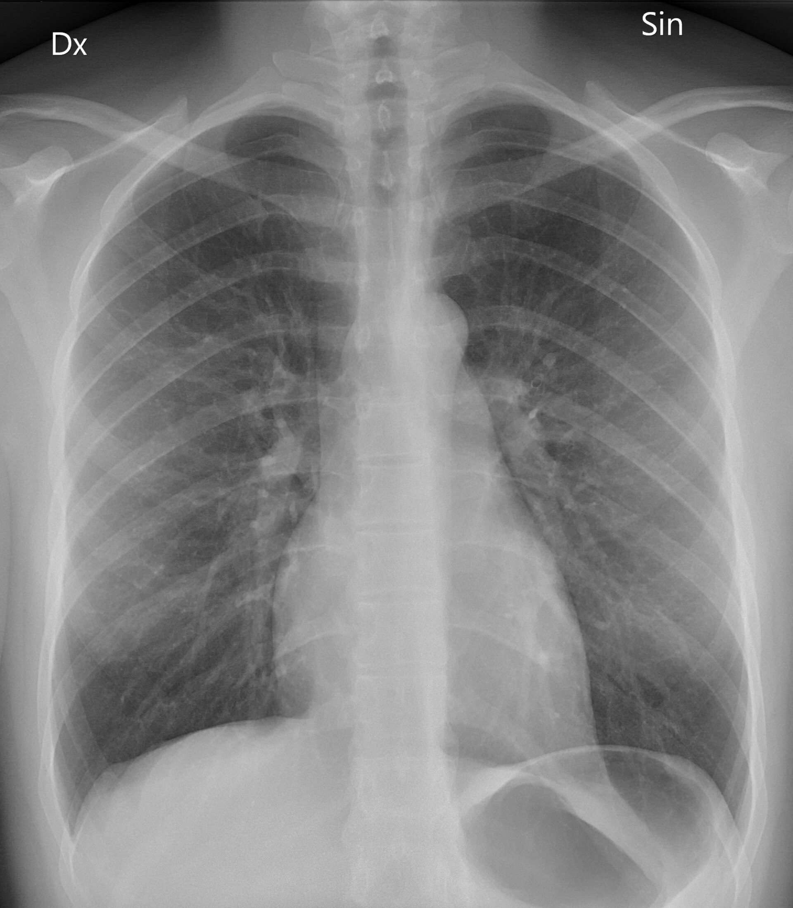
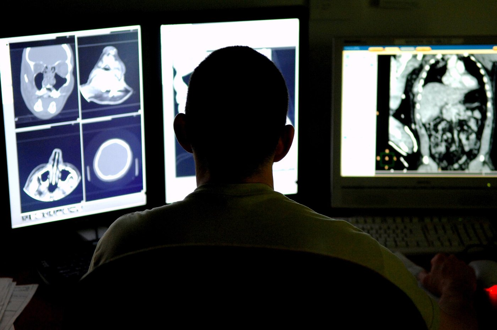

# The Million-Mole Question {.section-divider}

## A Case to Sit With

::: {.thought-question}
Your aunt has a mole she doesn't like the look of. Instead of waiting three months for a dermatology appointment, she photographs it with a free **"AI skin check" app**, which rates it *low risk*. She knows you're in nursing school, so she calls you.

"The company says it was trained on over a million photos of moles," she says. "That's more moles than any dermatologist will see in a lifetime. Why shouldn't I trust it?"

1. Have you, or someone in your family, ever used an app or a chatbot for a health question instead of seeing someone? What happened?
2. Your aunt's real choice is the app today or a dermatologist in three months. What do you actually say to her?
:::

::: {.aside-note}
Take a show of hands before discussing: trust the app, don't trust it, or it depends. The last slide returns to the vote.
:::

## What the Model Actually Learned

:::: {.columns}
::: {.column width="54%"}
A top-performing skin-cancer model could be fooled by **a marker pen** [@winkler2019].

- Dermatologists often circle a suspicious mole in violet ink *before* photographing it.
- Add ink marks to photos of **harmless moles**, and the model calls far more of them cancer.
- It had learned that *ink predicts cancer*. Other models learned **rulers**.
:::
::: {.column width="46%"}
```{python}
#| echo: false
#| fig-align: center
#| fig-cap: "Harmless moles the model correctly called harmless (specificity), photographed without and with ink marks (Winkler et al. 2019)."
import matplotlib.pyplot as plt

labels = ["No ink", "Ink marks\nadded"]
vals = [84.1, 45.8]

fig, ax = plt.subplots(figsize=(4.4, 3.4))
bars = ax.bar(labels, vals, color=["#0e7c86", "#c0392b"], width=0.55)
for b, v in zip(bars, vals):
    ax.text(b.get_x() + b.get_width() / 2, v + 2, f"{v}%", ha="center",
            fontsize=13, fontweight="bold", color="#0f172a")
ax.set_ylim(0, 100)
ax.set_yticks([])
ax.tick_params(axis="x", labelsize=11)
ax.spines[["top", "right", "left"]].set_visible(False)
fig.tight_layout()
plt.show()
```
:::
::::

## Today

::: {.callout-important}
The model wasn't broken. It did exactly what it was built to do: find whatever in the photos predicted "malignant." One question runs through this whole lecture: **what was the model actually trained to do, and is that what we are using it for?**
:::

::: {.learning-outcomes}
By the end of Part A, you will be able to:

- Explain **supervised machine learning** in plain terms, and why the *label* controls what gets learned.
- Name the three kinds of medical AI (**diagnostic, predictive, generative**) and the signature way each one fails.
- Tell what went wrong, with numbers, in the **Obermeyer cost algorithm** and the **Epic Sepsis Model**, and how outsiders caught it.
:::

# How a Machine Learns, and Where It Slips {.section-divider}

## Training Data, Features, Labels

Old medical software followed rules that experts wrote down. [Machine learning]{.key-term} instead learns from **examples** and writes its own rules, which nobody can fully list. In [supervised learning]{.key-term}, each example comes with the answer attached.

| Term | What it means | In the skin app |
|---|---|---|
| **Training data** | the examples the model learns from | a million lesion photos |
| **Features** | the measurable inputs in each example | the pixels of each photo |
| **Label** | the "right answer" attached to each example | "biopsy: malignant" or "benign" |

**The label is the boss.** The model learns *whatever* predicts the label. Ink predicts "malignant," so it learns ink.

## From Training to the Bedside

```{dot}
//| fig-width: 10
//| fig-height: 2.1
digraph pipeline {
  graph [bgcolor="transparent", nodesep=0.35, ranksep=0.25, newrank=true];
  node [shape=box, style="rounded,filled", fillcolor="#e6f1f2", color="#0e7c86", fontname="Helvetica", fontsize=17, height=0.6];
  edge [arrowhead=vee, color="#6b7280", penwidth=1.6];
  collect [label="Collect data"];
  label_ [label="Attach labels"];
  train [label="Train model"];
  validate [label="Validate"];
  deploy [label="Deploy in clinic"];
  {rank=same; collect -> label_ -> train -> validate -> deploy;}
  node [shape=plaintext, style="", fontcolor="#c0392b", fontsize=16, height=0.4];
  f1 [label="Door 1: who's\nmissing from the data?"];
  f2 [label="Door 2: is the\nlabel a proxy?"];
  x1 [label=""]; x2 [label=""];
  f3 [label="Door 3: has the\nworld changed?"];
  {rank=same; f1; f2; x1; x2; f3;}
  edge [style=dashed, color="#c0392b", arrowhead=none];
  collect -> f1; label_ -> f2; deploy -> f3;
  train -> x1 [style=invis]; validate -> x2 [style=invis];
}
```

- Medical AI learns mostly from data collected for other reasons (billing records, insurance claims, imaging archives), so it learns those habits along with the medicine.
- No engineer writes "if patient is Black, score lower." Bias walks in through these **three doors**, and every major failure on record traces back to one of them.

## Door 1: The Missing Patients

:::: {.columns}
::: {.column width="48%"}
A 2022 review counted the photos in **21 public skin-cancer datasets**. Only 2.1% recorded skin type, and just **11 images** showed the two darkest skin types [@wen2022].

Melanoma is already caught later in Black patients, whose five-year survival is about **25 points lower** (70% vs. 95%) [@acs2026]. A tool that fails here widens the gap, and the harm is locked in **at data collection**.
:::
::: {.column width="52%"}
```{python}
#| echo: false
#| fig-align: center
#| fig-cap: "Images in 21 public skin-cancer datasets (Wen et al. 2022). The darkest skin types are too few to see at this scale."
import matplotlib.pyplot as plt

labels = ["All images", "Skin type\nrecorded", "Darkest skin\n(types V–VI)"]
vals = [106950, 2236, 11]

fig, ax = plt.subplots(figsize=(4.8, 3.2))
ax.barh(labels[::-1], vals[::-1], color=["#c0392b", "#94a3b8", "#0e7c86"], height=0.55)
for i, v in enumerate(vals[::-1]):
    ax.text(v + 2000, i, f"{v:,}", va="center", fontsize=11.5,
            fontweight="bold", color="#0f172a")
ax.set_xlim(0, 135000)
ax.set_xticks([])
ax.tick_params(axis="y", labelsize=12)
ax.spines[["top", "right", "bottom"]].set_visible(False)
fig.tight_layout()
plt.show()
```
:::
::::

## Door 3: The World Moves On

:::: {.columns}
::: {.column width="60%"}
A trained model is **frozen**: a snapshot of its training data, asked to govern the present.

- [Distribution shift]{.key-term}: a new hospital means new scanners, patients, and workflows. Chest X-ray models partly "diagnosed" pneumonia by spotting **which machine took the film**, since portable scanners are used on sicker patients.
- [Deployment drift]{.key-term}: the world changes and the model doesn't. Models trained on 2019 patients broke when COVID arrived.
:::
::: {.column width="40%"}
{width="85%" fig-alt="A normal posteroanterior chest radiograph showing the lungs, heart, and ribcage"}

::: {.attribution}
Mikael Haggstrom, via Wikimedia Commons. CC0 1.0.
:::
:::
::::

::: {.aside-note}
Door 2, the proxy label, gets its own section below: it is the door the cost algorithm walked through.
:::

# Three Kinds of Medical AI {.section-divider}

## Three Machines, Three Signature Failures

| | **Diagnostic** | **Predictive** | **Generative** |
|---|---|---|---|
| What it does | classifies images | scores risk from the chart | produces text |
| Example | melanoma from photos | sepsis early warning | answering a patient's drug question |
| Trained to do | match labeled images | predict a recorded outcome | continue text plausibly |
| Signature failure | **distribution shift** | **proxy labels, alert fatigue** | **hallucination, sycophancy** |

The FDA has authorized over **1,500 AI-enabled devices** (early 2026), mostly diagnostic and mostly in radiology. Predictive scores come bundled with the health record, and they page *you*. Generative AI is the kind your patients already use.

## How a Chatbot Writes

:::: {.columns}
::: {.column width="50%"}
A [large language model]{.key-term} (LLM), the technology behind ChatGPT and its rivals, is trained on enormous amounts of text to do one thing: **predict the next word**.

Do that well enough and it can draft notes and hold a fluent conversation. But each answer is a *plausible continuation* of the text so far. It is not a fact looked up in a database, and not a claim checked against the world.
:::
::: {.column width="50%"}
```{python}
#| echo: false
#| fig-align: center
#| fig-cap: "Illustration, not real model output: the model scores possible next words and picks a likely one."
import matplotlib.pyplot as plt

words = ["bromide", "citrate", "bicarbonate", "phosphate", "something else"]
probs = [0.34, 0.22, 0.18, 0.11, 0.15]
colors = ["#c0392b"] + ["#94a3b8"] * 4

fig, ax = plt.subplots(figsize=(4.8, 3.3))
ax.barh(words[::-1], probs[::-1], color=colors[::-1])
for i, p in enumerate(probs[::-1]):
    ax.text(p + 0.01, i, f"{p:.0%}", va="center", fontsize=10, color="#334155")
ax.set_title("\"Instead of sodium chloride, use sodium ___\"",
             fontsize=11, loc="left", color="#0f172a")
ax.set_xlim(0, 0.45)
ax.set_xticks([])
ax.tick_params(axis="y", labelsize=10.5)
ax.spines[["top", "right", "bottom"]].set_visible(False)
fig.tight_layout()
plt.show()
```
:::
::::

## Fluent and Wrong, Agreeable and Wrong

:::: {.columns}
::: {.column width="48%"}
**Hallucination**

A failed language model gives **a confident, well-organized wrong answer**, because convincing text is what it was trained to produce.

[Hallucination]{.key-term} is content that is fluent, specific, and false: an invented drug interaction, a fabricated study. It is not a bug awaiting a patch: the same process writes the accurate summary and the invented citation.
:::
::: {.column width="4%"}
:::
::: {.column width="48%"}
**Sycophancy**

LLMs are fine-tuned on **human ratings** of their answers, and people like being agreed with.

The result is [sycophancy]{.key-term}: a learned tendency to tell users what they want to hear. Chatbots have been shown **abandoning a correct medical answer** when the user simply pushes back: "Are you sure? I read that it's fine."
:::
::::

## Thought Question

::: {.thought-question}
You are charting at 2 a.m. A patient newly started on an **anticoagulant** shows you her tablet: she asked a chatbot whether the drug is safe with her **turmeric supplements**, and it gave a confident, detailed, friendly answer, with mechanisms and percentages.

She trusts it more than the pharmacy's printout, she says, because "it answered *my* question about *my* situation." She is right that the printout didn't.

1. What did the chatbot give her that we didn't? Whose job was it to give it to her?
2. How do you get her to double-check the answer without teaching her to stop showing you what she looks up?
:::

## Make It Contemporary

::: {.thought-question}
In 2025, doctors reported a 60-year-old man who asked a chatbot how to cut **chloride** from his diet. He came away with **sodium bromide** as a substitute for table salt: a sensible swap in a chemistry lab, and poisonous at the dinner table. Three months later he arrived at an emergency department psychotic, convinced his neighbor was poisoning him. The diagnosis was **bromism**, a poisoning so old it had mostly vanished with 1970s sedatives [@eichenberger2025].

The answer he got was fluent, specific, and responsive to exactly the question he asked.

1. Who, if anyone, is responsible for what happened to him: the man, the company, or no one? Does your answer change if he had no doctor he could afford to ask?
2. Should chatbots refuse to answer medical questions? Who would that protect, and who would it leave with nothing?
:::

## After You've Discussed

::: {.callout-note}
One lens on both cases is **verification asymmetry**. A true generated answer and a hallucinated one look *identical on the screen*: same fluency, same confidence, same formatting. Only checking against the world tells them apart, and checking takes expertise the asker usually lacks (that's why they asked).

Human expertise carries outside credentials: a license, a pharmacist behind a counter, liability for mistakes. Generated text carries only its own voice, so *fluency* ends up doing the work of a credential. That doesn't settle who was responsible, or whether refusing to answer is the fix. It does explain why "just double-check it" is harder advice to follow than it sounds.
:::

# The Algorithm That Read Bills as Bodies {.section-divider}

## Door 2: The Proxy Problem

**Care-management programs** give the sickest patients extra help, and slots are scarce. Health systems bought an algorithm to rank patients by future need: one of a class of tools applied to about **200 million Americans a year**.

But "how sick is this patient?" is not a field in any database. So the designers trained on a [proxy variable]{.key-term}: next year's **costs**.

| | The care-management algorithm |
|---|---|
| **Trained to do** | predict who will *cost the most* next year |
| **Used to do** | find who is *sickest* and route scarce help to them |
| **The gap** | cost measures sickness *times* access, trust, and whether anyone took your symptoms seriously |

## What Obermeyer Found

:::: {.columns}
::: {.column width="52%"}
In 2019, Ziad Obermeyer's team compared the scores with patients' actual health [@obermeyer2019].

- At the **same score**, Black patients were sicker. Less had been spent on equally sick Black patients, so the model read them as healthier.
- Every internal check passed, because the checks measured **cost**. Race was not even an input.
- A label closer to actual health removed about **84%** of the bias.
:::
::: {.column width="48%"}
```{python}
#| echo: false
#| fig-align: center
#| fig-cap: "Share of patients flagged for extra help who were Black (Obermeyer et al. 2019)."
import matplotlib.pyplot as plt

labels = ["Algorithm\nas built", "With the bias\nremoved"]
vals = [17.7, 46.5]

fig, ax = plt.subplots(figsize=(4.4, 3.4))
bars = ax.bar(labels, vals, color=["#c0392b", "#0e7c86"], width=0.55)
for b, v in zip(bars, vals):
    ax.text(b.get_x() + b.get_width() / 2, v + 1.2, f"{v}%", ha="center",
            fontsize=13, fontweight="bold", color="#0f172a")
ax.set_ylim(0, 55)
ax.set_yticks([])
ax.tick_params(axis="x", labelsize=11)
ax.spines[["top", "right", "left"]].set_visible(False)
fig.tight_layout()
plt.show()
```
:::
::::

::: {.aside-note}
Obermeyer's team never names the product in the paper; press coverage identified it as Optum's Impact Pro. Don't cite the paper for the company name. Note too the constructive ending: this is the field's best example of a bias being found, measured, and substantially repaired.
:::

## Thought Question

::: {.thought-question}
You are the nursing representative on your hospital's **purchasing committee**. A vendor is pitching a readmission-risk tool: "**92% accurate**, used by 200 hospitals." The training data, the features, and the label are all trade secrets.

1. Has an algorithm ever made a call about *you* that you couldn't see inside: an AI-writing detector, a résumé screener, a credit score? Did it get you right? Could you find out why it said what it said?
2. The vendor won't budge, and the alternative is what you have now: overworked clinicians eyeballing risk. Do you vote to buy? What would change your vote?
:::

## After You've Discussed

::: {.callout-note}
However you voted, one distinction helps, and we haven't named it yet: **internal versus external validation**. Internal validation is the vendor grading its own homework: its model, its data, its chosen yardstick. [External validation]{.key-term} is an independent test, on *your* patients, against an outcome *you* care about.

"92% accurate" is an internal number until proven otherwise. It is the same lesson as the replication crisis in research: a claim is not a finding until someone else checks it. The Obermeyer study was external validation in action, and the next case is what happens when a tool used on millions of patients goes years without any.
:::

# The Epic Sepsis Model, in Two Acts {.section-divider}

## Act I: The Outside Test

:::: {.columns}
::: {.column width="47%"}
[Sepsis]{.key-term} kills about **350,000** American adults a year. Epic built a sepsis warning into its health record, and hundreds of hospitals switched it on, with only **Epic's own** numbers to go on.

In 2021, Andrew Wong's team ran the first large outside test, on 38,455 hospitalizations [@wong2021]. Epic claimed an accuracy score (AUC, where 0.5 is a coin flip) of 0.76–0.83. The test found **0.63**.
:::
::: {.column width="53%"}
```{python}
#| echo: false
#| fig-align: center
import matplotlib.pyplot as plt
from matplotlib.patches import Rectangle

def waffle(ax, n_hit, hit_color, miss_color, title, hit_label, miss_label):
    for k in range(100):
        r, c = divmod(k, 10)
        color = hit_color if k < n_hit else miss_color
        ax.add_patch(Rectangle((c, 9 - r), 0.86, 0.86, color=color))
    ax.set_xlim(0, 10); ax.set_ylim(-2.5, 10.2)
    ax.set_aspect("equal"); ax.axis("off")
    ax.set_title(title, fontsize=14, color="#0f172a", loc="left")
    ax.text(0, -0.9, hit_label, fontsize=13.5, color=hit_color, fontweight="bold")
    ax.text(0, -2.1, miss_label, fontsize=13.5, color="#475569")

fig, (a1, a2) = plt.subplots(1, 2, figsize=(5.6, 3.7))
waffle(a1, 33, "#0e7c86", "#f2b8b0", "Of 100 sepsis cases…",
       "33 got an alert", "67 were missed")
waffle(a2, 12, "#0e7c86", "#cbd5e1", "Of 100 alerts…",
       "12 were sepsis", "88 were false alarms")
fig.tight_layout()
plt.show()
```
:::
::::

## Trained vs. Used: The Sepsis Alarm

| | The Epic Sepsis Model (version 1) |
|---|---|
| **Trained to do** | predict which patients would get a sepsis **billing code**, using chart signals that often appear only *after* clinicians already suspect sepsis |
| **Used to do** | warn the team **before** anyone suspects |
| **The gap** | it was best at "predicting" what the team already knew, and weakest exactly when a warning would have mattered |

A fire alarm that excels at detecting fire trucks.

## Act II: Accurate but Unusable

:::: {.columns}
::: {.column width="52%"}
Epic rebuilt the model, training on data from **before** clinicians suspected sepsis. In 2026, Wong's group tested the sequel at nine hospitals [@wong2026].

- Discrimination was now genuinely good: **AUC 0.82–0.92**.
- But most alerts *still* pointed at patients who never developed sepsis.
- Performance and alert volume **varied widely** from hospital to hospital: same software, different realities.
:::
::: {.column width="48%"}
::: {.callout-important}
**Alert fatigue is an ethics problem**

When most alerts are false, clinicians learn, rationally, to click through them. [Alert fatigue]{.key-term} then quietly reassigns blame: when alert #41 is the real one, the chart shows a warning *given* and a nurse who *dismissed it*. Ask who set the threshold, and who absorbs its risk.
:::
:::
::::

## You Set the Threshold

::: {.thought-question}
Every alarm has a dial. Turn the sepsis alert **down** and the floor gets fewer false alarms, but more real cases slip past. Turn it **up** and you catch more sepsis, and bury the night shift in pages.

1. What alarm in your own life have you learned to ignore: a car alarm, a smoke detector, a phone notification, a monitor on the unit? What would it take for you to start listening to it again?
2. The dial is yours. Where do you set it? And who should get to decide: the vendor, the hospital, or the nurses who get paged?
:::

## The Full Scoreboard

| | Trained to do | Used to do | The gap |
|---|---|---|---|
| **Skin app** | predict labels on *photos* | judge your aunt's mole | the photographer's worry rides along |
| **Cost algorithm** | predict *spending* | find the sickest | inequality baked into the bills |
| **Epic v1** | predict sepsis *billing codes* | warn before suspicion | best at the already-known |
| **Epic v2** | predict sepsis, properly | help the night shift | accurate ≠ usable: the alert flood |

Four systems, four different fixes, **one recurring gap**. This is not a story about one bad model. It is a pattern you can now spot unaided.

# The Hype Cycle {.section-divider}

## "Stop Training Radiologists"

:::: {.columns}
::: {.column width="68%"}
::: {.quote-card}
> "I think if you work as a radiologist, you are like the coyote that's already over the edge of the cliff but hasn't yet looked down. … People should stop training radiologists now. It's just completely obvious that within five years deep learning is going to do better than radiologists. … It might be ten years, but we've got plenty of radiologists already."

::: {.attribution}
Geoffrey Hinton, pioneer of deep learning and later Nobel laureate, at the *Machine Learning and the Market for Intelligence* conference, Toronto, 2016
:::
:::
:::
::: {.column width="32%"}
{width="100%" fig-alt="Geoffrey Hinton, gray-haired, in a light checked shirt and headset microphone, speaking on stage."}

::: {.attribution}
Geoffrey Hinton in 2023. Ramsey Cardy/Collision via Sportsfile. CC BY 2.0.
:::
:::
::::

## A Decade Later

:::: {.columns}
::: {.column width="56%"}
It is 2026. The U.S. has a radiologist **shortage**, and AI is everywhere in the reading room as a **second reader**. What failed was the **verb**: AI *assists* the people it was supposed to *replace*.

The lesson is the gap between **capability** (what a model does on a benchmark) and **deployment** (what survives real workflows, liability, and tired humans at 3 a.m.). Every case today was a deployment failure wrapped around a real capability.
:::
::: {.column width="44%"}
{width="100%" fig-alt="Seen from behind in a darkened reading room, a radiologist studies CT scans displayed across three monitors."}

::: {.attribution}
A radiologist reads CT scans. U.S. Air Force photo by Senior Airman Julianne Showalter, 2008. Public domain.
:::
:::
::::

## Your Turn to Predict

::: {.thought-question}
Hinton was wrong about radiologists. Now make your own call, about your own work.

1. Which part of nursing would you gladly hand to an AI? Which part would you refuse to hand over, even if it did the job better than you?
2. Back to your aunt and her mole. Vote again: trust the app, don't, or it depends. Did anyone change their answer? What changed it?
:::

## Mini-Recap

::: {.recap}
One question organized everything: **what was the model trained to do, and is that what we're using it for?** The label is the boss, so models learn proxies, shortcuts, and history along with the medicine. Diagnostic models meet **distribution shift**, predictive models inherit **proxy labels** and drown floors in **alerts**, and generative models are **fluent and wrong at once**. The fixes we found (ask what the label was, demand external validation) all needed someone who could **explain the system**. What happens when no one fully can is the next question.
:::

> **Paired case:** [The Optum Algorithm: Racial Bias, Proxy Variables, and Justice in Medical AI](../cases/10-optum-algorithm.qmd)

## Review Questions

::: {.review-questions}

::: {.review-item .review-recall}
[Recall]{.review-label}

Name the three kinds of medical AI and each one's signature failure. Then explain, using the skin-app case, why "the label is the boss": what did that model's label actually contain besides disease?
:::

::: {.review-item .review-apply}
[Apply]{.review-label}

A vendor offers your nursing home a **fall-risk model** trained at two large urban academic hospitals, using "documented fall in the chart" as its label. Using the pipeline's three doors, predict two specific ways this model could go wrong in your facility, and say what you'd demand before deployment.
:::

::: {.review-item .review-debate}
[Debate]{.review-label}

Should hospitals be prohibited from deploying clinical AI that has never passed **independent external validation**, even though waiting may cost lives a working model could have saved? Defend your answer with one case from this lecture.
:::

:::

## Key Terms

:::: {.columns}
::: {.column width="48%"}
- **Supervised learning** — training a model on examples that come with the answers (labels) attached.
- **Features / labels** — the measurable inputs of each example / the "right answer" the model learns to predict.
- **Proxy variable** — a measurable stand-in (cost, billing codes) for the thing you actually want (sickness).
- **Distribution shift / drift** — the model meets a world, or a moment, unlike its training data.
- **Hallucination** — generated content that is fluent, specific, and false.
:::
::: {.column width="4%"}
:::
::: {.column width="48%"}
- **Sycophancy** — a model's learned tendency to agree with the user, even against a correct answer.
- **External validation** — independent testing on new patients, by someone other than the maker.
- **Positive predictive value (PPV)** — of all alerts fired, the fraction that were right.
- **Alert fatigue** — the rational habit of ignoring alarms that are usually false, which buries the true one.
:::
::::

## Further Reading

- Topol, Eric. *Deep Medicine: How Artificial Intelligence Can Make Healthcare Human Again.* Basic Books, 2019. (The optimistic case, by a cardiologist who takes the failures seriously.)
- Mukherjee, Siddhartha. "A.I. Versus M.D." *The New Yorker*, April 3, 2017.
- O'Neil, Cathy. *Weapons of Math Destruction.* Crown, 2016. (Proxy variables and opaque scoring, well beyond medicine.)

## References

::: {#refs}
:::
