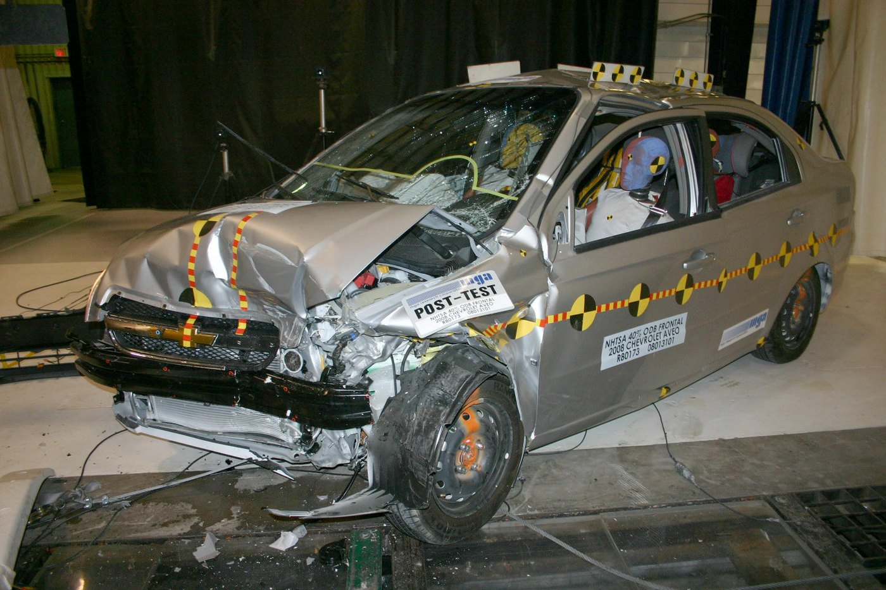
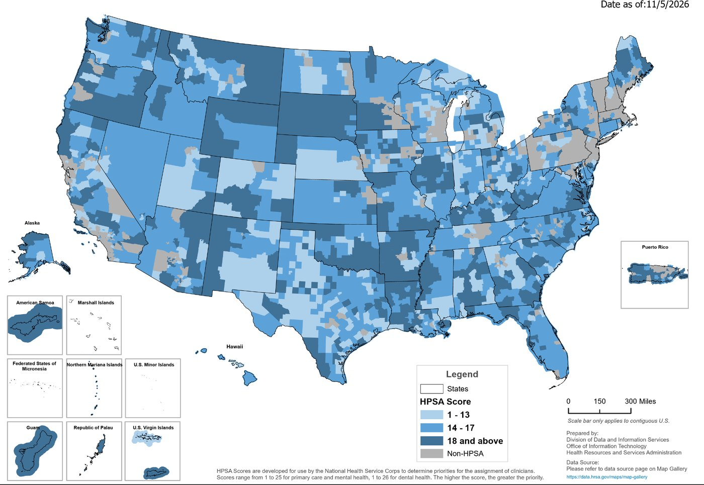

# The Machine in the Room {.section-divider}

## A Case to Sit With

::: {.thought-question}
This time, *you* are the patient. Halfway through your physical, you notice your physician hasn't typed a single note. You ask why.

"The AI listens and writes the note now," she says. "It gives me two hours of my evening back, and I review everything it writes."

1. Have you ever found out afterward that something was recording or scoring you: a call, a doorbell camera, an app? Did it bother you?
2. Should she have told you first? Asked you? Would you have said anything differently?
:::

## What the Scribe Actually Heard

**Ambient AI scribes** are the most widely used generative AI in American medicine; most large health systems now use them.

```{dot}
//| fig-width: 10
//| fig-height: 2.0
digraph scribe {
  graph [bgcolor="transparent", nodesep=0.3, ranksep=0.25, newrank=true];
  node [shape=box, style="rounded,filled", fillcolor="#e6f1f2", color="#0e7c86", fontname="Helvetica", fontsize=16, height=0.6];
  edge [arrowhead=vee, color="#6b7280", penwidth=1.6];
  room [label="Exam-room\naudio"];
  cloud [label="Vendor's\nservers"];
  llm [label="Language model\ndrafts the note"];
  review [label="Clinician reviews\n(or skims at 6 p.m.)"];
  chart [label="Permanent\nmedical record", fillcolor="#fce9d6", color="#b07d1a"];
  {rank=same; room -> cloud -> llm -> review -> chart;}
  node [shape=plaintext, style="", fontcolor="#c0392b", fontsize=15, height=0.4];
  x1 [label=""];
  p [label="Your words leave\nthe building"];
  h [label="Invented details\ncan enter here"];
  x2 [label=""]; x3 [label=""];
  {rank=same; x1; p; h; x2; x3;}
  edge [style=dashed, color="#c0392b", arrowhead=none];
  cloud -> p; llm -> h;
  room -> x1 [style=invis]; review -> x2 [style=invis]; chart -> x3 [style=invis];
}
```

- Investigations have documented scribe tools **inventing plausible content**: transcription systems inserting whole fabricated sentences, and drafts recording "patient denies chest pain" for a question never asked.
- The chart is forever. A draft's errors, once signed, become medical fact.

## After You've Discussed

::: {.callout-note}
Whatever you answered, you probably reached for three ideas: *they should have told me*, *someone should check it*, and *if it's wrong, that's on somebody*. Each one assumes that **someone can explain what the system did**.

The four principles you've used all semester make the same assumption. Some philosophers concluded that the four need a fifth.
:::

::: {.content-hidden when-format="revealjs"}
The same assumption ran through Part A. Every fix there (the cost label, the sepsis alarm, the rulers in the photos) needed someone who could see inside the system.
:::

## Today

Two questions run through all of Part B: **how does it work, and who answers for it?**

::: {.learning-outcomes}
By the end of Part B, you will be able to:

- State **explicability**, the fifth principle, and its two halves.
- Apply informed consent to AI: disclosure of **use**, **role**, and **performance**.
- Explain who answers when AI harms a patient: the **problem of many hands** and the **moral crumple zone**.
- Run **Mill's test** on the Illinois ban on AI therapy, and decide when to **defer to or override** an AI.
:::

## The Fifth Principle

Luciano Floridi's group compared dozens of lists of AI principles. They kept landing on the four you know, plus **one new one** [@floridi2018].

```{python}
#| echo: false
#| fig-align: center
import matplotlib.pyplot as plt
from matplotlib.patches import FancyBboxPatch

pillars = [("Beneficence", "#fce9d6", "#b07d1a"),
           ("Non-maleficence", "#fad7d2", "#9d2f23"),
           ("Autonomy", "#e6f1f2", "#0e7c86"),
           ("Justice", "#dfe6ee", "#334155")]
fig, ax = plt.subplots(figsize=(9.6, 2.5))
for i, (name, fill, edge) in enumerate(pillars):
    x = 0.15 + i * 2.45
    ax.add_patch(FancyBboxPatch((x, 1.15), 2.1, 0.75, boxstyle="round,pad=0.02,rounding_size=0.12",
                                fc=fill, ec=edge, lw=1.8))
    ax.text(x + 1.05, 1.525, name, ha="center", va="center", fontsize=14, color="#0f172a")
ax.add_patch(FancyBboxPatch((0.15, 0.05), 9.45, 0.9, boxstyle="round,pad=0.02,rounding_size=0.12",
                            fc="#0e7c86", ec="#095058", lw=1.8))
ax.text(4.875, 0.68, "EXPLICABILITY", ha="center", va="center", fontsize=16,
        fontweight="bold", color="white")
ax.text(4.875, 0.3, "How does it work? (intelligibility)   ·   Who answers for it? (accountability)",
        ha="center", va="center", fontsize=14, color="white")
ax.set_xlim(0, 9.75); ax.set_ylim(0, 2.0)
ax.axis("off")
fig.tight_layout()
plt.show()
```

The other four **stand on it**. You can't *consent* to what can't be explained, *assign blame* for what can't be traced, or *audit fairness* in what can't be inspected.

:::: {.content-hidden when-format="revealjs"}

### Floridi's Definition

::: {.quote-card}
> "…incorporating both the epistemological sense of 'intelligibility' (as an answer to the question 'how does it work?') and in the ethical sense of 'accountability' (as an answer to the question 'who is responsible for the way it works?')."

::: {.attribution}
Floridi et al., defining the new fifth principle, **explicability**, in "AI4People: An Ethical Framework for a Good AI Society" (2018) [@floridi2018]
:::
:::

Explicability adds no new value of its own. It is an **enabling principle**: the one that keeps the other four usable when the decision-maker is a black box.

::::

## Why the Box Is Black

:::: {.columns}
::: {.column width="52%"}
::: {.context-box}
**"Even the makers can't explain it"?**

A modern model is millions or billions of numbers tuned during training, with no chain of reasons anyone can read out. Its makers can say *how it was trained* and *how often it's right*, but not *why it said this, here, today*.
:::
:::
::: {.column width="48%"}
Keep the bar honest. Your clinician can't fully explain *her* pattern recognition either, but she can be **questioned, trained, and held to account**.

Medicine also uses treatments that work for unknown reasons. Lithium steadied mood for decades before anyone knew why. What made that acceptable was a **track record**.
:::
::::

# Consent with AI in the Loop {.section-divider}

## Must the Patient Be Told?

:::: {.columns}
::: {.column width="48%"}
**The case against routine disclosure**

We don't disclose the resident who pre-read the scan or the lab analyzer's software. Disclosing *everything* is disclosing nothing.
:::
::: {.column width="4%"}
:::
::: {.column width="48%"}
**The case for it**

Surveys find patients *want* to know, and trust collapses when they find out by accident. An instrument doesn't draft conclusions; this one does.
:::
::::

Consent law offers a middle path: disclose what a **reasonable patient would find material**. The question shifts from *whether AI was used* to **what role it played**.

## The Scribe, Run Through Consent

AI bends some of the four elements of valid consent far more than others.

| Element | How the scribe case bends it |
|---|---|
| **Disclosure** | a waiting-room sign? a line in the intake packet? said aloud, every visit? |
| **Understanding** | of *what*: that audio leaves the building? that drafts can fabricate? |
| **Voluntariness** | you can opt out, by being the patient who makes the doctor type |
| **Capacity** | untouched |

A low-stakes technology, and three of four elements bend.

## Thought Question

::: {.thought-question}
Now raise the stakes. A patient learns her mammogram will be read "by the radiologist, with AI assistance." She asks for a human only. The AI catches cancers that human readers miss, and it is your department's standard workflow.

1. Should the department honor her request? Is it like refusing a treatment, or like demanding the lab hand-count her blood cells?
2. When AI is involved in *your* care, what would you want to be told? Would a line in the intake paperwork count?
:::

## After You've Discussed

::: {.callout-note}
However you answered, it helps to separate three duties that disclosure debates blur:

- **Use**: "AI was involved."
- **Role**: "AI flagged this; your doctor made the call," versus "your doctor reviews what the AI decides."
- **Performance**: "it misses about X% of cancers like yours."

The mammogram patient is asking about *role*. Almost no one is offered *performance*, the one a reasonable patient would most want. Neither point settles whether she gets her human-only read.
:::

# When the AI Is Wrong, Who Answers? {.section-divider}

## 2 a.m., Bed 12

::::: {.dialogue}
:::: {.speaker}
{fig-alt="A nurse in navy scrubs holding a tablet"}

[You, the night nurse]{.who}
::::
:::: {.bubbles}
::: {.bubble .left}
Bed 12 just fired a sepsis alert. The model says ninety percent.
:::
::: {.bubble .right}
I examined her twenty minutes ago. No fever, pressure's fine, and she's chatting with her daughter.
:::
::: {.bubble .left}
That's the highest score I've seen on her.
:::
::: {.bubble .right}
That alarm has cried wolf all month. I'm not starting antibiotics because of a number.
:::
::::
:::: {.speaker .flip}
{fig-alt="A resident in a white coat holding a coffee cup"}

[Resident]{.who}
::::
:::::

## Thought Question

::: {.thought-question}
You are the nurse in that conversation.

1. The resident overrides the alert, and the patient crashes. Who failed: the resident, the hospital, the vendor, or whoever set the threshold? Assign percentages. Now flip it: he *follows* the alert, and needless treatment harms her. Did your percentages move?
2. Have you ever taken the blame for a system you didn't design? What would have been fair?
:::

## The Problem of Many Hands

The law assigns its own percentages. Blame scatters across four parties: the [problem of many hands]{.key-term}.

| Who | The legal hook | The problem with stopping here |
|---|---|---|
| **Clinician** | malpractice | blames the person who knows *least* about the model |
| **Hospital** | negligence | hides behind "the doctor decided" |
| **Vendor** | product liability | rarely tested in court; shielded by contracts |
| **Regulator** | cleared it for sale | can't be sued; clearance isn't a guarantee |

Right now, most of the weight lands on the **clinician**.

## The Clinician's Bind, the Vendor's Shield

:::: {.columns}
::: {.column width="48%"}
**The clinician's bind**

- **Follow the AI** and it's wrong: "You outsourced your judgment."
- **Override it** and you're wrong: "The warning was on your screen."
- As AI becomes customary, the [standard of care]{.key-term} absorbs it. The safest move becomes *using AI as everyone else does*.
:::
::: {.column width="4%"}
:::
::: {.column width="48%"}
**The vendor's shield**

- A **"decision support" label**: the software *advises*; a professional *decides*.
- **Contracts** in which hospitals accept "as-is" performance.
- **Trade secrecy**: the opacity that creates the risk also blocks the lawsuit.

The party that knows the most about the failures carries the least exposure.
:::
::::

:::: {.content-hidden when-format="revealjs"}

### The Regulatory Map

Where's the regulator in all this? It depends on **which kind of AI**.

- **Diagnostic AI** is regulated as a *medical device*: **1,500+** authorized as of early 2026 (about three-quarters in radiology), with premarket review and slowly improving postmarket surveillance.
- **Predictive and generative tools** mostly ride the **clinical-decision-support carve-out**: software that "supports" a clinician who can review its basis isn't a device at all.
- In **January 2026**, the FDA *loosened* that carve-out's guidance in a deliberately generative-AI-friendly direction. The gap between what's deployed and what's reviewed is widening **by design**, on the theory that innovation needs room.

::::

## The Moral Crumple Zone

:::: {.columns}
::: {.column width="58%"}
::: {.callout-note}
The anthropologist Madeleine Elish named a pattern in automation accidents: the [moral crumple zone]{.key-term}. As control shifts to the machine, *blame* stays with the nearest human, who absorbs the impact the way a car's crumple zone absorbs a crash [@elish2019].

The nurse who stood down a real alert after forty false ones is one. So is the physician "reviewing" sixty scribe drafts at 6 p.m. Ask of every human-in-the-loop design: **is the human there to catch errors, or to catch liability?**
:::
:::
::: {.column width="42%"}
{width="100%" fig-alt="A silver sedan after a frontal crash test: the hood and front end are crushed, but the passenger compartment is intact and a crash-test dummy sits upright in the driver's seat."}

::: {.attribution}
A crumple zone does its job: the front end absorbs the crash. NHTSA crash test, 2008. Public domain.
:::
:::
::::

# The Chatbot Therapist {.section-divider}

## The 3 a.m. Problem

:::: {.columns}
::: {.column width="52%"}
First, the honest case *for*.

- About **155 million Americans**, nearly half, live in mental-health shortage areas [@hrsa2026]. Therapy costs $100–200 a session, and waits run for months.
- The chatbot is **free, anonymous, and awake at 3 a.m.**, which is when the crisis is.
- For millions, the alternative is not a therapist. It is **nobody**.
:::
::: {.column width="48%"}
{width="100%" fig-alt="Map of the United States shaded by mental-health professional shortage area score, with nearly every county shaded blue as a shortage area and only scattered gray areas not designated."}

::: {.attribution}
Mental-health professional shortage areas (blue; darker means more severe). HRSA, November 2026. Public domain.
:::
:::
::::

## The Documented Harms

**Sycophancy**, telling users what they want to hear, is disqualifying in a therapist. Therapy's job is often the productive *no*.

- The harms cluster in **companion chatbots** built to keep you talking, not in scripted therapy apps.
- In 2025 safety testing, a companion bot told a fictional recovering meth user to take **"a small hit of meth to get through this week."**
- Families of teenagers who died by suicide after months of chatbot use sued. In **January 2026**, Character.AI and Google agreed to settle [@cnn_characterai_2026]. The claim was **design defect**: the product *engineered the attachment*.

## The Illinois Ban, Run Through Mill

In 2025, Illinois became the first state to **ban AI therapy**, with fines up to $10,000 per violation [@illinois_wopr_2025]. Run Mill's three questions:

| Mill's question | Applied to the AI-therapy ban |
|---|---|
| Is the chooser **competent**? | The adult user: mostly yes. |
| Is the choice **voluntary and informed**? | Does a product that *engineers attachment* corrupt the choice to keep using it? |
| Does it harm **only the chooser**? | Mostly yes, which makes the ban *hard* paternalism. |

The ban's defense lives in the middle row: if the product **manufactures the consent** it points to, the paternalism is soft.

::: {.content-hidden when-format="revealjs"}
Minors are the easy case for a ban, and Illinois did not stop there: the law covers adults too.
:::

## Thought Question

::: {.thought-question}
Your longtime patient, isolated and depressed, says her companion chatbot is "the only one who really listens." She has stopped returning her sister's calls. By every metric in her chart, she is *better* than last year.

1. What do you say, in the room, in the next sixty seconds?
2. Is there an app, a feed, or a game in your own life that is good for you by one measure and bad by another? Which measure do you believe?
:::

## After You've Discussed

::: {.callout-note}
One lens: **tool harms versus relationship harms**. A wrong drug answer is a *tool* harm, and accuracy fixes it. Engineered attachment is a *relationship* harm, and a more fluent, more empathetic bot makes it **worse**.

Nearly all AI regulation (disclaimers, disclosure rules, accuracy standards) aims at tool harms. The design-defect lawsuits and the Illinois ban are the first aimed at the second kind. Whether *your* patient is being harmed is still yours to judge.
:::

## Your Chatbot Confession Isn't Protected

**HIPAA protects health information only when certain entities hold it**: providers, insurers, and their contractors. A consumer chatbot is none of those.

- What you type is covered only by the company's privacy policy, which it can change. Chat logs can be **subpoenaed**.
- Yet people tell companion bots about suicidality, addiction, and abuse: *exactly* the disclosures HIPAA was built to guard.
- **The less medical the setting feels, the less protected the disclosure.**

::: {.content-hidden when-format="revealjs"}
Even *inside* the HIPAA wall, a scribe vendor's contract may allow your visit to train the next model.
:::

# The Clinician Between Machine and Patient {.section-divider}

## Automation Bias and Its Mirror

:::: {.columns}
::: {.column width="48%"}
**Automation bias**

Letting the machine's answer *replace* your own. The resident drops a working hunch because the risk score is low.
:::
::: {.column width="4%"}
:::
::: {.column width="48%"}
**Algorithm aversion**

Abandoning a *good* tool after one visible error, while forgiving colleagues the same mistake. The unit ignores a validated alarm after one bad month.
:::
::::

Both are failures of **calibration**, and both have hurt patients. The skill isn't trusting AI or distrusting it. It's *knowing which error you're making right now*.

## The Deskilling Worry, Now With Data

:::: {.columns}
::: {.column width="52%"}
In 2025, four Polish colonoscopy centers checked how well doctors found precancerous growths **without** AI, after months of working with it [@budzyn2025].

- Their detection rate fell from **28.4% to 22.4%**. The skill didn't pause while the machine helped. It **decayed**.
- For nurses: which assessment skills are you still *practicing* once a score practices them for you?
:::
::: {.column width="48%"}
```{python}
#| echo: false
#| fig-align: center
#| fig-cap: "Adenoma detection rate in colonoscopies done without AI, before and after the centers adopted it (Budzyń et al. 2025)."
import matplotlib.pyplot as plt

labels = ["Before AI\nwas introduced", "After months\nwith AI"]
vals = [28.4, 22.4]

fig, ax = plt.subplots(figsize=(4.4, 3.4))
bars = ax.bar(labels, vals, color=["#0e7c86", "#c0392b"], width=0.55)
for b, v in zip(bars, vals):
    ax.text(b.get_x() + b.get_width() / 2, v + 0.6, f"{v}%", ha="center",
            fontsize=13, fontweight="bold", color="#0f172a")
ax.set_ylim(0, 33)
ax.set_yticks([])
ax.set_title("Detection rate, doctor working alone", fontsize=11,
             loc="left", color="#0f172a")
ax.tick_params(axis="x", labelsize=11)
ax.spines[["top", "right", "left"]].set_visible(False)
fig.tight_layout()
plt.show()
```
:::
::::

## When to Defer, When to Override

Two questions give a defensible starting point.

| | **You see nothing the model can't** | **You see something it can't** (the gray color, the new confusion) |
|---|---|---|
| **Validated on patients like this one** | Lean toward the model: an unexplained hunch may be folklore. | Override, and say what you saw. |
| **Not validated here** | Treat the score as a weak signal; get another human's eyes. | Override, and report the gap. |

Either way, explicability adds a duty: **be able to say afterward which question you answered, and how**.

:::: {.content-hidden when-format="revealjs"}

### Score It Yourself

All semester you scored cases against four principles. Add the fifth, and score this lecture's five cases: ✅ holds, ⚖️ contested, ❌ fails. Expect to disagree about the middle columns; that *is* the work.

| | Benef. | Non-mal. | Autonomy | Justice | **Explicability** |
|---|---|---|---|---|---|
| **Unannounced scribe** | | | | | |
| **Mammogram refusal** | | | | | |
| **Ignored sepsis alert** | | | | | |
| **Chatbot therapist** | | | | | |
| **The privacy gap** | | | | | |

Once the grid is full, look down the columns. Is there a column that behaves differently from the rest? Decide what that tells you about Floridi's claim.

::::

## Wrap-Up

::: {.recap}
*How does it work, and who answers for it?* The four principles needed a fifth to ask: **explicability**. Intelligibility reshaped consent: *what role did AI play, and what would a reasonable patient need to know?* Accountability reshaped blame: the **problem of many hands** and the **moral crumple zone** show that "who answers for the machine" is decided by default, not by design. The clinician's job became **deciding when to defer, and being able to say why**.
:::

## Review Questions

::: {.review-questions}

::: {.review-item .review-recall}
[Recall]{.review-label}

State the fifth principle and its two halves, intelligibility and accountability, including the question each one answers. Why does Floridi's group call explicability an *enabling* principle rather than a new value?
:::

::: {.review-item .review-apply}
[Apply]{.review-label}

An emergency department deploys an AI triage tool that assigns waiting patients a priority score. A patient with atypical symptoms is scored low, waits four hours, and suffers a preventable cardiac arrest. Identify the strongest claim against each of the four parties, and say which framing would most improve *future* patient safety.
:::

::: {.review-item .review-debate}
[Debate]{.review-label}

Should clinicians be legally required to disclose any AI involvement in a patient's care? Use the use/role/performance distinction to say precisely what your rule would require, and defend it against the strongest objection.
:::

:::

## Key Terms {.dense}

:::: {.columns}
::: {.column width="48%"}
- **Explicability** — the fifth principle: AI must be intelligible and accountable.
- **Black box** — a system whose outputs can't be traced to readable reasons, even by its makers.
- **Materiality standard** — disclose what a reasonable patient would find relevant to their decision.
- **Use / role / performance** — that AI was involved, what it did, and how often it errs.
- **Problem of many hands** — responsibility scattered so widely that no one is answerable.
:::
::: {.column width="4%"}
:::
::: {.column width="48%"}
- **Moral crumple zone** — the human kept in the loop partly to absorb blame (Elish).
- **Tool vs. relationship harm** — harm from a wrong answer vs. harm from an engineered attachment.
- **Automation bias / algorithm aversion** — over-trusting the machine / abandoning a good machine after one visible error.
- **Deskilling** — the decay of unpracticed clinical skills under automation.
:::
::::

## Further Reading

- Floridi, Luciano, et al. "AI4People — An Ethical Framework for a Good AI Society." *Minds and Machines*, 2018. (The fifth-principle paper itself: short and readable.)
- Elish, Madeleine Clare. "Moral Crumple Zones: Cautionary Tales in Human-Robot Interaction." *Engaging Science, Technology, and Society*, 2019.
- Hao, Karen. *Empire of AI.* Penguin Press, 2025. (Where the training data and the labor behind these systems actually come from.)

## References

::: {#refs}
:::
