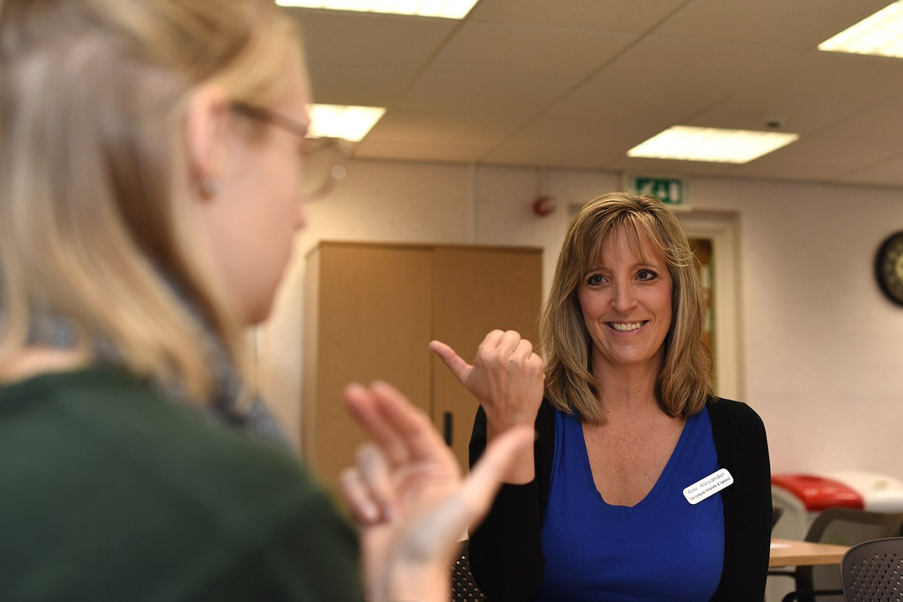
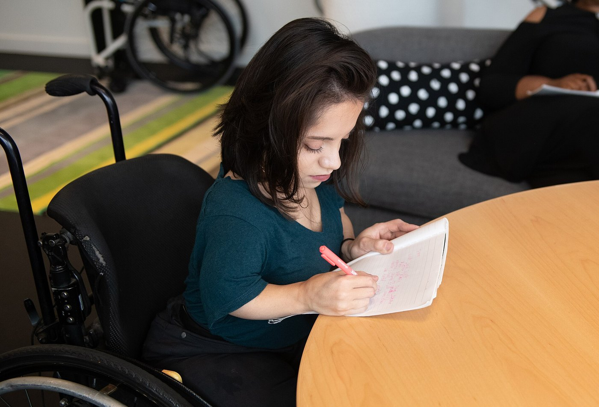

```{python}
#| include: false
import matplotlib.pyplot as plt
import numpy as np
from matplotlib.patches import FancyBboxPatch, FancyArrowPatch, Rectangle

TEAL, RED, SLATE, INK = "#0e7c86", "#c0392b", "#334155", "#0f172a"
TEAL_T, RED_T, GREY_T = "#e6f1f2", "#fad7d2", "#eef2f6"

def box(ax, x, y, w, h, fc, ec, lw=1.6):
    ax.add_patch(FancyBboxPatch((x, y), w, h, boxstyle="round,pad=0.02,rounding_size=0.15",
                                fc=fc, ec=ec, lw=lw))

def arrow(ax, a, b, color="#6b7280", rad=0.0, lw=1.8):
    ax.add_patch(FancyArrowPatch(a, b, arrowstyle="-|>", mutation_scale=16, color=color,
                                 lw=lw, connectionstyle=f"arc3,rad={rad}"))
```

# A Prediction You're About to Get Wrong {.section-divider}

## A Case to Sit With

::: {.thought-question}
**You are the nurse admitting Daniel, 34**, paralyzed from the chest down since a diving accident four years ago. The intake form asks for your impression of his *quality of life, 0–10*, before you've really talked to him.

Picture his life. Then write a number.

1. What number did you put, and what was it based on?
2. Daniel fills out the *same* scale an hour later. Will his number be higher than yours, lower, or the same? If his is much higher, which of you is wrong?
:::

## What Clinicians Guess, What Patients Say

:::: {.columns}
::: {.column width="46%"}
Most clinicians put a low number. Most patients like Daniel put a high one, and the gap is large and well documented [@gerhart1994].

The gap shows our **predictions** are off. It does *not* settle whether disability is bad in itself, or simply a different way of having a body.
:::
::: {.column width="54%"}
```{python}
#| echo: false
#| fig-align: center
#| fig-cap: "Emergency providers imagining life after a severe spinal cord injury, vs. what 128 survivors had reported (Gerhart et al. 1994)."
#| fig-alt: "Bar chart. Glad to be alive: 18 percent of providers imagining it, 92 percent of survivors living it. Average or better quality of life: 17 percent of providers, 86 percent of survivors."
groups = ["Glad to be alive", "Average or better\nquality of life"]
providers = [18, 17]
survivors = [92, 86]
x = np.arange(len(groups))

fig, ax = plt.subplots(figsize=(4.8, 3.5))
b1 = ax.bar(x - 0.2, providers, 0.38, color="#94a3b8", label="Providers imagining it")
b2 = ax.bar(x + 0.2, survivors, 0.38, color="#0e7c86", label="Survivors living it")
for bars in (b1, b2):
    for b in bars:
        ax.text(b.get_x() + b.get_width() / 2, b.get_height() + 2, f"{b.get_height():.0f}%",
                ha="center", fontsize=11.5, fontweight="bold", color="#0f172a")
ax.set_xticks(x, groups, fontsize=10.5)
ax.set_ylim(0, 108)
ax.set_yticks([])
ax.spines[["top", "right", "left"]].set_visible(False)
ax.legend(frameon=False, fontsize=9.5, loc="upper center", ncol=2, bbox_to_anchor=(0.5, 1.12))
fig.tight_layout()
plt.show()
```
:::
::::

::: {.content-hidden when-format="revealjs"}
Those are two different claims, and they are easy to confuse: that our predictions about disabled lives are wrong, and that disability is not bad in itself.
:::

## Today

One question runs through Part B: **is disability bad in itself, or only bad because of how the world is arranged?**

::: {.learning-outcomes}
By the end of Part B, you will be able to:

- Distinguish the **medical**, **social**, and **interactional** models of disability, and explain the **disability paradox**.
- Lay out the **mere-difference** vs. **bad-difference** dispute, and apply it to selective abortion and to choosing a Deaf child.
- Evaluate the case for amputating a healthy limb on request, and test its analogy to gender dysphoria.
:::

# Three Ways to See a Disability {.section-divider}

## The Same Person, Three Lenses

First, a prior question: **where does the problem live?**

| Model | Where the problem lives | The fix it points to | Its blind spot |
|---|---|---|---|
| [Medical]{.key-term} | in the body: a deficit to diagnose | cure or correct the person | the building and the bus never come up for review |
| [Social]{.key-term} | in the environment: barriers and design | change the world, not the body | some burdens (pain, fatigue) no ramp can fix |
| [Interactional]{.key-term} | in the *meeting* of body and world | both, weighed case by case | demands judgment; there is no formula |

The medical model is the frame of the chart and the care plan. The others ask what it leaves out.

::: {.content-hidden when-format="revealjs"}
All three answers have shaped law, medicine, and activism.
:::

## Same Body, Two Buildings

:::: {.columns}
::: {.column width="56%"}
The social model, forged by disabled activists in the 1970s, splits **impairment** (a feature of your body) from **disability** (what a society does with that feature).

```{dot}
//| fig-width: 5.4
//| fig-height: 2.0
digraph G {
  rankdir=LR;
  graph [bgcolor="transparent", nodesep=0.25, ranksep=0.35];
  node [shape=box, style="rounded,filled", fontname="Helvetica", fontsize=14, fillcolor="#e6f1f2", color="#0e7c86"];
  edge [arrowhead=vee, color="#6b7280"];
  body [label="Uses a\nwheelchair"];
  stairs [label="Only\nstairs"];
  ramp [label="A ramp"];
  out1 [label="Can't get in:\ndisabled", fillcolor="#fad7d2", color="#c0392b"];
  out2 [label="Walks in:\nnot disabled", fillcolor="#dcefdc", color="#2e7d32"];
  body -> stairs -> out1;
  body -> ramp -> out2;
}
```

The wheelchair didn't change between the two rows. The **building** did.
:::
::: {.column width="44%"}
{width="100%" fig-alt="A sidewalk ramp sloping down to a curb cut with tactile paving at a street crossing"}

::: {.attribution}
Curb cuts, won by wheelchair users, now serve strollers, suitcases, and bad knees. Ezekielf, via Wikimedia Commons. CC0 1.0.
:::
:::
::::

## Shakespeare's "Both" Position

Tom Shakespeare says, from inside the disability movement, that the pure social model overreaches [@shakespeare2006]. Build every ramp in the world, and a degenerative condition still brings pain and fatigue.

- His **interactional model**: disability is real, and it is **relational**, produced where a particular body meets a particular world.
- Some of the burden is social and removable (the stairs). Some is intrinsic and stays (the pain).
- The honest question is **how much of this burden is which**, and the answer changes case by case.

# The Disability Paradox {.section-divider}

## What Patients Report

In 1999, Gary Albrecht and Patrick Devlieger interviewed 153 people with disabilities. Outsiders, including health professionals, predicted the opposite of what they heard [@albrecht1999].

:::: {.columns}
::: {.column width="40%"}
```{python}
#| echo: false
#| fig-align: center
#| fig-alt: "A grid of 100 squares with 54 filled in: 54 percent of people with moderate to serious disabilities reported good or excellent quality of life."
fig, ax = plt.subplots(figsize=(4.2, 3.9))
for k in range(100):
    r, c = divmod(k, 10)
    ax.add_patch(Rectangle((c, 9 - r), 0.86, 0.86, color=TEAL if k < 54 else "#cbd5e1"))
ax.text(0, -0.9, "54% reported good or excellent", fontsize=13, color=TEAL, fontweight="bold")
ax.text(0, -2.0, "quality of life", fontsize=13, color=TEAL, fontweight="bold")
ax.text(0, 10.5, "People with moderate to serious disabilities", fontsize=11, color=INK)
ax.set_xlim(0, 10); ax.set_ylim(-2.6, 11.2)
ax.set_aspect("equal"); ax.axis("off")
fig.tight_layout()
plt.show()
```
:::
::: {.column width="60%"}
- It is a "paradox" only from the *outside*, where people imagine the disability but not the life around it.
- Explanations: **adaptation** (people adjust), **response shift** (what counts as a good day rescales), and the relationships, work, and meaning a diagnosis never mentions.
- At the bedside, it is a **patient-safety issue**: a low prediction can steer counseling and even resuscitation decisions.
:::
::::

## What the Paradox Does and Doesn't Show

:::: {.columns}
::: {.column width="48%"}
**What it shows**

Your quality-of-life predictions about disabled patients are **systematically miscalibrated**. Ask; don't assume.
:::
::: {.column width="4%"}
:::
::: {.column width="48%"}
**What it doesn't show**

That disability is *no loss at all*. Critics argue adaptation can mask real deprivation: a person can rescale "a good day" and report contentment while still being worse off on things that matter.
:::
::::

So the paradox unsettles the bedside, but it does not settle the philosophy.

# Is Disability Bad in Itself? {.section-divider}

## Mere Difference or Bad Difference?

**Is disability bad in itself, or only bad because of how the world is arranged?**

:::: {.columns}
::: {.column width="48%"}
::: {.context-box}
[Mere difference]{.key-term}

**Elizabeth Barnes**: disability is a difference, like being gay or left-handed, not in itself a harm [@barnes2016]. Its burdens are largely social, and it can carry goods: community, perspective, skills.
:::
:::
::: {.column width="4%"}
:::
::: {.column width="48%"}
::: {.context-box}
[Bad difference]{.key-term}

**Greg Bognar** and others: disability is, on balance, a real bad that we have reason to prevent, even in a perfectly just society [@bognar2016]. A just world removes the *stairs*, not the *condition*.
:::
:::
::::

Both sides accept the paradox data. They disagree about what it shows.

::: {.content-hidden when-format="revealjs"}
We'll track the two views across three hard cases: selective abortion after prenatal testing, choosing a Deaf embryo, and amputating a healthy limb on request. The aim is to record what each view **would say**, not which view wins, so you can see what holding a view consistently costs you.
:::

## The Expressivist Objection

Prenatal screening lets parents test for conditions like Down syndrome and end the pregnancy. **Adrienne Asch**, a bioethicist who was herself blind, pressed the [expressivist objection]{.key-term}: selecting against a trait *says something* about people who live with it [@asch1999].

:::: {.columns}
::: {.column width="48%"}
::: {.context-box}
**What she did not argue**

For banning abortion, or against reproductive choice. Her target was the **framing**: testing offered as routine, with disability described only as a list of deficits.
:::
:::
::: {.column width="4%"}
:::
::: {.column width="48%"}
::: {.context-box}
**What she demanded**

An honest picture of the *life*, not just the diagnosis: what a day with Down syndrome is actually like, from people who live it.
:::
:::
::::

## The Objection in Standard Form

:::: {.columns}
::: {.column width="60%"}
::: {.objection}
::: {.arg-name}
The Expressivist Objection
:::
::: {.arg-source}
After Adrienne Asch, "Prenatal Diagnosis and Selective Abortion" (1999)
:::

1. Selecting against a trait, *because of that trait*, acts on the judgment that it makes a life go worse.
2. Doing that publicly, through medicine, sends a message about everyone who already lives with the trait.
3. Disability does not make a life go worse in the way that message assumes.
4. So routine selective abortion for disability sends a false and harmful message about disabled people.
:::
:::
::: {.column width="40%"}
**The replies**

- Declining *this* pregnancy need not be a verdict on *existing people*.
- It is the surrounding attitudes, not the bare choice, that carry a message.

Everything rides on **premise 3**. If disability *is* a bad difference, the "message" may be true rather than a slander.
:::
::::

## Thought Question

:::: {.columns}
::: {.column width="64%"}
::: {.thought-question}
A Deaf couple comes to your fertility clinic. Both are fluent in ASL and deeply embedded in the Deaf community. They ask to select an embryo that will be Deaf, as another couple might hope for a child who shares their language. You are on the clinic's ethics committee.

1. Is there something about you or your family (a language, a faith, a culture, a trait) that outsiders might count as a disadvantage, but that you would want your child to share?
2. The committee has to vote. Do you allow it? Is selecting *for* Deafness morally different from selecting *against* it?
:::
:::
::: {.column width="36%"}
{width="100%" fig-alt="A smiling sign-language interpreter signs in American Sign Language to a learner seen from behind."}

::: {.attribution}
An ASL interpreter teaches the basics, RAF Mildenhall, 2018. U.S. Air Force photo by Brandon Esau. Public domain.
:::
:::
::::

## Choosing a Deaf Child

Some Deaf couples have sought to do exactly this. Savulescu's [procreative beneficence]{.key-term} says no [@savulescu2001_procreative].

:::: {.columns}
::: {.column width="52%"}
::: {.argument}
::: {.arg-name}
Against Selecting for Deafness
:::
::: {.arg-source}
After Julian Savulescu, "Procreative Beneficence" (2001)
:::

1. Choosing among possible children, parents have reason to pick the one expected to have the best life.
2. Other things equal, a hearing child has access to goods (spoken language, more careers) that a Deaf child lacks.
3. So, other things equal, parents have reason **not** to select for Deafness.
:::
:::
::: {.column width="35%"}
::: {.callout-note}
**The mere-difference reply** attacks premise 2. Deafness opens a language and a community as much as it closes options. The lives aren't ranked, just *different*.
:::
:::
::: {.column width="13%"}
{width="100%" style="transform: scaleX(-1);" fig-alt="A Deaf woman in a denim jacket, signing"}
:::
::::

## Two Kinds of Reasons

:::: {.columns}
::: {.column width="48%"}
::: {.context-box}
**A welfarist asks**

Does the child's life go well *for the child*?
:::
:::
::: {.column width="4%"}
:::
::: {.column width="48%"}
::: {.context-box}
**A perfectionist asks**

Is a capacity (hearing) worth having in itself, however content its absence leaves you?
:::
:::
::::

Most "select out but not in" policies rely on a perfectionist premise (hearing is better, full stop) while presenting themselves as neutral. That doesn't make the policy wrong. It locates its real commitment.

# A Healthy Limb, and a Patient Who Wants It Gone {.section-divider}

## Body Integrity Dysphoria

Some people feel a persistent, distressing sense that a healthy limb is *not theirs* and should be removed: [body integrity dysphoria]{.key-term}.

```{python}
#| echo: false
#| fig-align: center
#| fig-alt: "A sequence of four steps. Late 1990s, Falkirk, Scotland: surgeon Robert Smith amputates the healthy legs of two patients. The cases become public and the hospital stops the practice. 2005: Michael First's study finds the desire stable, specific and long-standing. ICD-11: the WHO classifies body integrity dysphoria."
fig, ax = plt.subplots(figsize=(9.6, 2.4))
steps = [("Late 1990s, Falkirk", "Surgeon Robert Smith\namputates the healthy\nlegs of two patients"),
         ("The cases go public", "The hospital\nstops the practice"),
         ("2005", "Michael First's study:\nthe desire is stable,\nspecific, long-standing"),
         ("ICD-11", "The WHO classifies\nbody integrity\ndysphoria")]
for i, (head, body) in enumerate(steps):
    x = 0.1 + i * 3.0
    box(ax, x, 0.15, 2.6, 2.5, TEAL_T, TEAL)
    ax.text(x + 1.3, 2.25, head, ha="center", va="center", fontsize=12.5, fontweight="bold", color=INK)
    ax.text(x + 1.3, 1.1, body, ha="center", va="center", fontsize=11.5, color=INK)
    if i < 3:
        arrow(ax, (x + 2.65, 1.4), (x + 3.0, 1.4))
ax.set_xlim(0, 11.8); ax.set_ylim(0, 2.8); ax.axis("off")
fig.tight_layout()
plt.show()
```

::: {.content-hidden when-format="revealjs"}
Both patients had sought the operation for years, and both reported relief afterward. First found the desire was not a delusion or a passing wish [@first2005]. The request pushes respect for autonomy to its edge.
:::

When a competent adult calmly and persistently asks to remove a healthy part of their own body, what does respect for autonomy require?

## What Autonomy Might Require

::: {.argument}
::: {.arg-name}
The Autonomy Argument for Amputation
:::
::: {.arg-source}
After Tim Bayne and Neil Levy, "Amputees by Choice" (2005)
:::

1. A competent adult's settled, informed request about their own body should normally be honored, even when others find it strange.
2. The desire in body integrity dysphoria is competent, settled, and informed: stable for decades, not a delusion.
3. Surgery reliably relieves the distress, and no other treatment reliably does.
4. So refusing the amputation, not performing it, is what fails to respect the patient.
:::

**Pushback:** premise 1 (removing healthy tissue may exceed a doctor's role) and premise 3 ("nothing else works" is far from settled).

## Two Colleagues, One Analogy

::::: {.dialogue}
:::: {.speaker}
{fig-alt="A man in his fifties in a cardigan, holding a folder"}

[Colleague]{.who}
::::
:::: {.bubbles}
::: {.bubble .left}
Body integrity dysphoria and gender dysphoria have the same shape: distress at a bodily feature, a request to alter the body, relief when we do.
:::
::: {.bubble .left}
If we accommodate one, consistency demands we treat them alike.
:::
::: {.bubble .right}
Same shape, different substance. The analogy is a rhetorical trap.
:::
::::
:::: {.speaker .flip}
{fig-alt="A woman in her sixties with silver hair and a green blazer, hands clasped"}

[Colleague]{.who}
::::
:::::

## Thought Question

::: {.thought-question}
You sit on the hospital ethics board with them.

1. Think of a time someone told you "that's just like…" about two things you felt were different. What made the comparison fair, or unfair?
2. Which colleague do you side with? What is the best point the other one has?
:::

## Same Structure, Same Evidence?

```{python}
#| echo: false
#| fig-align: center
#| fig-alt: "Two layers. Structure, which the two conditions share: distress at a bodily feature, a request to alter the body, relief afterward. Evidence, which has to be asked of each condition separately: how large the outcome studies are, how reversible the intervention is, and how the diagnosis behaves over time. The cells for body integrity dysphoria and for gender dysphoria are left as open questions."
fig, ax = plt.subplots(figsize=(9.6, 3.3))
ax.text(0.1, 5.75, "Structure: shared", fontsize=13.5, fontweight="bold", color=INK, va="center")
for i, t in enumerate(["Distress at a\nbodily feature", "A request to\nalter the body", "Relief\nafterward"]):
    x = 3.3 + i * 2.95
    box(ax, x, 4.55, 2.6, 1.0, GREY_T, "#94a3b8")
    ax.text(x + 1.3, 5.05, t, ha="center", va="center", fontsize=11.5, color=INK)
    if i < 2:
        arrow(ax, (x + 2.65, 5.05), (x + 2.95, 5.05))
ax.plot([0.1, 11.9], [4.15, 4.15], color="#94a3b8", lw=1.2, ls="--")
ax.text(0.1, 3.55, "Evidence: ask of\neach one separately", fontsize=13.5, fontweight="bold", color=INK, va="center")
for i, t in enumerate(["How large are the\noutcome studies?", "How reversible is\nthe intervention?", "How does the diagnosis\nbehave over time?"]):
    x = 3.3 + i * 2.95
    ax.text(x + 1.3, 3.55, t, ha="center", va="center", fontsize=11.5, color=INK)
for j, name in enumerate(["Body integrity dysphoria", "Gender dysphoria"]):
    y = 1.75 - j * 1.25
    ax.text(0.1, y + 0.5, name, fontsize=12, color=INK, va="center")
    for i in range(3):
        x = 3.3 + i * 2.95
        box(ax, x, y, 2.6, 1.0, TEAL_T, TEAL)
        ax.text(x + 1.3, y + 0.5, "?", ha="center", va="center", fontsize=16, fontweight="bold", color=TEAL)
ax.set_xlim(0, 12); ax.set_ylim(0.3, 6.1); ax.axis("off")
fig.tight_layout()
plt.show()
```

An argument that rides the shared structure all the way to "treat them identically" has skipped the evidential question. The analogy **holds at the level of form and may break at the level of evidence.**

# Bringing It to the Bedside {.section-divider}

## The Paradox Has a Name in the Chart

[Diagnostic overshadowing]{.key-term}: blaming a patient's new symptoms on their *existing* disability instead of investigating them as you would in anyone else.

```{python}
#| echo: false
#| fig-align: center
#| fig-alt: "The same new symptom, chest pain, in two patients. In a patient without a disability, it is investigated. In a patient with cerebral palsy, it is filed under his baseline."
fig, ax = plt.subplots(figsize=(9.6, 2.5))
box(ax, 0.1, 1.05, 2.6, 1.3, GREY_T, "#94a3b8")
ax.text(1.4, 1.7, "New symptom:\nchest pain", ha="center", va="center", fontsize=12.5, fontweight="bold", color=INK)
rows = [(2.05, "A patient without a disability", "Investigated", TEAL_T, TEAL),
        (0.15, "A patient with cerebral palsy", "Filed under “his baseline”", RED_T, RED)]
for y, who, what, fc, ec in rows:
    box(ax, 3.7, y, 3.9, 1.2, "white", "#94a3b8")
    ax.text(5.65, y + 0.6, who, ha="center", va="center", fontsize=12, color=INK)
    box(ax, 8.5, y, 3.4, 1.2, fc, ec)
    ax.text(10.2, y + 0.6, what, ha="center", va="center", fontsize=12.5, fontweight="bold", color=INK)
    arrow(ax, (2.75, 1.7), (3.65, y + 0.6))
    arrow(ax, (7.65, y + 0.6), (8.45, y + 0.6), color=ec)
ax.set_xlim(0, 12); ax.set_ylim(0, 3.4); ax.axis("off")
fig.tight_layout()
plt.show()
```

The countermeasure is a habit: **ask whether you'd order this workup for a patient without the disability**, and if so, order it.

::: {.content-hidden when-format="revealjs"}
This is the miscalibration from earlier, under its clinical name. Another example: a patient with an intellectual disability grows withdrawn, and no one checks for depression or pain.
:::

## The Access Gap Is Measurable

:::: {.columns}
::: {.column width="46%"}
Disabled patients get worse care, and not mainly because of their bodies.

- Exam tables that don't lower and scales that can't weigh a wheelchair user mean basics like cancer screening happen *less* often.
- In a 2021 national survey, most physicians believed disabled people have a worse quality of life, and fewer than half felt very confident they could give them equal care [@iezzoni2021].
:::
::: {.column width="54%"}
```{python}
#| echo: false
#| fig-align: center
#| fig-cap: "Survey of 714 U.S. physicians, 2019–20 (Iezzoni et al. 2021)."
#| fig-alt: "Bar chart of 714 U.S. physicians. 82 percent think disabled people have a worse quality of life. 57 percent strongly agree they welcome disabled patients. 41 percent are very confident they can give disabled patients equal care."
labels = ["Think disabled people have\na worse quality of life",
          "Strongly agree they welcome\ndisabled patients",
          "Very confident they can give\ndisabled patients equal care"]
vals = [82.4, 56.5, 40.7]

fig, ax = plt.subplots(figsize=(5.2, 3.2))
bars = ax.barh(labels[::-1], vals[::-1], color=["#0e7c86", "#94a3b8", "#c0392b"][::-1], height=0.55)
for b, v in zip(bars, vals[::-1]):
    ax.text(v + 1.5, b.get_y() + b.get_height() / 2, f"{v:.0f}%", va="center",
            fontsize=12, fontweight="bold", color="#0f172a")
ax.set_xlim(0, 100)
ax.set_xticks([])
ax.tick_params(axis="y", labelsize=10)
ax.spines[["top", "right", "bottom"]].set_visible(False)
fig.tight_layout()
plt.show()
```
:::
::::

## How You Talk Is Part of the Care

:::: {.columns}
::: {.column width="58%"}
**Person-first or identity-first?** "Person with a disability" puts the person first. "Disabled person" (and capital-D **Deaf**, **Autistic**) is claimed with pride by many. There's no single correct form: **ask, and use what the patient uses.**

**"Nothing about us without us."** At the bedside: speak *to* the patient, not the companion pushing the chair. Presume capacity. Ask what help they want before you give it.
:::
::: {.column width="42%"}
{width="100%" fig-alt="A young woman seated in her wheelchair takes handwritten notes at a table during a meeting."}

::: {.attribution}
Chona Kasinger for Disabled And Here. CC BY 4.0.
:::
:::
::::

## The Commitments Map

What each view **would say** about the three hard cases, not which view wins.

| Case | Mere difference would say… | Bad difference would say… |
|---|---|---|
| Selective abortion | screening framed as tragedy rests on a false premise | a real loss may be prevented, but the *message* still warrants care |
| Choosing a Deaf embryo | selecting *for* Deafness is coherent, like any valued trait | choosing a worse-off life for a child who can't consent |
| Amputating a healthy limb | a settled identity claim deserving accommodation | distress to be treated, not a difference to affirm |

Read **down** a column: can either view hold up across all three cases? Read **across** a row: how much was fixed by a premise chosen early? The map decides nothing; it shows where the decision lives.

## Wrap-Up

::: {.recap}
*Is disability bad in itself, or only bad because of how the world is arranged?* We began with a gap: clinicians predict low quality of life for disabled patients, and patients report high. That **disability paradox** unsettles the bedside but leaves the question open. We tracked *mere difference* and *bad difference* across selective abortion, Deaf embryo selection, and body integrity dysphoria, and tested the analogy to gender dysphoria by mapping it rather than asserting it. The disagreements are about premises and evidence, not about who cares more.
:::

## Review Questions

::: {.review-questions}

::: {.review-item .review-recall}
[Recall]{.review-label}

State the medical, social, and interactional models of disability in one sentence each, and say where each locates "the problem."
:::

::: {.review-item .review-apply}
[Apply]{.review-label}

A hospital is designing a survey that asks nurses to rate incoming patients' quality of life. Using the disability paradox, name one concrete way this could harm disabled patients, and one safeguard you'd build in.
:::

::: {.review-item .review-debate}
[Debate]{.review-label}

Should a competent adult with body integrity dysphoria ever be able to obtain surgery to remove a healthy limb? Defend your answer using the autonomy argument and at least one objection to it.
:::

:::

## Key Terms {.dense}

:::: {.columns}
::: {.column width="48%"}
- **Medical / social / interactional model** — disability located in the body / in the environment / where the two meet.
- **Impairment vs. disability** — a bodily feature vs. what a society does to people who have it.
- **Disability paradox** — disabled people report far higher quality of life than outsiders, including clinicians, predict.
- **Mere vs. bad difference** — not in itself a harm (Barnes) vs. a genuine bad worth preventing (Bognar).
- **Expressivist objection** — selecting against a disability sends a message about people who have it (Asch).
:::
::: {.column width="4%"}
:::
::: {.column width="48%"}
- **Procreative beneficence** — parents should choose the possible child expected to have the best life (Savulescu).
- **Welfarist vs. perfectionist** — good *for the person* vs. worth having in itself.
- **Body integrity dysphoria** — persistent distress that a healthy limb is not one's own (ICD-11).
- **Diagnostic overshadowing** — blaming a disabled patient's new symptoms on their existing disability.
:::
::::

## Further Reading

- Barnes, Elizabeth. *The Minority Body: A Theory of Disability*. Oxford University Press, 2016.
- Shakespeare, Tom. *Disability Rights and Wrongs Revisited*. Routledge, 2014.
- Johnson, Harriet McBryde. "Unspeakable Conversations." *The New York Times Magazine*, 2003. (The disability-rights case against Peter Singer, by a lawyer who met him.)

## References

::: {#refs}
:::
