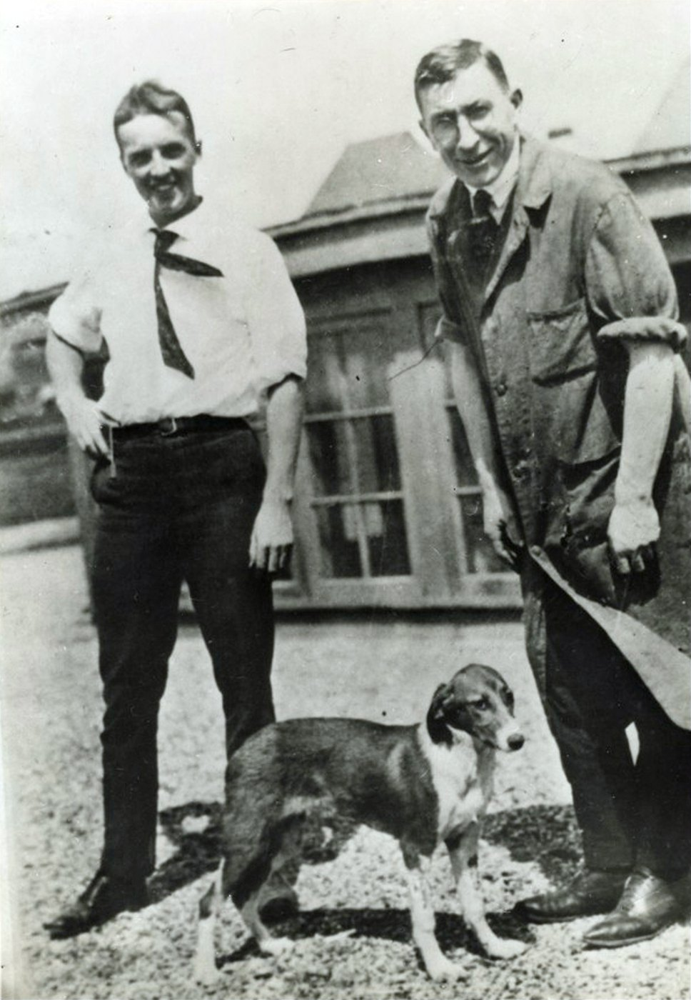
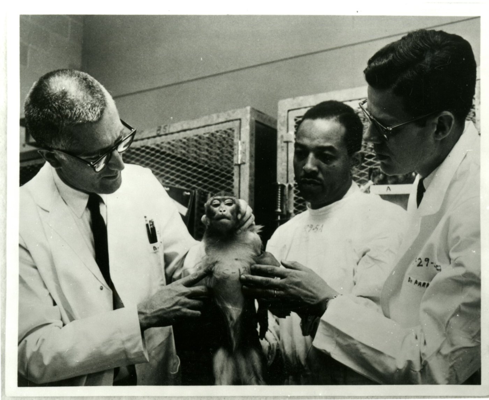
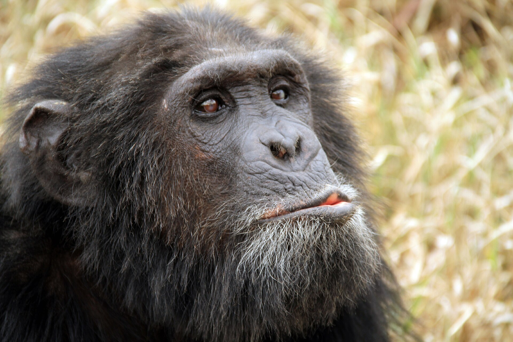

```{python}
#| include: false
import matplotlib.pyplot as plt
import numpy as np
from matplotlib.patches import FancyBboxPatch, FancyArrowPatch, Rectangle, Circle

TEAL, RED, SLATE, INK = "#0e7c86", "#c0392b", "#334155", "#0f172a"
TEAL_T, RED_T, GREY_T = "#e6f1f2", "#fad7d2", "#eef2f6"

def box(ax, x, y, w, h, fc, ec, lw=1.6):
    ax.add_patch(FancyBboxPatch((x, y), w, h, boxstyle="round,pad=0.02,rounding_size=0.15",
                                fc=fc, ec=ec, lw=lw))

def arrow(ax, a, b, color="#6b7280", rad=0.0, lw=1.8):
    ax.add_patch(FancyArrowPatch(a, b, arrowstyle="-|>", mutation_scale=16, color=color,
                                 lw=lw, connectionstyle=f"arc3,rad={rad}"))
```

# Every Drug You'll Ever Give {.section-divider}

## A Case to Sit With

::: {.thought-question}
**You just joined your hospital's animal-research committee.** The first protocol tests a new painkiller: first in mice, then in a small group of monkeys, who will be euthanized so their nerve tissue can be studied. If it passes, you will give this drug to your patients.

1. How do you vote tonight: yes, no, or not yet? What is the one thing that would flip your vote?
2. Does it matter that the animals are *monkeys* rather than *mice*? Think of an animal you have known well: a pet, a farm animal, a working animal. Does knowing it change your vote? Should it?
:::

## Today

We use a medicine without a second thought, yet hesitate to *approve* the research behind it. Two duties pull apart: one to the patients who need the drug, one to the animals who pay for it. So Part A asks: **which animals matter, how much, and what does that permit?**

::: {.content-hidden when-format="revealjs"}
That hesitation is not hypocrisy. This lecture gives you tools to hold both duties at once, instead of choosing a slogan and defending it.
:::

::: {.learning-outcomes}
By the end of Part A, you will be able to:

- Define **moral status** and **speciesism**, and explain the argument from **marginal cases**.
- Compare what **Kant**, **Korsgaard**, **Singer**, **Regan**, and **Cohen** say we owe animals.
- Explain the **3 Rs**, the **translation gap**, and how an **IACUC** reviews research, using **primates** as the hard case.
:::

# Who Counts, and How Much? {.section-divider}

## What "Moral Status" Means

:::: {.columns}
::: {.column width="50%"}
- A being has [moral status]{.key-term} when it matters *for its own sake*: we owe duties **to it**, not just duties about it.
- A rock has none. A person has full moral status.
- The debate is over **what earns status**: being alive, being [sentient]{.key-term} (able to feel pain and pleasure), or being rational or self-aware.
:::
::: {.column width="50%"}
```{python}
#| echo: false
#| fig-align: center
#| fig-cap: "An illustration, not data."
#| fig-alt: "A grid of three criteria against five beings. Alive: a tree, a mouse, a newborn and an adult human count; a rock does not. Sentient: the mouse, the newborn and the adult human count. Rational and self-aware: only the adult human counts."
fig, ax = plt.subplots(figsize=(4.9, 3.3))
cols = ["Rock", "Tree", "Mouse", "Newborn", "Adult\nhuman"]
rows = [("Alive", [0, 1, 1, 1, 1]), ("Sentient", [0, 0, 1, 1, 1]), ("Rational,\nself-aware", [0, 0, 0, 0, 1])]
for j, c in enumerate(cols):
    ax.text(3.0 + j * 1.45, 3.75, c, ha="center", va="center", fontsize=11.5, color=INK)
for i, (name, vals) in enumerate(rows):
    y = 2.7 - i * 1.05
    ax.text(0.05, y, name, ha="left", va="center", fontsize=12.5, color=INK, fontweight="bold")
    for j, v in enumerate(vals):
        ax.add_patch(Circle((3.0 + j * 1.45, y), 0.33, fc=TEAL if v else "white",
                            ec=TEAL if v else "#94a3b8", lw=1.6))
ax.text(0.05, -0.15, "Filled: counts under that criterion", fontsize=11, color=SLATE, va="center")
ax.set_xlim(0, 9.6); ax.set_ylim(-0.5, 4.3); ax.set_aspect("equal"); ax.axis("off")
fig.tight_layout()
plt.show()
```
:::
::::

Pick a criterion and you have, without noticing, sorted every living thing into "counts" and "doesn't."

## Speciesism: the Word and the Charge

In 1970 the psychologist Richard Ryder coined [speciesism]{.key-term}; Peter Singer made it famous [@singer1975].

:::: {.columns}
::: {.column width="48%"}
::: {.context-box}
**The charge**

Giving less weight to a being's interests *just because* of its species is like racism or sexism: a bias for "our own kind" dressed up as a principle. A pig's pain is as real as a person's.
:::
:::
::: {.column width="4%"}
:::
::: {.column width="48%"}
::: {.context-box}
**The reply**

Species membership *does* track real differences: rationality, moral agency, belonging to a moral community.
:::
:::
::::

::: {.content-hidden when-format="revealjs"}
Whether that reply works is what the rest of this section argues about.
:::

## The Argument from Marginal Cases

The hardest problem for any view that draws the line at **rationality**.

```{python}
#| echo: false
#| fig-align: center
#| fig-alt: "A flow of the argument. Suppose moral status requires reason, language, or planning. Many adult animals lack these, so they don't fully count. But some humans lack them too: newborns, people with advanced dementia or severe cognitive disability, and we rightly give them full moral status. So either the criterion is wrong, or something makes the human cases different, and it can't be just because they're human."
fig, ax = plt.subplots(figsize=(9.6, 3.1))
box(ax, 1.9, 5.9, 8.2, 1.0, TEAL_T, TEAL)
ax.text(6, 6.4, "Suppose moral status requires reason, language, or planning",
        ha="center", va="center", fontsize=12.5, fontweight="bold", color=INK)
box(ax, 0.2, 3.3, 5.4, 1.7, GREY_T, "#94a3b8")
ax.text(2.9, 4.15, "Many adult animals lack these,\nso they don't fully count.",
        ha="center", va="center", fontsize=12, color=INK)
box(ax, 6.4, 3.3, 5.4, 1.7, GREY_T, "#94a3b8")
ax.text(9.1, 4.15, "Some humans lack them too: newborns, people with\nadvanced dementia or severe cognitive disability.\nWe rightly give them full moral status.",
        ha="center", va="center", fontsize=10.5, color=INK)
arrow(ax, (4.6, 5.85), (2.9, 5.1)); arrow(ax, (7.4, 5.85), (9.1, 5.1))
ax.text(6, 2.55, "So either…", ha="center", va="center", fontsize=13, fontweight="bold", color=RED)
box(ax, 0.2, 0.2, 5.4, 1.7, RED_T, RED)
ax.text(2.9, 1.05, "the criterion is wrong,", ha="center", va="center", fontsize=12.5, color=INK, fontweight="bold")
box(ax, 6.4, 0.2, 5.4, 1.7, RED_T, RED)
ax.text(9.1, 1.05, "or something makes the human cases\ndifferent, and it can't be just\n“because they're human.”",
        ha="center", va="center", fontsize=10.5, color=INK, fontweight="bold")
arrow(ax, (5.2, 2.5), (2.9, 2.0), color=RED); arrow(ax, (6.8, 2.5), (9.1, 2.0), color=RED)
ax.set_xlim(0, 12); ax.set_ylim(0, 7.1); ax.axis("off")
fig.tight_layout()
plt.show()
```

This doesn't settle the debate. It forces every side to say *exactly* why its line falls where it does.

::: {.content-hidden when-format="revealjs"}
These humans are the "marginal cases." Saying they count simply "because they're human" would be speciesism.
:::

## Thought Question

::: {.thought-question}
A wildfire is closing in. One shelter holds **five dogs**; another, **one human stranger**. You have time to open only one door before the fire arrives.

1. Which door do you open? What decides it for you: species, numbers, or something else?
2. Would your answer change if the one human were someone you loved? Should it?
:::

## The Kantian Line

:::: {.columns}
::: {.column width="16%"}
{width="100%" fig-alt="Painted portrait of Immanuel Kant"}
:::
::: {.column width="41%"}
**Kant: duties *about* animals** [@kant_lectures_ethics]

- Only rational agents are "ends in themselves," so we have no direct duties **to** animals.
- But cruelty is still wrong, because it corrupts *us*. A man who shoots his loyal old dog "damages in himself" the kindness he owes other people.
:::
::: {.column width="2%"}
:::
::: {.column width="41%"}
**Korsgaard: Kant, repaired** [@korsgaard2018]

- Christine Korsgaard, a leading Kantian, argues Kant got animals **wrong**.
- We value ourselves as ends because things matter *to us*. But things matter to animals too.
- So honest Kantianism yields **direct** duties to animals, our [fellow creatures]{.key-term}.
:::
::::

::: {.content-hidden when-format="revealjs"}
Kant's view still shapes law that bans cruelty while permitting nearly any *use*.
:::

## Singer: Can They Suffer?

:::: {.columns}
::: {.column width="58%"}
::: {.argument}
::: {.arg-name}
The Equal-Consideration Argument
:::
::: {.arg-source}
After Peter Singer, *Animal Liberation* (1975)
:::

1. If a being can suffer, it has an interest in not suffering.
2. Equal interests deserve equal moral weight, whoever has them.
3. Many animals can suffer as humans can.
4. So their suffering counts equally, and discounting it for being an animal's is speciesism.
:::
:::
::: {.column width="42%"}
**What follows** [@singer1975]

- **Factory farming** fails at once: vast suffering for the minor interest of cheaper meat.
- **Research** is harder: would you run this study on a human with similar mental capacities?
- As a utilitarian, Singer allows that a big enough benefit *could* justify a study.
:::
::::

::: {.content-hidden when-format="revealjs"}
If you would not run the study on such a human, Singer says, it needs another justification. The next thinker rejects exactly the utilitarian allowance.
:::

## Rights: Regan vs. Cohen

[Subjects-of-a-life]{.key-term} have rights, says Regan [@regan1983]. Not without a moral community, says Cohen [@cohen1986].

```{python}
#| echo: false
#| fig-align: center
#| fig-alt: "Two chains of reasoning side by side. Tom Regan: many animals have beliefs, desires, memory, and a future that matters to them; such beings have inherent value; they have a right not to be used merely as a means; so research on them is wrong, even when it helps many. Carl Cohen: rights arise among beings who can make moral claims on each other; animals can't recognize duties, so they hold no rights; favoring our own species is like favoring our own children; so humane, regulated research is a moral good."
fig, ax = plt.subplots(figsize=(9.6, 2.8))
chains = [(0.2, "Tom Regan", ["Many animals have beliefs, desires,\nmemory, and a future that matters to them.",
                             "Such beings have inherent value.",
                             "They have a right not to be used\nmerely as a means."],
           "Research on them is wrong,\neven when it helps many."),
          (6.3, "Carl Cohen", ["Rights arise among beings who can\nmake moral claims on each other.",
                              "Animals can't recognize duties,\nso they hold no rights.",
                              "Favoring our own species is like\nfavoring our own children."],
           "Humane, regulated research\nis a moral good.")]
for x, name, steps, verdict in chains:
    ax.text(x + 2.75, 7.75, name, ha="center", va="center", fontsize=14, fontweight="bold", color=TEAL)
    for i, t in enumerate(steps):
        y = 5.75 - i * 1.75
        box(ax, x, y, 5.5, 1.3, TEAL_T, TEAL)
        ax.text(x + 2.75, y + 0.65, t, ha="center", va="center", fontsize=10.5, color=INK)
        arrow(ax, (x + 2.75, y - 0.03), (x + 2.75, y - 0.42))
    box(ax, x, 0.25, 5.5, 1.5, "#fce9d6", "#b07d1a", lw=2.2)
    ax.text(x + 2.75, 1.0, verdict, ha="center", va="center", fontsize=11, color=INK, fontweight="bold")
ax.set_xlim(0, 12); ax.set_ylim(0, 8.2); ax.axis("off")
fig.tight_layout()
plt.show()
```

Cohen's soft spot is the marginal cases. He answers that rights belong to humans *as a kind*. Is that a principle, or speciesism with better manners?

::: {.content-hidden when-format="revealjs"}
For Regan, rights are not for trading: no benefit to others can buy them out. For Cohen, favoring our own species is moral, not bias, and humans who can't exercise rights still hold them as members of the kind.
:::

## Four Views, Four Verdicts

| | Eating meat | Animal research | Pets | Wildlife |
|---|---|---|---|---|
| **Kant / Cohen** | permitted | permitted, even good | fine if not cruel | manage for human use |
| **Singer** | wrong (factory farms) | only if benefit clearly outweighs | fine if welfare met | reduce suffering overall |
| **Regan** | wrong | wrong, full stop | guardianship, not ownership | respect, don't exploit |
| **Korsgaard** | deeply troubling | rarely justified | a real relationship of duty | owed direct concern |

::: {.content-hidden when-format="revealjs"}
Read across a row to see a view's reach; read down a column to see how much a verdict depends on the theory behind it.
:::

## Moral Agents and Moral Patients

:::: {.columns}
::: {.column width="46%"}
```{python}
#| echo: false
#| fig-align: center
#| fig-alt: "A small circle inside a large one. The large circle is moral patients, who can be wronged, such as a newborn or a dog. The small circle inside it is moral agents, who can have duties, deserve blame, and make claims."
fig, ax = plt.subplots(figsize=(4.8, 3.9))
ax.add_patch(Circle((5, 4.4), 4.2, fc=TEAL_T, ec=TEAL, lw=2))
ax.add_patch(Circle((5, 3.4), 2.2, fc="#7fbcc2", ec=TEAL, lw=2))
ax.text(5, 7.35, "Moral patients", ha="center", va="center", fontsize=13.5, fontweight="bold", color=INK)
ax.text(5, 6.6, "can be wronged", ha="center", va="center", fontsize=12, color=INK)
ax.text(2.5, 5.6, "a newborn", ha="center", va="center", fontsize=11.5, color=SLATE, style="italic")
ax.text(7.5, 5.6, "a dog", ha="center", va="center", fontsize=11.5, color=SLATE, style="italic")
ax.text(5, 3.95, "Moral agents", ha="center", va="center", fontsize=13, fontweight="bold", color=INK)
ax.text(5, 3.0, "can have duties,\ndeserve blame,\nmake claims", ha="center", va="center", fontsize=11, color=INK)
ax.set_xlim(0.5, 9.5); ax.set_ylim(0, 8.8); ax.set_aspect("equal"); ax.axis("off")
fig.tight_layout()
plt.show()
```
:::
::: {.column width="4%"}
:::
::: {.column width="50%"}
- A **moral agent** can be held responsible: it can have duties, deserve blame, make claims.
- A **moral patient** cannot act morally but can still be *wronged*.
- Cohen ties rights to agency. Regan and Korsgaard insist patients matter regardless.

The views split over whether being a *patient* is enough to be owed direct duties.
:::
::::

## Make It Contemporary

::: {.thought-question}
The science keeps moving the line. Frans de Waal documented chimps that plan, deceive, and grieve; later work found problem-solving and apparent pain responses in **octopuses** [@dewaal2016]. In 2022 the United Kingdom's Animal Welfare (Sentience) Act recognized **octopuses, crabs, and lobsters** as sentient.

1. Have you ever changed what you eat, buy, or do because of something you learned about an animal? What did it take? If not, what would it take?
2. Should the *law* track the latest cognitive science, or stay simpler and more stable?
:::

::: {.content-hidden when-format="revealjs"}
Octopuses are invertebrates. The 2022 Act followed a government-commissioned scientific review.
:::

# From Theory to the Lab {.section-divider}

## Why Animal Research Happens

:::: {.columns}
::: {.column width="58%"}
The stakes are on your med cart.

- **Insulin** was isolated in dogs in 1921. The first patient, a dying 14-year-old, recovered within days.
- **Polio and COVID-19 vaccines** were tested in monkeys before people.
- Animal testing has long been required before most drugs reach human trials.

The question is not whether research helped us, but **what it costs, and whether each use is justified.**
:::
::: {.column width="42%"}
{width="70%" fig-alt="Black-and-white photo of Charles Best and Frederick Banting standing on a Toronto rooftop with a short-haired dog between them, 1921."}

::: {.attribution}
Charles Best and Frederick Banting with a dog from the insulin experiments, Toronto, 1921. Library and Archives Canada. Public domain.
:::
:::
::::

## Two Founding Scandals

:::: {.columns}
::: {.column width="48%"}
::: {.callout-important}
**Silver Spring, Maryland, 1981**

Alex Pacheco volunteered in Edward Taub's lab, which severed nerves in macaques' limbs to study recovery. He photographed filthy cages and untreated wounds and took them to police. The photos launched **PETA**.
:::
:::
::: {.column width="4%"}
:::
::: {.column width="48%"}
::: {.callout-important}
**Harry Harlow, 1950s–60s**

Harlow raised infant monkeys in isolation to study attachment. Many were left severely, permanently damaged. The work changed how orphanages and hospitals cared for infants. To many, it is suffering no result could justify.
:::
:::
::::

```{python}
#| echo: false
#| fig-align: center
#| fig-alt: "A timeline: Harlow's isolation studies in the 1950s and 60s; the 3 Rs proposed in 1959; Silver Spring in 1981; IACUCs required by law in 1985."
fig, ax = plt.subplots(figsize=(9.6, 1.5))
ax.plot([0.4, 11.6], [1.2, 1.2], color="#94a3b8", lw=3, solid_capstyle="round")
pts = [(1.4, "1950s–60s", "Harlow's isolation studies"), (4.4, "1959", "The 3 Rs proposed"),
       (7.6, "1981", "Silver Spring"), (10.4, "1985", "IACUCs required by law")]
for x, d, t in pts:
    ax.plot([x], [1.2], marker="o", markersize=12, color=TEAL)
    ax.text(x, 1.85, d, ha="center", va="center", fontsize=13, fontweight="bold", color=TEAL)
    ax.text(x, 0.5, t, ha="center", va="center", fontsize=11.5, color=INK)
ax.set_xlim(0, 12); ax.set_ylim(0.1, 2.2); ax.axis("off")
fig.tight_layout()
plt.show()
```

**How much harm may knowledge cost, and who decides?**

::: {.content-hidden when-format="revealjs"}
Taub was convicted on one count of denying a monkey veterinary care. In 1983 Maryland's highest court reversed: the state cruelty law, it ruled, did not reach federally regulated research. Harlow's infant monkeys, deprived of mothers, clung to cloth dummies.
:::

## The 3 Rs

In 1959, two British scientists proposed the framework that still governs humane research [@russell1959].

| R | The question it asks | A concrete move |
|---|---|---|
| **Replacement** | Could this be done without animals? | cell cultures, organoids, computer models, human volunteers |
| **Reduction** | Are we using too many? | better statistics; sharing tissue across studies |
| **Refinement** | Are we causing avoidable harm? | anesthesia, pain control, [humane endpoints]{.key-term}, enrichment |

A humane endpoint ends a study, and the animal's life, *before* suffering peaks, rather than waiting for death as the data point.

::: {.content-hidden when-format="revealjs"}
The goal of the 3 Rs is not to end research but to shrink its harm at every step.
:::

## Does the Research Even Work?

:::: {.columns}
::: {.column width="46%"}
Research is a **cost-benefit** trade. But a benefit you don't get can't justify a harm.

About **9 in 10** drugs that enter human trials, after testing largely in animals, never win approval, mostly for lack of effect or for toxicity [@sun2022].

That is the [translation gap]{.key-term}. It doesn't make research worthless; it raises the burden of proof.
:::
::: {.column width="54%"}
```{python}
#| echo: false
#| fig-align: center
#| fig-cap: "Of 100 drug candidates that enter human trials, about 10 are approved (Sun et al. 2022)."
import matplotlib.pyplot as plt
from matplotlib.patches import Rectangle

fig, ax = plt.subplots(figsize=(4.6, 4.6))
for k in range(100):
    r, c = divmod(k, 10)
    color = "#0e7c86" if k < 10 else "#cbd5e1"
    ax.add_patch(Rectangle((c, 9 - r), 0.86, 0.86, color=color))
ax.text(0, -0.9, "10 approved", fontsize=13, color="#0e7c86", fontweight="bold")
ax.text(0, -2.0, "90 fail in human trials", fontsize=13, color="#475569")
ax.set_xlim(0, 10); ax.set_ylim(-2.5, 10.1)
ax.set_aspect("equal"); ax.axis("off")
fig.tight_layout()
plt.show()
```
:::
::::

## Replacing Animals: How Far, How Fast

:::: {.columns}
::: {.column width="58%"}
- **Works now:** human cells, "organs-on-chips," and computer models handle much toxicity screening.
- **Not yet:** a whole body (an immune system, a developing brain, a years-long disease) is hard to simulate.
- **Policy is moving.** FDA aims to make animal studies "the exception rather than the norm" [@fda2025_nams]; NIH no longer funds animal-only research calls [@nih2025_nams]; the EU adopted a phase-out roadmap in 2026 [@ec2026_roadmap].

The question is now **how fast** to replace, and **who bears the risk** of moving too soon.
:::
::: {.column width="42%"}
{width="100%" fig-alt="A small transparent lung-on-a-chip device lit in blue, with clear tubing attached, on a microscope stage."}

::: {.attribution}
A lung-on-a-chip, lined with living human cells. Wyss Institute, Harvard, via NIH-NCATS. CC BY 2.0.
:::
:::
::::

## IACUC: The IRB for Animals

After Silver Spring, 1985 amendments to the **Animal Welfare Act** required every research institution to have an [IACUC]{.key-term} (Institutional Animal Care and Use Committee).

```{python}
#| echo: false
#| fig-align: center
#| fig-alt: "Two panels. Who sits on an IACUC, by law: a veterinarian, a scientist, a nonscientist, and a member from outside the institution. What every protocol must show: why this species and exactly how many, a documented search for alternatives, and a pain category for each procedure."
fig, ax = plt.subplots(figsize=(9.6, 2.1))
ax.text(0.2, 3.6, "Who sits on it, by law", fontsize=13.5, fontweight="bold", color=TEAL, va="center")
for i, t in enumerate(["Veterinarian", "Scientist", "Nonscientist", "Outside\nmember"]):
    x = 0.2 + (i % 2) * 2.75; y = 1.75 - (i // 2) * 1.45
    box(ax, x, y, 2.5, 1.15, TEAL_T, TEAL)
    ax.text(x + 1.25, y + 0.575, t, ha="center", va="center", fontsize=12, color=INK)
ax.plot([6.0, 6.0], [0.2, 3.8], color="#cbd5e1", lw=2)
ax.text(6.4, 3.6, "What every protocol must show", fontsize=13.5, fontweight="bold", color=TEAL, va="center")
for i, t in enumerate(["Why this species, and exactly how many", "A documented search for alternatives",
                       "A pain category for each procedure"]):
    y = 2.6 - i * 0.95
    ax.plot([6.55], [y], marker="s", markersize=8, color=TEAL)
    ax.text(6.9, y, t, fontsize=12, color=INK, va="center")
ax.set_xlim(0, 12); ax.set_ylim(0, 4); ax.axis("off")
fig.tight_layout()
plt.show()
```

It approves every study *before* it begins and inspects facilities twice a year. Most scrutinized: pain *left untreated* because relief would ruin the data.

::: {.content-hidden when-format="revealjs"}
The member from outside the institution is there so the committee isn't only judging itself.
:::

## IACUC vs. IRB

| | IRB (humans) | IACUC (animals) |
|---|---|---|
| Protects | the research subject | the research animal |
| Core consent question | did the subject **agree**? | (animals can't consent) |
| Substitute safeguard | informed consent, voluntariness | the **3 Rs**, veterinary oversight |
| Shared engine | weigh benefits vs. harms; independent review; no self-policing | same |

A human can refuse; an animal never can. So the weight an IRB places on *agreement* shifts, for animals, onto **someone else minimizing their harm.**

# The Hardest Case: Primates {.section-divider}

## Why Primates Are Used, and Contested

:::: {.columns}
::: {.column width="58%"}
- **Used** because they are so like us: a monkey's visual cortex maps how human vision and memory work, and macaques were central to testing **HIV** treatments and **COVID-19** vaccines.
- **Contested** for the same reason: tool use, planning, self-recognition, complex social bonds, and lives of 30+ years, often spent entirely in a lab.

On **every** criterion any theory uses (sentience, subject-of-a-life, a good of one's own), primates score high.
:::
::: {.column width="42%"}
{width="100%" fig-alt="Black-and-white 1966 photo of NIH scientists in lab coats and a technician examining a laboratory monkey in front of wire-mesh cages."}

::: {.attribution}
NIH scientists Harry Meyer Jr. and Paul Parkman and technician Rudyard Wallace examine a laboratory monkey during rubella vaccine research, 1966. NIH, via National Library of Medicine. Public domain.
:::
:::
::::

## U.S. Research Animals by Species

```{python}
#| echo: false
#| fig-align: center
#| fig-cap: "Animals used in U.S. research and covered by the Animal Welfare Act, fiscal year 2025 (USDA APHIS)."
import matplotlib.pyplot as plt

species = ["Guinea pigs", "Rabbits", "Hamsters", "Primates", "Pigs", "Dogs", "Cats", "Sheep"]
counts = [110210, 99264, 61443, 60920, 39483, 37583, 11358, 10972]
colors = ["#94a3b8"] * len(species)
colors[species.index("Primates")] = "#c0392b"

fig, ax = plt.subplots(figsize=(8.4, 3.0))
bars = ax.barh(species[::-1], [c / 1000 for c in counts[::-1]], color=colors[::-1], height=0.65)
for b, c in zip(bars, counts[::-1]):
    ax.text(b.get_width() + 1.5, b.get_y() + b.get_height() / 2, f"{c:,}",
            va="center", fontsize=10.5, color="#0f172a")
ax.set_xlim(0, 130)
ax.set_xlabel("Animals used per year (thousands)", fontsize=10.5)
ax.tick_params(axis="y", labelsize=11)
ax.spines[["top", "right"]].set_visible(False)
fig.tight_layout()
plt.show()
```

The chart hides the biggest fact: **mice and rats bred for research**, by far the most-used animals, and fish are **excluded** from the law, so no one counts them officially [@usda_aphis_2025].

## The 2015 NIH Chimpanzee Decision

:::: {.columns}
::: {.column width="58%"}
::: {.callout-important}
**The end of invasive chimp research in the U.S.**

In 2011 the **Institute of Medicine** concluded that almost all biomedical research on chimpanzees was **no longer necessary** [@iom2011_chimp]. In 2015 NIH announced it would **retire its remaining research chimpanzees** [@nih2015_chimp].
:::

Chimps had helped develop the hepatitis B vaccine. The judgment was not that they never helped, but that the benefit no longer **justified the cost**.
:::
::: {.column width="42%"}
{width="100%" fig-alt="A chimpanzee sitting in grass at the Sweetwaters Chimpanzee Sanctuary in Kenya"}

::: {.attribution}
Valentina Storti, via Wikimedia Commons. CC BY 2.0.
:::
:::
::::

::: {.content-hidden when-format="revealjs"}
The Institute of Medicine's reason was that alternatives had caught up. NIH's decision ended federal support for invasive chimp studies. Replacement succeeded.
:::

## Thought Question

::: {.thought-question}
You are back on the IACUC. A respected neuroscientist wants to implant electrodes in the brains of **four macaques** to study how memory forms. The work could, in a decade, help patients with Alzheimer's. The monkeys will live in the lab for years and be euthanized at the end.

1. How do you vote? What single fact would most change it: fewer animals? guaranteed pain control? a stronger medical payoff?
2. Cohen says approve it; Regan says never. Whose burden of proof feels heavier to *you*, and why?
:::

## Necessary or Avoidable?

:::: {.columns}
::: {.column width="46%"}
```{python}
#| echo: false
#| fig-align: center
#| fig-cap: "An illustration, not data."
#| fig-alt: "Two bars showing the harms in research, split into harms called necessary and harms that are avoidable. In the second bar, as alternatives improve, the share called necessary is smaller and the avoidable share is larger."
fig, ax = plt.subplots(figsize=(4.8, 3.5))
for x, nec, lab in [(1.0, 6.2, "Before"), (5.6, 2.6, "As alternatives\nimprove")]:
    ax.add_patch(Rectangle((x, 0), 2.6, nec, fc=RED_T, ec=RED, lw=1.6))
    ax.add_patch(Rectangle((x, nec), 2.6, 8 - nec, fc=TEAL_T, ec=TEAL, lw=1.6))
    ax.text(x + 1.3, nec / 2, "called\n“necessary”", ha="center", va="center", fontsize=11.5, color=RED, fontweight="bold")
    ax.text(x + 1.3, nec + (8 - nec) / 2, "avoidable", ha="center", va="center", fontsize=11.5, color=TEAL, fontweight="bold")
    ax.text(x + 1.3, -0.9, lab, ha="center", va="center", fontsize=11.5, color=INK)
arrow(ax, (3.8, 4.0), (5.4, 4.0), color=SLATE, lw=2.2)
ax.text(4.6, 8.7, "Harms in research", ha="center", va="center", fontsize=12.5, fontweight="bold", color=INK)
ax.set_xlim(0, 9.2); ax.set_ylim(-1.6, 9.2); ax.axis("off")
fig.tight_layout()
plt.show()
```
:::
::: {.column width="4%"}
:::
::: {.column width="50%"}
- Almost everyone agrees we may not impose *avoidable* suffering.
- The fight is over **"necessary"**: necessary *for what*, and judged *by whom*?
- The chimp decision turned on a finding that the suffering had become avoidable, because alternatives existed.

Progress in the 3 Rs **shrinks the set of harms that can still be called necessary**, and raises the bar for every new protocol.
:::
::::

## Wrap-Up

::: {.recap}
*Which animals matter, how much, and what does that permit?* Kant, Korsgaard, Singer, Regan, and Cohen answer very differently, and the argument from **marginal cases** tests every line they draw. In the lab, the **3 Rs** try to shrink harm, the **translation gap** raises the burden of proof, and the **IACUC** enforces the rules. The chimp retirement shows the system moving: as alternatives improve, fewer harms count as "necessary." Next: the food system, and pigs grown for human organs.
:::

> **Paired case:** [David Bennett and the First Pig-Heart Transplant](../cases/12-bennett-xenotransplant.qmd)

## Review Questions

::: {.review-questions}

::: {.review-item .review-recall}
[Recall]{.review-label}

State the three Rs and explain what an IACUC must verify before approving a study. Which R was decisive in the 2015 NIH chimpanzee decision?
:::

::: {.review-item .review-apply}
[Apply]{.review-label}

A lab wants to test a cosmetic ingredient for skin irritation using rabbits. Run the proposal through Singer's and Regan's views, and through the first R. Where would each say the proposal fails or passes?
:::

::: {.review-item .review-debate}
[Debate]{.review-label}

Cohen argues that favoring our own species is moral, not bias, like favoring our own children. Is the analogy sound? Defend your answer, using the argument from marginal cases.
:::

:::

## Key Terms {.dense}

:::: {.columns}
::: {.column width="48%"}
- **Moral status** — mattering for one's own sake.
- **Sentience** — the capacity to feel pain and pleasure; Singer's criterion.
- **Speciesism** — discounting a being's interests merely because of its species.
- **Marginal cases** — any criterion that excludes animals also excludes some humans.
- **Indirect duties** — Kant: duties "about" animals are really duties to people.
- **Subject-of-a-life** — Regan: a being with beliefs, desires, memory, and a future.
:::
::: {.column width="4%"}
:::
::: {.column width="48%"}
- **Moral agent vs. patient** — one who can have duties vs. one who can be wronged.
- **The 3 Rs** — Replacement, Reduction, Refinement (Russell & Burch, 1959).
- **Translation gap** — the frequent failure of animal results to predict human outcomes.
- **IACUC** — the committee that reviews animal research.
- **Humane endpoint** — ending a study before an animal's suffering peaks.
:::
::::

## Further Reading

- Singer, Peter. *Animal Liberation Now*. Harper Perennial, 2023 (updated edition of the 1975 classic).
- Korsgaard, Christine. *Fellow Creatures: Our Obligations to the Other Animals*. Oxford University Press, 2018.
- de Waal, Frans. *Are We Smart Enough to Know How Smart Animals Are?* Norton, 2016.

## References

::: {#refs}
:::
