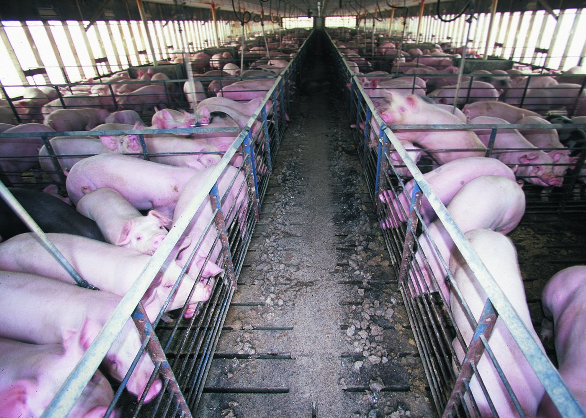
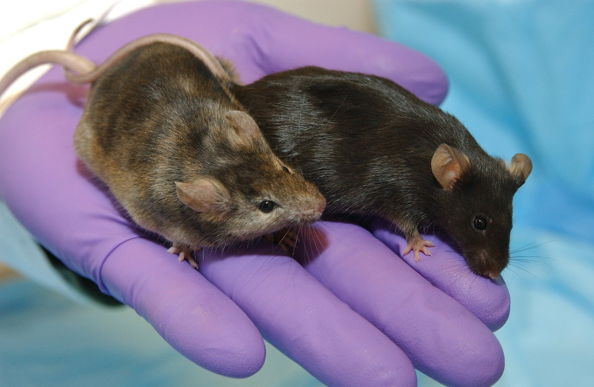

```{python}
#| include: false
import matplotlib.pyplot as plt
import numpy as np
from matplotlib.patches import FancyBboxPatch, FancyArrowPatch, Rectangle, Polygon

TEAL, RED, SLATE, INK = "#0e7c86", "#c0392b", "#334155", "#0f172a"
TEAL_T, RED_T, GREY_T = "#e6f1f2", "#fad7d2", "#eef2f6"
WARM, WARM_T, GREY = "#b07d1a", "#fce9d6", "#94a3b8"

def box(ax, x, y, w, h, fc, ec, lw=1.6):
    ax.add_patch(FancyBboxPatch((x, y), w, h, boxstyle="round,pad=0.02,rounding_size=0.15",
                                fc=fc, ec=ec, lw=lw))

def arrow(ax, a, b, color="#6b7280", rad=0.0, lw=1.8):
    ax.add_patch(FancyArrowPatch(a, b, arrowstyle="-|>", mutation_scale=16, color=color,
                                 lw=lw, connectionstyle=f"arc3,rad={rad}"))
```

# Rank These Four {.section-divider}

## A Case to Sit With

::: {.thought-question}
Here are four ways humans use animals. Put them in order, from **most defensible** to **least**:

1. **Bacon** from a factory-farmed pig.
2. A **rabbit** used to test a new mascara for eye irritation.
3. A **gene-edited pig** whose heart is transplanted into a dying patient.
4. A **lab mouse** engineered to be smarter, to make a better research subject.

What did you put **last**, and what rule were you using? Did "high-tech" or "unnatural" push anything *down* your list? Should it?
:::

## Today

Most people rank the pig-heart transplant as more troubling than the bacon. Today's question: **what makes one use of animals more defensible than another?** Our tool will rank uses by **scale, necessity, and benefit**, and on it the everyday cheeseburger comes out *worse* than the high-tech transplant.

::: {.content-hidden when-format="revealjs"}
In Part A we asked **which beings have moral status**, and met Kant, Korsgaard, Singer, Regan, and Cohen. Today the same views face the two largest and most advanced uses of animals. Whether you accept the tool's result, or reject the tool, is the work of this lecture.
:::

::: {.learning-outcomes}
By the end of Part B, you will be able to:

- Explain how industrial animal agriculture harms **animals and humans**: antibiotic resistance and pandemic risk.
- Describe how pigs are **gene-edited** for transplant, and what makes **xenotransplantation** ethically distinct.
- Use the **scale–necessity–benefit** ledger, explain how Regan resists it, and connect it to earlier arguments in the course.
:::

# The Biggest Use: The Food System {.section-divider}

## The Scale Is the Argument

:::: {.columns}
::: {.column width="44%"}
Humans slaughter nearly **88 billion** land animals a year for meat: about ten for every person on Earth. Nine in ten are **chickens** [@owid_2024].

Recall Singer: this is vast suffering for an interest (taste, cost, convenience) that is **minor and replaceable.** A practice repeated billions of times needs a justification billions of times as strong.
:::
::: {.column width="56%"}
```{python}
#| echo: false
#| fig-align: center
#| fig-cap: "Land animals slaughtered for meat worldwide, 2024, in billions (FAOSTAT via Our World in Data)."
import matplotlib.pyplot as plt

animals = ["Chickens", "Ducks", "Pigs", "All others"]
billions = [78.5, 4.2, 1.5, 3.6]
colors = ["#c0392b", "#94a3b8", "#94a3b8", "#cbd5e1"]

fig, ax = plt.subplots(figsize=(5.4, 3.4))
bars = ax.barh(animals[::-1], billions[::-1], color=colors[::-1], height=0.6)
for b, v in zip(bars, billions[::-1]):
    ax.text(b.get_width() + 1.2, b.get_y() + b.get_height() / 2, f"{v}",
            va="center", fontsize=15, fontweight="bold", color="#0f172a")
ax.set_xlim(0, 95)
ax.set_xticks([])
ax.tick_params(axis="y", labelsize=14)
ax.spines[["top", "right", "bottom"]].set_visible(False)
fig.tight_layout()
plt.show()
```
:::
::::

## What That Number Looks Like

:::: {.columns}
::: {.column width="50%"}
{width="100%" fig-alt="Aerial view of a concentrated animal feeding operation: rows of long metal barns surrounded by bare ground and waste lagoons"}

::: {.attribution}
Socially Responsible Agricultural Project, via Wikimedia Commons. CC BY 4.0.
:::
:::
::: {.column width="50%"}
{width="100%" fig-alt="Interior of a long hog barn with a central aisle between metal-railed pens crowded with pigs on slatted floors."}

::: {.attribution}
Inside a hog barn, Lyons, Georgia. Jeff Vanuga, USDA NRCS. Public domain.
:::
:::
::::

Most live in [CAFOs]{.key-term} (concentrated animal feeding operations): crowded indoor barns they never leave.

## It Harms Humans Too: Antibiotics

:::: {.columns}
::: {.column width="50%"}
- About **two-thirds** of medically important antibiotics sold in the U.S. go to food animals [@patel2020_stewardship], and sales rose 16% in 2024 [@fda_amr_2024].
- Routine use breeds [antibiotic resistance]{.key-term}: bacteria that survive the drugs reach people through food, water, and farm workers.
- Resistant infections already contribute to about **4.7 million deaths** a year; one forecast projects **8.2 million** by 2050 [@gram2024].
:::
::: {.column width="50%"}
```{python}
#| echo: false
#| fig-align: center
#| fig-cap: "Medically important antibiotics sold for U.S. food animals, millions of kg."
import matplotlib.pyplot as plt

years = ["2015 (peak)", "2023", "2024"]
kg = [9.70, 6.13, 7.10]

fig, ax = plt.subplots(figsize=(4.6, 3.5))
bars = ax.bar(years, kg, color=["#94a3b8", "#94a3b8", "#c0392b"], width=0.55)
for b, v in zip(bars, kg):
    ax.text(b.get_x() + b.get_width() / 2, v + 0.2, f"{v:.1f}", ha="center",
            fontsize=13, fontweight="bold", color="#0f172a")
ax.annotate("+16% in\none year", xy=(2, 7.1), xytext=(1.45, 9.0), fontsize=10.5,
            color="#c0392b", ha="center",
            arrowprops=dict(arrowstyle="->", color="#c0392b", lw=1.2))
ax.set_ylim(0, 11)
ax.set_yticks([])
ax.tick_params(axis="x", labelsize=11)
ax.spines[["top", "right", "left"]].set_visible(False)
fig.tight_layout()
plt.show()
```
:::
::::

## It Harms Humans Too: Pandemics

:::: {.columns}
::: {.column width="50%"}
- Crowding genetically similar animals together is ideal for breeding new viruses. **Avian** and **swine influenza** strains have jumped from farms to people.
- Many experts count industrial animal agriculture and the wildlife trade among the century's leading **pandemic risks**.
- **A rare convergence.** Kant and Cohen grant animals no rights, yet their human-centered view still **condemns** this system.
:::
::: {.column width="50%"}
```{python}
#| echo: false
#| fig-align: center
#| fig-alt: "Two boxes with arrows meeting at one verdict. Welfare reasons: the animals suffer. Self-interested reasons, as in Kant and Cohen: resistant bacteria and pandemic flu. Both point to the same verdict: the system is condemned."
fig, ax = plt.subplots(figsize=(4.8, 3.6))
box(ax, 0.2, 4.6, 4.4, 3.2, TEAL_T, TEAL)
ax.text(2.4, 6.85, "Welfare\nreasons", ha="center", va="center", fontsize=13.5, fontweight="bold", color=INK)
ax.text(2.4, 5.35, "the animals\nsuffer", ha="center", va="center", fontsize=12, color=INK)
box(ax, 5.4, 4.6, 4.4, 3.2, WARM_T, WARM)
ax.text(7.6, 6.85, "Self-interested\nreasons", ha="center", va="center", fontsize=13.5, fontweight="bold", color=INK)
ax.text(7.6, 5.35, "resistant bacteria,\npandemic flu", ha="center", va="center", fontsize=12, color=INK)
arrow(ax, (2.4, 4.5), (4.0, 2.55))
arrow(ax, (7.6, 4.5), (6.0, 2.55))
box(ax, 1.6, 0.5, 6.8, 1.95, GREY_T, SLATE, lw=2.2)
ax.text(5.0, 1.48, "The same verdict:\nthe system is condemned", ha="center", va="center",
        fontsize=13, fontweight="bold", color=INK)
ax.set_xlim(0, 10); ax.set_ylim(0.2, 8.0); ax.axis("off")
fig.tight_layout()
plt.show()
```
:::
::::

::: {.content-hidden when-format="revealjs"}
Welfare reasons and self-interested reasons point the *same* way: a system that breeds resistant bacteria and pandemic flu is condemned even on a view that grants animals no rights.
:::

## Thought Question

::: {.thought-question}
Your hospital buys its cafeteria meat from industrial farms. A nurses' group proposes switching to higher-welfare, antibiotic-free suppliers. It costs more, and the money comes from the budget that funds patient programs.

1. Have you ever paid more, or gone without, for something you thought was right: cage-free eggs, fair-trade coffee, a boycott? Should an institution make that choice for everyone who eats there?
2. Do you vote for the switch? What do you say to the patient whose program might be trimmed to pay for it?
:::

## Direct and Indirect Harm

```{python}
#| echo: false
#| fig-align: center
#| fig-alt: "The factory farm causes two harms. Direct harm falls on the animal: the welfare wrong. Indirect harm falls on humans, through resistant bacteria and new viruses."
fig, ax = plt.subplots(figsize=(9.6, 3.0))
box(ax, 0.2, 1.25, 3.2, 1.5, GREY_T, SLATE, lw=2.0)
ax.text(1.8, 2.0, "The factory farm", ha="center", va="center", fontsize=14.5, fontweight="bold", color=INK)
box(ax, 6.6, 2.25, 5.2, 1.55, TEAL_T, TEAL)
ax.text(9.2, 3.3, "The animal", ha="center", va="center", fontsize=14.5, fontweight="bold", color=INK)
ax.text(9.2, 2.7, "the welfare wrong", ha="center", va="center", fontsize=12.5, color=INK)
box(ax, 6.6, 0.2, 5.2, 1.55, WARM_T, WARM)
ax.text(9.2, 1.25, "Humans", ha="center", va="center", fontsize=14.5, fontweight="bold", color=INK)
ax.text(9.2, 0.65, "resistant bacteria, new viruses", ha="center", va="center", fontsize=12.5, color=INK)
arrow(ax, (3.5, 2.3), (6.5, 3.0))
arrow(ax, (3.5, 1.7), (6.5, 1.0))
ax.text(4.9, 3.05, "direct harm", ha="center", va="center", fontsize=13, fontweight="bold", color=TEAL)
ax.text(4.9, 0.95, "indirect harm", ha="center", va="center", fontsize=13, fontweight="bold", color=WARM)
ax.set_xlim(0, 12); ax.set_ylim(0, 4); ax.axis("off")
fig.tight_layout()
plt.show()
```

The two can come apart. Banning routine antibiotic use eases the public-health harm and leaves the welfare harm untouched. Knowing *which* harm a policy fixes keeps you from claiming credit for both.

::: {.content-hidden when-format="revealjs"}
The reverse is possible too: a reform could ease the welfare harm and leave the public-health harm in place. The two wrongs have different victims.
:::

# The High-Tech, Low-Number Use {.section-divider}

## Why Xenotransplantation

:::: {.columns}
::: {.column width="56%"}
- More than **100,000** Americans are on the transplant waiting list, and about **13 die each day** waiting.
- [Xenotransplantation]{.key-term}, transplanting organs from another species, promises an unlimited supply, grown to order.
- The species of choice is the **pig**: organs the right size, and fast breeding. The obstacle was rejection: the human body destroys ordinary pig tissue within minutes.
:::
::: {.column width="44%"}
```{python}
#| echo: false
#| fig-align: center
#| fig-alt: "A grid of 100 squares for every 100 people on the U.S. transplant waiting list: 86 are waiting for a kidney, and 14 for another organ."
fig, ax = plt.subplots(figsize=(4.2, 3.9))
for k in range(100):
    r, c = divmod(k, 10)
    ax.add_patch(Rectangle((c, 9 - r), 0.86, 0.86, color=TEAL if k < 86 else "#cbd5e1"))
ax.set_title("Of every 100 people on the list…", fontsize=13.5, color=INK, loc="left")
ax.text(0, -0.9, "86 wait for a kidney", fontsize=13.5, color=TEAL, fontweight="bold")
ax.text(0, -2.1, "14 wait for another organ", fontsize=13.5, color="#475569")
ax.set_xlim(0, 10); ax.set_ylim(-2.5, 10.2)
ax.set_aspect("equal"); ax.axis("off")
fig.tight_layout()
plt.show()
```
:::
::::

::: {.content-hidden when-format="revealjs"}
Most people on the list (86%) are waiting for a kidney. Pigs also bring decades of surgical familiarity.
:::

## How You Build a Transplant Pig

The breakthrough was genetic, not surgical. CRISPR lets researchers edit a pig so its organs survive in a human body.

```{python}
#| echo: false
#| fig-align: center
import matplotlib.pyplot as plt
from matplotlib.patches import FancyBboxPatch

steps = [
    ("Knock OUT\npig genes", "sugars that trigger\ninstant rejection", "#e6f1f2", "#0e7c86"),
    ("Inactivate\npig viruses", "hidden in the\npig genome", "#e6f1f2", "#0e7c86"),
    ("Knock IN\nhuman genes", "to calm clotting\nand inflammation", "#e6f1f2", "#0e7c86"),
    ("A tolerated\norgan", "the body accepts it,\nfor a time", "#0e7c86", "#095058"),
]
w, gap = 2.3, 0.5
fig, ax = plt.subplots(figsize=(10, 2.3))
for i, (title, body, fill, edge) in enumerate(steps):
    x = i * (w + gap)
    last = i == len(steps) - 1
    ax.add_patch(FancyBboxPatch((x, 0), w, 1, boxstyle="round,pad=0.02,rounding_size=0.08",
                                fc=fill, ec=edge, lw=1.8))
    ax.text(x + w / 2, 0.7, title, ha="center", va="center", fontsize=14.5,
            fontweight="bold", color="white" if last else "#0f172a", linespacing=1.1)
    ax.text(x + w / 2, 0.26, body, ha="center", va="center", fontsize=12,
            color="white" if last else "#334155", linespacing=1.25)
    if not last:
        ax.annotate("", xy=(x + w + gap - 0.03, 0.5), xytext=(x + w + 0.03, 0.5),
                    arrowprops=dict(arrowstyle="-|>", color="#6b7280", lw=1.6))
ax.set_xlim(-0.05, len(steps) * w + (len(steps) - 1) * gap + 0.05); ax.set_ylim(-0.05, 1.05)
ax.axis("off")
fig.tight_layout(pad=0.2)
plt.show()
```

A transplant pig may carry **a dozen or more edits**, some removing pig features the body attacks, some adding human ones it accepts.

## The Cases So Far

```{python}
#| echo: false
#| fig-align: center
#| fig-alt: "Bar chart of days a gene-edited pig organ functioned in living patients: Bennett 2022 heart about 60; Faucette 2023 heart about 40; Slayman 2024 kidney 52; Pisano 2024 kidney 47; Looney 2024-25 kidney 130; Andrews 2025 kidney 271; an unnamed Mass General patient, kidney transplanted November 2025, still working at 290 days in September 2026."
import matplotlib.pyplot as plt

rows = [  # name, year and organ, days, ongoing
    ("David Bennett", "2022 · heart", 60, False),
    ("Lawrence Faucette", "2023 · heart", 40, False),
    ("Rick Slayman", "2024 · kidney", 52, False),
    ("Lisa Pisano", "2024 · kidney", 47, False),
    ("Towana Looney", "2024–25 · kidney", 130, False),
    ("Tim Andrews", "2025 · kidney", 271, False),
    ("Unnamed patient", "2025–26 · kidney", 290, True),
]
fig, ax = plt.subplots(figsize=(9.4, 3.4))
for y, (name, meta, d, ongoing) in enumerate(rows):
    ax.barh(y, d, height=0.62, color="#0e7c86" if not ongoing else "white",
            edgecolor="#0e7c86", hatch="///" if ongoing else None, lw=1.4, zorder=3)
    label = f"{d}+ and counting (Sept 2026)" if ongoing else (f"~{d}" if name in ("David Bennett", "Lawrence Faucette") else f"{d}")
    ax.text(d + 5, y, label, va="center", fontsize=10.5, fontweight="bold", color="#0f172a")
ax.set_yticks(range(len(rows)), [f"{n}\n{m}" for n, m, _, _ in rows], fontsize=9.5)
ax.invert_yaxis()
ax.set_xlim(0, 430)
ax.set_xlabel("days the pig organ functioned", fontsize=10, color="#64748b")
ax.xaxis.grid(True, color="#e5e7eb", zorder=0)
ax.spines[["top", "right", "left"]].set_visible(False)
fig.tight_layout()
plt.show()
```

In 2025 the FDA cleared the first formal **trials**: an equipoise problem, not just a rescue. And two patients, including Tim Andrews, used a pig kidney as a **bridge** to a human one [@egenesis2026_update].

## What Makes Xeno Ethically Distinct

```{python}
#| echo: false
#| fig-align: center
#| fig-alt: "Three parties in a row. The source pig, under animal welfare: a whole life in sterile isolation. The patient, under consent under desperation: consents, but is dying. The public, under risk to the public: shares the infection risk and cannot consent. An organ passes from pig to patient, and a pig virus could pass from patient to public."
fig, ax = plt.subplots(figsize=(9.6, 3.3))
cols = [(0.1, "Animal welfare", "The source pig", "a whole life in\nsterile isolation", TEAL_T, TEAL),
        (4.3, "Consent under desperation", "The patient", "consents, but is dying:\nchoice, or cornered hope?", GREY_T, SLATE),
        (8.5, "Risk to the public", "The public", "shares the infection risk,\nand can't consent", WARM_T, WARM)]
for x, tag, who, body, fc, ec in cols:
    ax.text(x + 1.7, 3.05, tag, ha="center", va="center", fontsize=14, fontweight="bold", color=ec)
    box(ax, x, 0.2, 3.4, 2.4, fc, ec)
    ax.text(x + 1.7, 2.05, who, ha="center", va="center", fontsize=16, fontweight="bold", color=INK)
    ax.text(x + 1.7, 1.0, body, ha="center", va="center", fontsize=13.5, color=INK)
arrow(ax, (3.6, 1.4), (4.25, 1.4))
arrow(ax, (7.8, 1.4), (8.45, 1.4))
ax.text(3.92, 1.85, "organ", ha="center", va="center", fontsize=10.5, color=SLATE)
ax.text(8.12, 1.85, "virus?", ha="center", va="center", fontsize=10.5, color=SLATE)
ax.set_xlim(0, 12); ax.set_ylim(0, 3.4); ax.axis("off")
fig.tight_layout()
plt.show()
```

A pig virus that crosses into the patient and then **spreads to others** is a [xenozoonosis]{.key-term}. The paired case follows one patient through all three problems.

::: {.content-hidden when-format="revealjs"}
Source pigs are engineered and monitored as living organ factories. And a dying patient offered a first-of-its-kind organ is not a free chooser in the ordinary sense: is that consent, or a cornered hope?
:::

# The Ranking That Surprises People {.section-divider}

## The Ledger

Rank a use by **scale** (how many animals?), **necessity** (is there an alternative?), and **benefit** (how big is the good?).

| Use | Scale | Necessity | Benefit | Verdict |
|---|---|---|---|---|
| **Factory-farmed bacon** | billions | easily avoided | taste, cost | **worst** |
| **Cosmetic rabbit test** | many | avoidable | a beauty product | bad |
| **Pig-heart transplant** | one pig | no alternative | a human life | **best** |
| **Smarter lab mouse** | few | — | research gain, *but…* | (see the frontier) |

The **everyday cheeseburger** scores worse than the **headline-grabbing transplant.**

## Why Singer Accepts the Pig Heart

:::: {.columns}
::: {.column width="52%"}
- Singer opposes factory farming *because* it is vast suffering for a trivial, replaceable interest.
- **One** pig, humanely raised, to save a human life with no alternative, is exactly the trade a utilitarian can endorse.
- So an arch-critic of how we treat animals can **support** pig-heart transplants.
:::
::: {.column width="48%"}
```{python}
#| echo: false
#| fig-align: center
#| fig-cap: "How Singer weighs the two. An illustration, not data."
#| fig-alt: "Two balances. Factory farming: vast suffering outweighs taste and cost. Pig-heart transplant: a human life outweighs one pig."
def seesaw(ax, y0, title, left, right, heavy):
    dy = 0.6 if heavy == "left" else -0.6
    yl, yr = y0 - dy, y0 + dy
    ax.plot([1.6, 8.4], [yl, yr], color=SLATE, lw=4, solid_capstyle="round")
    ax.add_patch(Polygon([(5, y0), (4.45, y0 - 0.9), (5.55, y0 - 0.9)], closed=True, fc=SLATE, ec=SLATE))
    for xc, yb, (label, fc), big in [(1.6, yl, left, heavy == "left"), (8.4, yr, right, heavy == "right")]:
        s = 2.3 if big else 1.1
        ax.add_patch(Rectangle((xc - s / 2, yb + 0.08), s, s, fc=fc, ec="white", lw=1.5))
        if big:
            ax.text(xc, yb + 0.08 + s / 2, label, ha="center", va="center", fontsize=12,
                    fontweight="bold", color="white")
        else:
            ax.text(xc, yb + s + 0.55, label, ha="center", va="center", fontsize=12, color=INK)
    ax.text(5, y0 + 2.55, title, ha="center", va="center", fontsize=13.5, fontweight="bold", color=INK)

fig, ax = plt.subplots(figsize=(4.8, 3.9))
seesaw(ax, 7.0, "Factory farming", ("vast\nsuffering", RED), ("taste, cost", GREY), "left")
seesaw(ax, 1.9, "Pig-heart transplant", ("one pig", GREY), ("a human\nlife", TEAL), "right")
ax.set_xlim(0, 10); ax.set_ylim(0.8, 10.0); ax.axis("off")
fig.tight_layout()
plt.show()
```
:::
::::

**"Creepy" and "wrong" are different properties.** Novelty triggers disgust; ethics tracks suffering, necessity, and benefit.

::: {.content-hidden when-format="revealjs"}
This is the result that unsettles people, and it is perfectly consistent: the same logic that condemns the factory farm, applied to xenotransplantation, points the other way.
:::

## Why Regan Won't Rank Them

::: {.argument}
::: {.arg-name}
The Rights Objection to the Ledger
:::
::: {.arg-source}
After Tom Regan, *The Case for Animal Rights* (1983) [@regan1983]
:::

1. A subject-of-a-life has a right not to be used merely as a means to others' ends.
2. The transplant pig is killed precisely *as a means*: to harvest its heart.
3. Rights are not outweighed by good consequences, however large, or by small numbers.
4. So the pig-heart transplant violates the pig's rights, and "only one pig" is no defense.
:::

The rights view refuses the whole exercise. For Regan, the ledger prices a life that should be **off the market**.

# The Frontier: Smarter Animals {.section-divider}

## Thought Question

:::: {.columns}
::: {.column width="64%"}
::: {.thought-question}
A lab proposes engineering mice with substantially **human-like memory and problem-solving**, to make Alzheimer's research more accurate.

1. Does making the mouse smarter make it *more* wrong to experiment on, even though the point was better research?
2. Could it ever be **kinder** to refuse: not to create a being whose new capacities only deepen its suffering in a cage?
:::
:::
::: {.column width="36%"}
{width="100%" fig-alt="Two laboratory mice, one brown and one black, resting on a researcher's gloved palm."}

::: {.attribution}
A gene-knockout mouse beside an ordinary one. Maggie Bartlett, NHGRI. Public domain.
:::
:::
::::

## Uplifting, and Its Paradox

:::: {.columns}
::: {.column width="52%"}
[Uplifting]{.key-term} means deliberately raising an animal's cognitive capacities (by gene editing, drugs, or adding human cells), for example to build a more capable research subject.

::: {.callout-important}
**The paradox.** In Part A, capacities *earned* moral status. Raise an animal's capacities and we **raise its moral status**. The better we make a research animal, the **less** we may be permitted to use it.
:::
:::
::: {.column width="4%"}
:::
::: {.column width="44%"}
```{python}
#| echo: false
#| fig-align: center
#| fig-cap: "An illustration, not data."
#| fig-alt: "Two lines plotted against the capacities we add to an animal. Its moral status rises. What we may do to it falls."
fig, ax = plt.subplots(figsize=(4.6, 3.4))
x = np.linspace(0, 1, 50)
ax.plot(x, 0.2 + 0.62 * x, color=TEAL, lw=3.5)
ax.plot(x, 0.82 - 0.62 * x, color=WARM, lw=3.5)
ax.text(0.98, 0.9, "Its moral status", color=TEAL, fontsize=13, fontweight="bold", ha="right")
ax.text(0.98, 0.07, "What we may do to it", color=WARM, fontsize=13, fontweight="bold", ha="right")
ax.set_xlim(0, 1); ax.set_ylim(0, 1)
ax.set_xticks([]); ax.set_yticks([])
ax.set_xlabel("The capacities we add  →", fontsize=11.5, color=INK)
ax.spines[["top", "right"]].set_visible(False)
fig.tight_layout()
plt.show()
```
:::
::::

::: {.content-hidden when-format="revealjs"}
Recall the enhancement debate from genomics: there the target was *humans*. Here it is the animal.
:::

## It's Already Real

- In 2022, Stanford researchers transplanted **human brain organoids** (clusters of human neurons) into rat brains, where they grew, wired in, and influenced the rats' behavior [@revah2022_chimera].
- Such [chimeras]{.key-term} (animals carrying human cells) are made to study human disease, but they create beings of **uncertain status**: how much human neural tissue is too much?
- Regulators now draw uneasy lines, especially around human cells in animal **brains** and reproductive systems.

## Moral Status: Discovered or Created?

```{python}
#| echo: false
#| fig-align: center
#| fig-alt: "Two rows. Discovered, as in all of Part A: an animal exists, we investigate it, and we find out how much it matters. Created, as with uplifting and chimeras: we decide how much it will matter, we build the animal to match, and we owe it what we chose."
fig, ax = plt.subplots(figsize=(9.6, 3.2))
rows = [(2.6, "Discovered", "all of Part A", TEAL_T, TEAL,
         ["An animal\nexists", "We investigate\nit", "We find out how\nmuch it matters"]),
        (0.3, "Created", "uplifting, chimeras", WARM_T, WARM,
         ["We decide how much\nit will matter", "We build the\nanimal to match", "We owe it what\nwe chose"])]
for y, name, sub, fc, ec, steps in rows:
    ax.text(0.1, y + 1.0, name, fontsize=15, fontweight="bold", color=ec, va="center")
    ax.text(0.1, y + 0.45, sub, fontsize=11.5, color=SLATE, va="center")
    for i, t in enumerate(steps):
        x = 2.75 + i * 3.1
        box(ax, x, y, 2.75, 1.5, fc, ec)
        ax.text(x + 1.375, y + 0.75, t, ha="center", va="center", fontsize=13.5, color=INK)
        if i < 2:
            arrow(ax, (x + 2.8, y + 0.75), (x + 3.05, y + 0.75))
ax.set_xlim(0, 12); ax.set_ylim(0.1, 4.3); ax.axis("off")
fig.tight_layout()
plt.show()
```

We are used to asking "what do we owe this creature?" We are not used to choosing, in advance, **how much we'll be obligated**, and then building the creature to match.

# Connecting Threads {.section-divider}

## The Course, Applied to Animals

Each earlier argument about who counts, and why, can be aimed at the transplant pig.

| Earlier in the course | The argument | Aimed at the pig |
|---|---|---|
| **Abortion** | killing is wrong because it takes a "future like ours" (Marquis) | the pig has a future of experiences too |
| **Genetics** | a savior sibling is a child *made to be used* | the transplant pig is made, born, and killed to be used |
| **End of life** | humans may accept risk or death for others, *by choice* | the pig is killed for benefit, and never chooses |
| **Moral status** | sentience; being a subject-of-a-life | pigs plainly qualify on both |

Each argument changes its verdict, or reveals special pleading, when the patient is a pig.

## Marquis and the Pig

::: {.thought-question}
Don Marquis argued abortion is wrong because it deprives the fetus of a [future like ours]{.key-term}: a future of valuable experiences [@marquis1989]. The fetus isn't conscious yet, but it has that future to lose.

A healthy pig also has a future of experiences, and the transplant ends it.

1. If a valuable future makes killing a fetus wrong, why doesn't a pig's future make killing the pig wrong?
2. Something has to give: Marquis's argument, the bacon, or the claim that the two futures are alike. Which one do you give up, and what does it cost you?
:::

## Wrap-Up

::: {.recap}
*What makes one use of animals more defensible than another?* Our tool (**scale, necessity, benefit**) reorders intuitions: the industrial cheeseburger comes out worse than the gene-edited pig heart, and a critic of factory farming like Singer can consistently accept xenotransplantation. Regan's rights view refuses the ranking, so the verdict still depends on the theory you hold. The food system showed animal and **human** harms converging; **uplifting** showed we can now *create* the moral status we must then honor.
:::

> **Paired case:** [David Bennett and the First Pig-Heart Transplant](../cases/12-bennett-xenotransplant.qmd): one desperate patient, one designed animal, and a public that never consented.

## Review Questions

::: {.review-questions}

::: {.review-item .review-recall}
[Recall]{.review-label}

Name the three factors in the scale–necessity–benefit ledger, and use them to explain why factory-farmed bacon ranks worse than a pig-heart transplant.
:::

::: {.review-item .review-apply}
[Apply]{.review-label}

A company wants to gene-edit chickens to grow faster and resist a barn virus, cutting both cost and antibiotic use. Run it through the ledger and through the direct/indirect-harm distinction. Where does it help, and whom?
:::

::: {.review-item .review-debate}
[Debate]{.review-label}

Is it ethically justified to genetically modify and raise pigs so their organs can be transplanted into people? Defend a yes or a no, and answer the strongest objection from the other side (Singer's ledger or Regan's rights view).
:::

:::

## Key Terms {.dense}

:::: {.columns}
::: {.column width="48%"}
- **CAFO** — concentrated animal feeding operation; the high-density industrial farm.
- **Antibiotic resistance** — bacteria evolving to survive drugs; driven partly by routine livestock use.
- **Direct vs. indirect harm** — harm to the animal itself vs. harm to humans through the same practice.
- **Xenotransplantation** — transplanting organs or tissue from another species into humans.
- **Xenozoonosis** — an infection crossing from the source animal to the recipient, and possibly the public.
:::
::: {.column width="4%"}
:::
::: {.column width="48%"}
- **Scale–necessity–benefit ledger** — ranking animal uses by number harmed, alternatives, and size of the good.
- **Uplifting** — deliberately enhancing an animal's cognitive capacities.
- **Chimera** — an organism containing cells from another species.
- **Future like ours** — Marquis: killing is wrong because it deprives a being of a valuable future.
:::
::::

## Further Reading

- Singer, Peter. *Animal Liberation Now*. Harper Perennial, 2023: the updated case against industrial farming.
- Griffith, Bartley P., et al. "Genetically Modified Porcine-to-Human Cardiac Xenotransplantation." *New England Journal of Medicine*, 2022: the Bennett case, by the surgical team.
- Korsgaard, Christine. *Fellow Creatures*. Oxford University Press, 2018: duties to animals, including the created ones.

## References

::: {#refs}
:::
